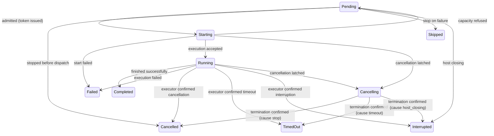
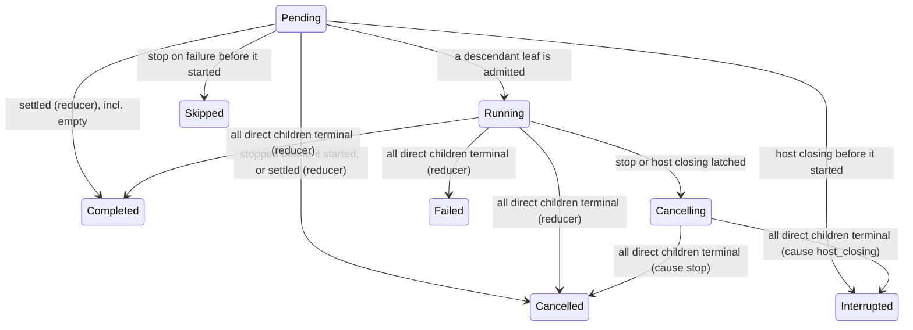
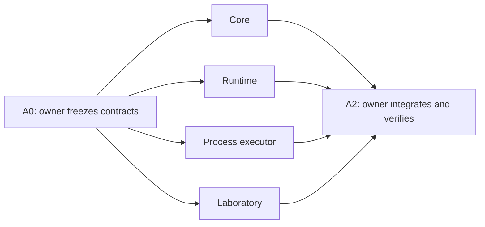

# Job batches — standalone engine and later Rush integration

Status: design only; this document does not authorize implementation or agent
launches. Revision 2 (2026-10-08) makes the contract of sections 2-5
freezable. It resolves the findings of four independent reviews of
revision 1 (`51599fa4`); Appendix A maps every finding to its resolution:

- `docs/reviews/2026-10-08-job-batches-xxs-states.md` (S1-S5)
- `docs/reviews/2026-10-08-job-batches-xxs-api.md` (A1-A9)
- `docs/reviews/2026-10-08-job-batches-xxs-parallel-testing.md` (P1-P8)
- `docs/reviews/2026-10-08-job-batches-xxs-rush-integration.md` (I1-I7)

The original integration investigation used HEAD `322705af`. File names below
are navigation aids, not frozen line-number contracts; re-read the current
implementation before changing it.

## 0. Scope and delivery boundary

The first deliverable is ordinary Go code in this repository:

```text
internal/jobbatch/                  Independent engine and runtime.
internal/jobbatch/testdata/         Deterministic core/runtime inputs.
internal/jobbatch/lab/              Scenario, controlled and process executors.
cmd/batchlab/                      Standalone development executable.
```

There is one module and one implementation. `batchlab` imports the package
that Rush will eventually use; it must not contain a second scheduler.
`internal/jobbatch/lab` is a consumer of the engine, not an engine dependency.
The engine/runtime depend only on the standard library. The process executor
may use `internal/platform` and `golang.org/x/sys`, but not Rush's app,
coordinator, session services, provider configuration, or MCP owner.

**Current scope ends at a working autonomous engine plus batchlab.** No Rush
tool registrations, DB migrations, changes to existing launch paths, new
model prompts, or project pre-refactoring are prerequisites for that delivery.
Section 9 records the later integration work; it is not part of the first
implementation wave.

Required behavior, retained from the operator's original request:

- A batch contains tasks and/or nested batches.
- Parallel batches start eligible work up to their limit and wait for every
  started task. Sequential batches process direct children in order, stopping
  on failure or continuing according to policy.
- Notifications are per-item or aggregate; several batches can coexist.
- Items can be appended to a nonterminal batch. Any item/subtree can be
  stopped. Task output can be inspected. Message-capable executors can receive
  input at any nesting depth.
- Success, failure, cancellation, timeout, interruption, and skipped work are
  distinct. An executor reports outcomes explicitly; the engine never
  interprets natural-language answers.
- Every independent CLI-command, MCP-call, or agent launch will eventually
  enter as a batch with one task. An existing batch's leaf is not wrapped
  again. This is a future integration invariant, tested abstractly now.

Job batches are not the existing `fs_*` batching utilities. This component
owns group scheduling and policy, not filesystem-operation atomicity.

## 1. Architecture and ownership of truth

### 1.1 Pure engine

`Engine` owns a forest of batch trees and their shared scheduling budget.
Keeping shared admission here prevents each batch from independently
allocating the supposedly global limit. The tree is an internal representation,
not another public scheduler.

The engine has no goroutines, mutexes, clock reads, filesystem/network I/O,
process launching, or Rush imports. It accepts events and produces an ordered
transition containing changed views, execution commands, and notices.
The same ordered input events produce the same commands, notices and terminal
states. Time-dependent behavior enters as explicit events, not `time.Now()`
in core.

### 1.2 Runtime

One `Runner` owns one engine, potentially serving many root batches. It
serializes public requests and executor reports through one event loop.
Snapshots are requested through that loop while it is live, not by reading
the engine from another goroutine. At Closed the Runtime freezes the final
views and snapshots for read-only access without the exited loop: BatchView's
sequence is S_F, including roots settled earlier; released roots still return
`ErrReleased`. Events reads the frozen retained ring under its own lock
(section 4.1). Existing Batch.Done/Wait remain cached.

The loop applies events and schedules effects in transition order. Blocking
executor work happens outside it. Merely unlocking a mutex before calling an
executor is insufficient: separately dispatched transitions must not reorder
Start and Stop effects or issue duplicate executions.

Host cancellation starts closing; it does not stop the loop. The loop keeps
accepting executor reports until every accepted execution has confirmed
termination (section 3.4).

### 1.3 Executors and observers

The executor owns the actual execution and its output. The engine sees task
identity, admission group, cancellation intent, control results, and explicit
completion. CLI, MCP, and agent are adapter kind names, not branches of the
pure engine. Unknown executor kinds fail validation in the consumer before
launch.

Accepted work becomes terminal only when its executor confirms that the
execution has stopped. No executor error, panic, timeout, or Close deadline is
a substitute for that confirmation (sections 3.1.1 and 3.4).

The public record feed is not durable storage and is not a promise of
exactly-once delivery across crashes. It must not block executor cancellation
or the state loop. The final snapshot/Wait result remains authoritative even
if an observer falls behind.

## 2. Contract to freeze before parallel implementation

The integration owner implements the shared declarations in phase A0 before
spawning implementers. All slices use those declarations. The following names
and semantics are the shared contract, not competing design suggestions.

**What A0 writes in Go, and what it does not (P1).** Go has no forward
declarations: a function declared without a body is an external (assembly)
implementation, and a second declaration of the same name is a
redeclaration. A0 therefore writes only data declarations — types, interface
types, enum constants, error sentinels — plus small pure methods on those
types that every slice must answer identically (for example
`State.Terminal`). The function and method signatures listed in this section
and in section 5.3 are frozen by this document; each is declared exactly
once, with its real body, by its owning slice (section 7.2). No placeholder
bodies, function variables or empty concrete structs exist to make early
compilation possible.

```go
type ID string
type Mode string   // "parallel", "sequential".
type OnFail string // "stop", "continue".
type Notify string // "each", "all".
type State string  // Section 3.1.
type Cause string  // "stop", "timeout", "host_closing", "stop_on_fail".

type TaskSpec struct {
    Kind    string
    Group   string          // Empty: the default group, bounded globally only.
    Payload json.RawMessage // Opaque to the engine; read-only once accepted.
    Timeout time.Duration   // Zero means no item timeout.
}
type BatchSpec struct {
    Mode        Mode
    OnFail      OnFail
    Notify      Notify
    MaxParallel int // 0: no cap of its own (section 3.2).
    Items       []Spec
}
type Spec struct {
    Task  *TaskSpec
    Batch *BatchSpec // Exactly one of Task/Batch is set.
}
type Limits struct {
    MaxConcurrent int
    ByGroup       map[string]int
    MaxDepth      int
    MaxNodes      int // Per root, including its nested batches.
}
type Result struct {
    State   State           // Completed, Failed, Cancelled, TimedOut, Interrupted.
    Code    string          // Short machine code; safe to journal.
    Summary string          // For explicit inspection only; never journaled.
    Details json.RawMessage // Opaque; never logged automatically.
}
type Launch struct {
    ID    ID
    Token uint64 // Admission-attempt identity, unique within one Runner.
    Task  TaskSpec
}

type Executor interface {
    Start(ctx context.Context, l Launch, report func(Result)) (Execution, error)
}
type Execution interface {
    Stop(ctx context.Context) error
}
// Optional capabilities, discovered on the Execution by type assertion.
type OutputReader interface {
    ReadOutput(ctx context.Context, cursor uint64) (OutputChunk, error)
}
type Messenger interface {
    Inject(ctx context.Context, msg json.RawMessage) error
}
type Disposer interface {
    Dispose(ctx context.Context) error
}

type RunnerConfig struct {
    Limits          Limits
    Executor        Executor
    ControlTimeout  time.Duration // Per physical Stop/Dispose call, from dispatch; positive.
    RecordRetention int           // Records kept for Events; positive.
}
type SubmitRequest struct {
    Root ID
    Spec Spec   // A batch (section 2.1).
    Ref  string // Optional caller reference; journaled, never payload.
}
type AddRequest struct {
    Parent ID
    Items  []Spec
    Ref    string
}
```

Enum strings: State is `pending`, `starting`, `running`, `cancelling`,
`completed`, `failed`, `cancelled`, `timed_out`, `interrupted`, `skipped`;
StartRejected reasons are `capacity`, `failure`, `cancelled`. JSON tags are
the snake_case of field names. `Ref` holds at most 128 bytes of
`[A-Za-z0-9._:-]`; `Result.Code` at most 64 bytes of `[a-z0-9_.-]` — the
Runner replaces an invalid code with `invalid_code` at the report boundary.

Public core API:

```go
func NewEngine(Limits) (*Engine, error)
func (e *Engine) Apply(Event) (Transition, error)
func (e *Engine) View(ID) (NodeView, bool)
func (e *Engine) Snapshot(ID) (BatchView, bool)
```

Public runtime API:

```go
func NewRunner(context.Context, RunnerConfig) (*Runner, error)
func (r *Runner) Submit(context.Context, SubmitRequest) (*Batch, error)
func (r *Runner) Add(context.Context, AddRequest) ([]ID, error)
func (r *Runner) Stop(context.Context, ID) error
func (r *Runner) CapacityAvailable(context.Context, string) error
func (r *Runner) View(context.Context, ID) (NodeView, error)
func (r *Runner) Snapshot(context.Context, ID) (BatchView, error)
func (r *Runner) Events(context.Context, uint64) (EventPage, error)
func (r *Runner) Output(context.Context, ID, uint64) (OutputChunk, error)
func (r *Runner) Inject(context.Context, ID, json.RawMessage) error
func (r *Runner) Release(context.Context, ID) error
func (r *Runner) Close(context.Context) error
func (b *Batch) ID() ID
func (b *Batch) Done() <-chan struct{}
func (b *Batch) Wait(context.Context) (Summary, error)
```

Supporting types, also frozen in A0:

- `Event`: Submit{root, spec, ref}, Add{parent, items, ref},
  StopRequested{node}, Started{node, token}, StartRejected{node, token,
  reason, code}, Settled{node, token, result}, ControlReported{node, token,
  op, code}, CapacityAvailable{group}, DeadlineExpired{node, token},
  HostClosing, Release{root}. Invalid, stale or out-of-order events produce
  an error, no mutation, no sequence increment and no commands.
  `ControlReported{op: stop}` answers exactly one pending StopLeaf command
  for that leaf/token (section 3.1.2); it is not an unsolicited status update.
- `Command`: StartLeaf carries the full immutable `Launch` (identity, token,
  kind, group, timeout, payload), so the Runtime needs no lookup to start a
  leaf. StopLeaf carries node, token and cause.
- `Transition`: monotonic sequence of accepted events, the accepted event,
  changed node views, commands, selected notices, newly settled roots, and
  `Final bool`. Final is true exactly once: HostClosing has been applied and
  all roots are terminal after this transition. HostClosing itself is Final
  iff no nonterminal roots remain after it: this includes already-terminal
  or no roots and pending-only roots/subtrees interrupted and settled in that
  same transition. Otherwise Final is the later last-root drain `settled` or
  `start_rejected` under latched `host_closing`. Newly settled roots includes
  roots settled by HostClosing. The supplied design's enumeration wording is
  also corrected here.
  After Final, Engine.Apply rejects every event with `ErrClosed`, without
  mutation, sequence increment, commands, notices or records.
- `Notice`: root, node, node kind (task, batch, root), state, cause, leaf
  counts. Metadata only.
- `NodeView`: id, root, parent, ordinal, kind; batch policy fields for
  batches and group for tasks; state, latched cause, current token, attempt
  count, reported outcome (state, code, summary — never details), control
  error code and `control_pending` (true exactly while a StopLeaf command
  awaits its logical answer). Batch nodes have no control state. Payload is
  never a view field. Summary is for explicit
  inspection; it never enters records.
- `Counts`: leaf counts by pending, active (starting, running, cancelling),
  completed, failed, cancelled, timed_out, interrupted, skipped. A nested
  batch is never counted, only its leaves.
- `BatchView`: transition sequence, the batch's own view, its counts, and
  every descendant view in pre-order (section 4.2). `Summary`: root, state,
  counts, sequence — the small immutable aggregate returned by Wait.
- `OutputChunk`: data (a caller-owned copy), next cursor, oldest retained
  cursor, EOF, truncated (section 4.3).
- `Record`: cursor, transition sequence and type with the metadata of
  section 4.1; `closed` is the one last in-band record, with sequence S_F.
  `EventPage{Records, Next, Oldest, Head, Final}`: cursors start at 1;
  Head is inclusive newest (0 when empty), Oldest is oldest retained
  (Head+1 when empty), Next is last returned+1. Final is 0 until Closed,
  then F=Head forever; Closed iff Final != 0. Gap and EOF pages have the
  explicit Next values of section 4.1. S_F is the final transition sequence;
  records of sequences <= S_F have exactly cursors 1..F. Each root's
  `settled_sequence` s_r <= S_F, with equality only for roots settled in
  Final. An accepted stateless tail `capacity_available`, `release` or
  HostClosing after the last settlement gives max(s_r) < S_F. Footer
  `final_cursor=F` and `final_sequence=S_F` are producer boundaries;
  `last_cursor` is writer progress only.
- Errors: `ErrInvalidSpec`, `ErrDuplicateRoot`, `ErrUnknownNode`,
  `ErrTerminal`, `ErrNotTerminal`, `ErrNotStarted`, `ErrUnsupported`,
  `ErrReleased`, `ErrClosing`, `ErrClosed`, `ErrCloseTimeout`, `ErrGap`,
  `ErrExecutorPanic`, `ErrExecutionDone`, `ErrDispose`, and `ErrCapacity`, which an
  executor wraps in its Start error to signal a typed capacity refusal.
  `ErrDispose` names each affected node/token and its safe disposal code:
  `dispose_pending`, `dispose_failed`, `dispose_panic` or `dispose_timeout`.
  It describes handle cleanup, never a task outcome (sections 3.1.2, 3.4 and 4.5).

Do not add a mandatory Store interface or DB-style transaction to this scope.

### 2.1 IDs, ownership, and validation

Callers supply a unique nonempty root ID; the contract reserves `.` as the
item-path separator. Descendant IDs are deterministic append-only ordinal
paths, such as `root.1.2`. Parent and ordinal are explicit view fields;
consumers must not parse IDs for ownership. Duplicate root submission fails
without executing anything. Rerunning work requires a new root ID.

Root specs must be batches; the engine rejects a root task. A consumer
normalizes a standalone task to a one-task batch once at ingress. This
normalization preserves the caller's selected policy; it does not normalize
every nested leaf.

Validate a complete Submit/Add subtree before accepting any of it: exactly
one node shape, known mode/policy, nonnegative timeout, valid limits, IDs and
reference, depth/node bounds (Add counts toward the root's `MaxNodes`), and no
irrelevant task/batch-only fields. Add is atomic as a request, not as
execution across tasks. Add returns the new direct children of `Parent` in
input order.

Require positive global, depth, and node limits. Group limits, when supplied,
must be positive; a group without a limit is bounded only globally.
`MaxParallel` is validated as written and never normalized into a number:
0 adds no cap of its own, a positive value caps every active leaf beneath the
batch (section 3.2). Sequential accepts only 0 or 1. Numeric
machine-specific defaults belong to batchlab/Rush, not hardcoded
command/agent categories in core.

Mode is explicit; absent Notify normalizes to `all`. A Sequential batch with
absent OnFail uses `stop`; Parallel requires OnFail to be empty. Root depth
is one and ordinals start at one. These defaults are resolved once, before
subtree validation.

### 2.2 Ownership of mutable values (A7)

| Value | Crosses | Rule |
|---|---|---|
| `RunnerConfig.Limits`, incl. `ByGroup` | caller → Runner | Copied by `NewRunner`; later caller edits have no effect. |
| Submit/Add specs and payloads | caller → Runner | Deep-copied before the request is queued. |
| `Launch`, incl. `Task.Payload` | Runner → executor | Read-only shared data; the executor must not mutate it and need not copy it. |
| `Result` | executor → Runner | Copied once by the report callback. |
| Inject message | caller → executor | Copied by `Runner.Inject`; owned by the executor once `Messenger.Inject` returns nil. |
| `OutputChunk.Data` | executor → caller | A detached copy owned by the caller; the Runner does not copy again. |
| Views, snapshots, summaries, records | Runner → caller | Values that alias no internal state. |

Direct Engine callers transfer ownership of their events to `Apply`. Do not
clone the entire forest on every transition; report changed nodes only.

### 2.3 Requests: acceptance and replies (A5)

- Each public request is queued with a reply slot and an atomic state that
  moves from queued to either accepted (by the loop) or abandoned (by its
  caller). Exactly one of the two wins.
- The loop skips abandoned requests. It applies an accepted request and
  writes its reply without blocking.
- If the caller's context ends and abandonment wins, the request had no
  effect and the caller gets the context error. If acceptance already won,
  the caller waits for the reply — written promptly, because the loop never
  waits for executors — and gets the committed result. There is no
  "maybe accepted" outcome; an accepted Add always reaches its caller with
  its IDs.
- `Stop` returns nil once the stop intent is accepted. Every accepted
  nonterminal call, including a repeated no-op, records one `stop_requested`;
  a terminal node returns nil without acceptance or a record. After F it
  returns `ErrClosed`, including for terminal nodes. It never waits for
  `Execution.Stop` or termination; the control protocol is section 3.1.2.
  Termination is awaited with `Batch.Wait` or the node's `Events` records.
- `Release(root)` of a terminal root in an open or draining Runner is accepted
  and returns immediately, without waiting for pins or Dispose. It gives up
  retained handles and records Release. A repeat returns `ErrReleased`
  without a record; after F it returns `ErrClosed`. Nonterminal roots return
  `ErrNotTerminal` (sections 3.1.2 and 4.5).
- `Batch.Wait` returns the root `Summary` with a nil error for every
  terminal outcome, Failed and Cancelled included; its error describes only
  the wait itself. Cancelling Wait never stops work.
- `CapacityAvailable` returns after acceptance.

## 3. State, scheduling, and races

### 3.1 Lifecycle

Leaf states:



A report's `Result.State` must be Completed, Failed, Cancelled, TimedOut or
Interrupted. Any other value still means the execution ended: the leaf
settles Failed with code `executor_invalid_state`. When a cause was latched
first, the leaf settles with that cause and keeps the reported result as its
outcome (section 3.3).

Natural completion may arrive before Start returns. Runner buffers that
report and publishes Started before Settled for an accepted start. A failed
Start is authoritative: it must return no accepted execution. Start must
honor cancellation and finish its setup in bounded time. If cancellation was
already latched, a rejected start confirms that no execution exists and
settles with the latched cause, not a fresh Failed/Pending state.

Starting/Cancelling still hold their reserved slots until rejection or
confirmed execution termination. A successful Start means accepted work,
not completed work. At most one accepted execution per leaf. Rejected
admission attempts have distinct tokens and may retry without side effects.

Stop/timeout records intent and requests executor cancellation. It does not
pretend a process, MCP call, or agent has already stopped. Executor Stop
returning nil only acknowledges the request; completion confirms termination.

Batch states:



A nonterminal batch (Pending, Running or Cancelling) settles in the transition in which its last nonterminal direct child becomes terminal — by any path (Settled, a rejected start under a latched cause, Stop of a Pending leaf or batch, a skip, a nested batch settling) and whether or not any leaf was ever admitted. A batch created with no nonterminal direct child (empty, or holding only empty batches) settles in its creating transition. Outcome: its own latched cause wins (stop ⇒ Cancelled, host_closing ⇒ Interrupted, stop_on_fail ⇒ Skipped); otherwise the unchanged leaf-count reducer with an empty cause (zero leaves ⇒ Completed). A never-admitted batch can only reduce to Completed or Cancelled. Within one transition: latch the event's causes top-down (Stop: the addressed node and its nonterminal descendants; HostClosing: every nonterminal node), change leaf states, settle bottom-up to a fixpoint (a child that ends Failed under stop-on-fail skips its successors in the same pass), then admit (§3.2). Notices follow settlement order: descendants before ancestors, siblings by ordinal. Invariant after every transition: every nonterminal batch has a nonterminal direct child, and no terminal batch has a nonterminal descendant.

The unchanged leaf-count reducer is: any Failed/TimedOut/Interrupted ⇒ Failed;
otherwise any Cancelled ⇒ Cancelled; otherwise Completed, including zero leaves.
Without the batch's own latch, its aggregate cause is empty; child causes do not
climb to ancestors. Descendant outcomes stay visible in the counts. Using direct
children rather than leaves avoids settling a parent atop a stuck nested batch
and preserves the Sequential gate and Release requirements.

A Pending successor
that stop-on-fail never started becomes Skipped, and so do its Pending
descendants; an already-terminal successor batch also keeps its state (an
all-stopped successor remains Cancelled after a later predecessor failure,
not Skipped). Descendants that are already terminal keep their state, so an
empty batch that completed earlier is never renamed (S3). Skipped is produced
only by stop-on-fail and never conceals a start error.

Empty batches, including batches holding only empty nested batches, complete
in their creating transition, have zero task counts, and then reject Add.
An item asking for input is not terminal and does not free capacity;
waiting/interaction details belong to its executor.

#### 3.1.1 Errors by phase (S2, A2)

1. **Start rejected.** A non-nil error from `Start` is authoritative: no
   execution exists. `errors.Is(err, ErrCapacity)` is a capacity refusal
   (section 3.2). Any other error is a start failure: the leaf becomes Failed
   with the error's `Code() string` if it provides one, else `start_failed`.
   A nil execution with a nil error fails with `start_nil_execution`. The
   Runner recovers a panic inside `Start` as a start failure with code
   `start_panic`. When cancellation was latched before the rejection, the
   leaf settles with the latched cause instead.
   The executor, not the Runner, guarantees that a rejected or panicking
   Start leaves no running process, call or agent behind (executor-owned
   setup cleanup). The Runner cannot verify that and does not claim to. A
   report made by a rejected attempt is ignored as an
   `executor_contract` violation, not journaled: there is no accepted event
   or diagnostic record for it. After F, callbacks cannot journal anything.
2. **Accepted execution.** Only the attempt's report settles it, and a
   report means the execution has stopped. Stop error, panic, timeout and
   acknowledgement follow the serialized command/result protocol in section
   3.1.2; none settles work or releases its reservation. Executor concurrency:
   Stop may overlap ReadOutput, Inject and the report callback, but never
   another Stop on the same Execution. Stop may repeat after the earlier
   physical Stop returned, including after the executor reported termination
   but before the loop accepted that report. Dispose runs once only after
   the report is accepted, retained ownership is given up, and all calls have
   actually returned. It overlaps no call; nothing may be called after Dispose.
3. **Inspection and input.** Errors from `ReadOutput`/`Inject` return to
   their callers, a panic as `ErrExecutorPanic`; neither changes state.
4. **Executor goroutines.** A panic inside a goroutine the executor owns is
   the executor's to contain; its protocol must still either report
   termination or keep the execution alive. The Runner cannot catch it.
5. **No synthetic termination.** No rule in this document turns an error, a
   panic, a timeout, or a Close deadline into Settled. Work an executor never
   confirms stays visible and nonterminal.

#### 3.1.2 Stop and disposal protocol (R2-API-02/03/04/05)

Engine control state is per leaf/current token: `none`, `pending`, `acked`
or `failed(code)`. Emitting StopLeaf sets `pending`; `control_pending` exposes
that gate. Commands and logical results alternate per token, without a public
invocation ID. Runtime alone calls `Execution.Stop`; Engine never calls it.

| Operation / condition | Engine acceptance and effects | Runtime / lifetime rule |
|---|---|---|
| Stop leaf: Pending | Latch first cause `stop`; settle Cancelled; no StopLeaf. | No execution or physical Stop. |
| Stop leaf: Starting | Latch first cause and emit StopLeaf, setting pending. | Cancel Start context; physically Stop only if Start returns an accepted Execution. A rejected Start settles by the existing cause and drops the command without ControlReported. |
| Stop leaf: Running | Latch first cause, enter Cancelling, emit StopLeaf and set pending. | Dispatch physical Stop, or queue at most one command behind an existing physical Stop. |
| Stop leaf: Cancelling | Reissue StopLeaf only when control is failed and nothing is pending; keep the original cause. Otherwise accepted recorded no-op. | A retry can queue behind a timed-out but still physically running Stop; never overlap physical Stops. |
| Stop leaf: Terminal / after F | Terminal returns nil without a record; after F return ErrClosed. | No command or call. |
| Stop batch/root: never admitted | Preserve section 3.1's S-R2-1 top-down causes, leaf changes and bottom-up settlement fixpoint; settle existing Pending descendants, no physical Stop. | No batch control state. |
| Stop batch/root: Running or Cancelling | One pre-order subtree traversal: latch only nodes without a cause, stop Starting/Running leaves, settle Pending leaves, and retry exactly Cancelling leaves with failed control and nothing pending, keeping their causes. Terminal descendants stay unchanged. | Commands are in pre-order; no batch control state or aggregate retry gate. |
| Every accepted nonterminal Stop call | Exactly one `stop_requested` record, including no-op calls; no extra request record per descendant. | Return at intent acceptance, not at dispatch, acknowledgement or termination. |
| DeadlineExpired / first HostClosing | Latch only where no cause exists; issue initial cancellation controls as appropriate. Never retry a failed control or replace a cause. | Cancel Starting context; no automatic retry, including on host cancellation. |
| ControlReported, current pending StopLeaf | Only `op: stop` answers pending: empty code acknowledges nil, sets acked and clears control error; failure sets failed(code) and control error (`stop_failed`, `stop_panic`, `stop_timeout`). Neither changes state, reservation or generation. | At most one logical result per command: first physical return, panic or timeout wins a one-shot latch. |
| ControlReported without pending / stale token / terminal / after F | Error, no mutation, sequence increment or record (ErrClosed after F). | Never publish an unsolicited or late result. |
| Physical Stop dispatch and return | Logical pending is independent of the physical-call slot. | Per-handle lock stores all active-call pins, one physical Stop slot and at most one queued StopLeaf. Acquire the Stop pin in the loop at physical dispatch; start ControlTimeout then, not while queued. Release pin and slot ONLY at actual return, never at timeout, Settled or F. Dispatch queued work only if the leaf is still nonterminal. |
| Timeout / late Stop return / leaf settlement | Timeout may answer the pending command once; settlement retires its control gate and drops any queued command. | Once the result latch fired or the leaf is terminal (even before F), late return is pin-only. No ControlReported if the leaf settles first, the queued command is dropped, or F has occurred. No automatic retry. |
| Release(root), terminal and open/draining | Accepted, record Release, return immediately; repeat ErrReleased without record; after F ErrClosed. | Give up retained handles without waiting for pins or Dispose; reject new handle accesses (section 4.5). |
| Dispose | Not an Engine event or task settlement; no feed/event. | Runner-only, once after accepted termination report, give-up by Release or F, pins=0, and optional Disposer present. Use detached context; ControlTimeout starts at physical dispatch. First nil / `dispose_failed` / `dispose_panic` / `dispose_timeout` latches cleanup result; no retry, late actual return ignored. No capability means no disposal call is required (sections 3.4 and 4.5). |
| Close(ctx), including host cancellation | First HostClosing only, never retries controls; drain to authoritative Final/F unchanged. | Lifetime wait is bounded by ctx and includes disposal results after F: on ctx expiry before F return ErrCloseTimeout; after F return ErrDispose naming failed cleanup, or pending cleanup if ctx expires before results complete; nil only when all required disposals succeeded. F gives up unreleased handles; disposal waits for pins outside the loop. Repeated Close results are stable once cleanup results complete (sections 3.4 and 4.5). |

ReadOutput and Inject also pin their physical calls. Pins and disposal neither
free admission slots nor bump availability generations. Accepted execution
termination and Start rejection handle reservations by sections 3.1/3.2;
in particular capacity-refused attempts release their reservations without
pretending to be accepted-execution settlements. Disposal results do not
change Final, F, frozen task state, cached Wait or retained feed boundaries.
The Release/Close/Dispose rows forward-reference the lifetime details in
sections 3.4 and 4.5; feed drain never waits for cleanup or observers.

### 3.2 Admission and fairness

A Pending leaf L without a latched cause is **eligible** when all of these
hold (active means Starting, Running or Cancelling; batch nodes consume no
slot):

1. **Sequential gate:** for every Sequential ancestor, L lies inside that
   ancestor's current direct child — the lowest-ordinal direct child that is
   not terminal. A nested batch settles before the next direct sibling
   starts.
2. **Global:** active leaves in the Runner < `MaxConcurrent`.
3. **Group:** if `ByGroup[g]` is set for L's group g, active leaves of g <
   `ByGroup[g]`.
4. **Subtree caps:** for every ancestor with `MaxParallel > 0`, active
   leaves beneath it < `MaxParallel`. `MaxParallel = 0` adds no cap and never
   inherits a number from the global or a group budget.
5. **Capacity block:** L's group is not capacity-blocked (below).
6. **Root:** the root is neither closing nor released.

Consequences (S4): `Sequential(0)` runs its current child under the child's
own rules, so a nested Parallel child may overlap its leaves;
`Sequential(1)` additionally limits its whole subtree to one active leaf. A
batch mixing groups `g:1` and `h:2` with `MaxParallel = 0` gets no common
cap of 1 from `g`.

**Selection.** After each accepted event the engine admits eligible leaves
until none is left. It walks roots round-robin from a cursor that persists
across transitions and, within a root, picks the eligible leaf with the
lowest pre-order position. A leaf blocked by its group is skipped, not
waited behind, so a blocked group never holds back another group or another
root. Releasing a slot reconsiders waiting work across the forest, including
a root that has never started a leaf.

**Capacity refusal without lost wake-ups (S1).** Each group g has an
availability generation `gen[g]`, incremented by every accepted
`CapacityAvailable(g)` and by every settlement of an accepted execution in g.
A StartLeaf records `gen[g]` at authorization. A capacity `StartRejected`
returns the leaf to Pending and releases its reservation. If `gen[g]` has
advanced since that attempt was authorized, the group stays eligible: the
signal arrived while the attempt was in flight and allows one retry.
Otherwise the group is blocked at the current generation and becomes
eligible again only when `gen[g]` advances. A late refusal therefore cannot
erase a signal accepted after its attempt began, a stale refusal cannot
re-block the group after a newer wake-up, and refusals without new signals
never spin. Do not busy-loop or wait only for the same tree to settle.

Operational start failure is Failed, not a capacity refusal. Automatic
retries of failed tasks are out of scope.

**Waiting executions and budgets (I1).** An execution that waits for work it
launched — an agent waiting for its commands — must never have to draw that
work's slot from a budget it holds itself, or a full budget deadlocks. The
engine does not detect such waits and adds no lending primitive in this
scope. Callers put waiting levels in distinct groups whose limits are not
jointly bound by a smaller `MaxConcurrent` (`MaxConcurrent` at least the sum
of those groups' limits); section 9.2 applies this to Rush. A future lending
primitive would be an additive field on `SubmitRequest`, not a breaking
change.

### 3.3 Linearization rules

The event-loop acceptance order, not wall-clock callback order, decides:

1. **Add vs last direct child becoming terminal:** Add accepted first extends
   the batch; the event that makes its last nonterminal direct child terminal
   accepted first settles it, and subsequent Add returns `ErrTerminal`.
   This includes Stop of a Pending leaf, not just an execution completion.
2. **Stop vs dispatch:** stop cancels undispatched tasks. An already
   authorized Start may be in flight; its context is cancelled and the
   returned execution is stopped before waiting for its final report.
   A Start entered with an already-cancelled context must do no side effects.
3. **Stop vs natural completion:** Settled accepted first keeps its natural
   terminal state. Stop accepted first latches cancellation as terminal cause;
   retain the executor's reported outcome as details, not as a second notice.
4. **Repeated/late reports:** reports for terminal nodes or stale launch
   tokens cannot release capacity twice, restart work, or change the winner.
   Each StopLeaf command has at most one logical ControlReported (possibly
   none if settlement, queue drop or F wins). Late physical Stop returns are
   pin-only, including before F once terminal; they cannot clear or replace
   a newer control error (section 3.1.2).
5. **Timeout vs Stop:** the first accepted cancellation cause is retained.
   A later timer cannot relabel an operator stop or a completed task.
6. **Timers are attempt-scoped:** the Runner arms an item's timeout when it
   dispatches StartLeaf (authorization, not queueing) and retires it when
   that attempt is rejected or settles. `DeadlineExpired` carries the token;
   a stale token or a terminal node is rejected, so an old attempt's timer
   cancels neither a Pending leaf nor a newer attempt.
7. **Inject vs settlement:** Inject is accepted only for a leaf whose
   accepted execution is neither terminal nor cancelling at acceptance. The
   executor call runs after acceptance; if the execution ends meanwhile, the
   executor answers `ErrExecutionDone`. A message is never applied to work
   that was already terminal when Inject was accepted.

Report callbacks must return without waiting for the event loop, including
callbacks invoked synchronously by Start. Use a per-attempt completion latch,
not a blocking callback channel that deadlocks Start. Executor errors and
panics follow section 3.1.1; rejected work must not leak a reservation.

Public operation contexts bound request submission/waiting, not task lifetime
(section 2.3). Cancellation of Batch.Wait alone does not stop work. Runner's
host context or explicit Stop controls work lifetime. Rush's eventual
synchronous adapter will explicitly connect caller cancellation to Stop.

### 3.4 Host shutdown, Close and draining (S5)

Host shutdown is distinct from user Stop.

- **Closing** starts at host-context cancellation or the first `Close` call.
  Together they accept exactly one `HostClosing` event over the Runner's
  lifetime; later calls/cancellation never reissue it or retry failed controls.
  New Submit, Add and Inject fail with `ErrClosing`. Pending leaves become
  Interrupted. Starting and Running leaves without a latched cause latch
  `host_closing` and receive initial StopLeaf controls, preserving existing
  causes (section 3.1.2).
- **Draining.** The loop keeps accepting Start results, reports and control
  results, and serves View, Snapshot, Events, Output, Stop and Release.
  Physical Stop and Dispose use detached contexts bounded by `ControlTimeout`,
  starting at dispatch, not queueing; cancelled host/request contexts do not
  pre-cancel cleanup.
- **Close(ctx)** waits for F and then the logical disposal result of EVERY
  execution handle given up during the Runner's lifetime, including handles
  given up by Release before F. Expiry before F returns an error wrapping
  `ErrCloseTimeout` naming unfinished nodes. Nothing settles synthetically;
  reservations stay held. Once closed, failed disposal results, or pending
  results when ctx expires, return `ErrDispose` naming each affected node,
  launch token and code (`dispose_failed`, `dispose_panic`, `dispose_timeout`
  or `dispose_pending`). Nil requires all required disposal results to be nil;
  no required disposals is vacuous success. Close can be called again: pending
  cleanup can complete, but once all logical results are in, repeated calls
  return the same success or failure, without retrying disposal.
- **Closed** means closing AND every root terminal, witnessed by
  Transition.Final. Terminal roots alone do not close an open Runner. The
  exact publication order is: append Final's event, commands and selected
  notices in order; append ONE last `closed` record with sequence S_F and
  cursor F; set EventPage.Final=F and wake readers; close Done for roots newly
  settled in that transition; enter Closed and exit the loop; THEN give up
  unreleased handles, start eligible Dispose calls when pins=0, and resume
  Close waiters into the cleanup wait. Handles already given up by Release
  are never given up or disposed again at F. All transition records precede
  their roots' Done publication. Closed is a feed/state boundary, not a
  promise that pending or later Close calls return nil: Close has the separate
  disposal barrier above and never waits for reader/observer acknowledgement.
  Events reads retained records through F; View/Snapshot read frozen final
  state (sections 1.2 and 4.1), or `ErrReleased` for released roots. Existing
  Batch handles answer Done/Wait from cached Summary. Wait, Done, Events and
  final View/Snapshot are independent of disposal. Output, Inject, Stop,
  Submit, Add, Release and CapacityAvailable return `ErrClosed`. Late callbacks
  append nothing and cannot change Head, Final or frozen state.
- An executor that never confirms termination keeps the Runner draining,
  visible through Snapshot and pre-F Close errors, never hidden.

**Stop pins and the disposal barrier (R2-API-05, R2-API-02/03).** Each
StopLeaf command has at most one logical ControlReported, possibly none if
settlement, queue drop or F wins. After its timeout/result latch or terminal
settlement, late physical Stop return is pin-only, before as well as after F;
it cannot publish another result or replace a newer control error. Per-handle
locks and pins survive loop exit. A Stop still physically executing after
settlement allows Release to return nil immediately but prevents Dispose
until actual return releases its pin. If it never returns, bounded Close
returns `ErrDispose` with `dispose_pending` after F, even though the feed and
cached task results are already final. Dispose's own `dispose_timeout` is a
logical cleanup result, not confirmation of physical resource cleanup: Close
must not wait forever for that timed-out physical Dispose to return (section
4.5). Neither late Stop nor disposal creates feed records or Engine events.

**Accounting dependency.** See section 3.2, Waiting executions and budgets
(S-R2-2). Failed or hung Stop on a still-Cancelling execution keeps its
admission slot indefinitely until accepted execution termination; pins and
disposal do not free slots or advance availability generations. An independent
capacity tail accepted before F is covered by the final boundary; after Closed
CapacityAvailable returns `ErrClosed` without a generation change. The
independent signal source remains the capacity task.

**Integration dependencies (sections 9.1/9.2/9.4).** Rush wiring must cover
singleton Stop at leaf/root, durable cause before cancellation, repeated
`job_kill` reissue and ledger order, kill timeout as `stop_timeout`, shell and
delegation Disposer implementations and shutdown `ErrDispose` logging, and
cross-process routing. These are forward dependencies, not changes to those
sections; restart/resumption and cross-process delivery remain later work.

## 4. Notifications, output, and injection

Separate three concepts:

- Diagnostic records describe every accepted transition.
- Selected notices implement NotifyEach/NotifyAll.
- Batch.Wait returns one root result; it is not an extra user notification.

### 4.1 Records, notices and the public feed (A1, A3)

`Runner.Events` is the only public stream: a cursor feed of records. Every
record has a gapless producer cursor, the sequence of the transition it came
from, and a type:

- one record per accepted event (`submit`, `add`, `stop_requested`,
  `started`, `start_rejected`, `settled`, `control`, `capacity_available`,
  `deadline_expired`, `host_closing`, `release`), carrying every
  scheduling-relevant field: root, node, token, state, cause, reason, safe
  code, group, `ref`, and for Submit/Add the IDs created;
- one `command` record per engine command, in transition order: start or
  stop, node, token, cause — never the payload;
- one `notice` record per selected notice; one transition may select
  several;
- exactly one last `closed` record, after all event/command/notice records
  of Transition.Final, with sequence S_F and cursor F. No record follows it.

Records never contain payloads, `Result.Summary`/`Details`, injected
messages, output, or arguments. EventPage has `Records`, `Next`, `Oldest`,
`Head`, `Final` with the inclusive boundaries of section 2. Retention keeps
only the last `RecordRetention` records; `RecordRetention >= 1` ensures the
newest `closed` record is always retained. Older notices are lost, announced
by `ErrGap`; consumers must not reconstruct them by reapplying Notify.

`Events(ctx, c)` has these ordered read rules:

- If c < Oldest, return an empty EventPage with Next=Oldest and current
  Oldest, Head, Final, and an error wrapping `ErrGap`; never silently skip.
- If Oldest <= c <= Head, immediately return a bounded page of retained
  records starting at c, Next=last returned+1, and current boundaries, even
  with an already-cancelled ctx. Check context only before waiting.
- If c=Head+1 while not Closed, wait for append or context cancellation.
  Closing always appends `closed`, so the final append wakes waiters.
- If Closed and c>F, return an immediate empty page with Next=F+1,
  Head=Final=F, frozen Oldest, and `ErrClosed` as EOF, even if c>F+1.

After Closed the retention window [Oldest_F,F] is immutable and served under
its own ring lock, not through the exited loop. Reads are nonconsuming, have
no ack, and concurrent identical reads return identical pages. Close never
waits for readers. Post-Closed Events(1) returns the full feed if Oldest=1,
otherwise ErrGap; restarting at Oldest reaches `closed`. Snapshot/Wait may
inspect final state, but never repair a lost journal or recover lost notices.
Slow consumers never block the loop, cancellation or admission.

**Notice selection.** Root completion produces exactly one selected root notice.
For descendant completion, NotifyEach applies to direct children; an ancestor
NotifyAll suppresses ordinary notices inside its subtree. A nested aggregate,
a Skipped batch included, may be announced by its NotifyEach parent without
repeating descendant output. A settlement cascade selects notices in settlement
order: descendants before ancestors, siblings by ordinal. Reducer notices have
an empty cause absent the batch's own latch, even when its leaf counts include
Cancelled; Notice/NodeView cause is separate from Summary, which has no cause
field. For B{B.1}, NotifyAll suppresses the B.1 notice and selects B once;
NotifyEach permits B.1 before the exactly-once B root notice. Question/input
requests are not engine events (section 4.4) and are never suppressed by
completion-notification policy.

One-task ingress defaults to NotifyAll. Its adapter delivers either the
synchronous result or the root completion notice, never both plus a leaf
notice. Opt-in NotifyEach can expose lifecycle information, but must not
duplicate the full user-facing result.

### 4.2 Discovery (A8)

`Snapshot` accepts any batch node and returns a consistent view at one
transition: the batch, its leaf counts, and every descendant NodeView in
pre-order (parent before children, siblings by ordinal). Consumers address
deep nodes from snapshots and views, never by parsing IDs.

### 4.3 Output (A9)

Each execution exposes at most one byte stream with absolute cursors starting
at 0; the process executor merges stdout and stderr in arrival order.
`ReadOutput(ctx, cursor)`:

- returns retained bytes from `max(cursor, Oldest)`; `Truncated` is set when
  the cursor is older than `Oldest` (retention dropped those bytes), and
  `Next` is the cursor after the returned bytes;
- on a live stream with nothing new, waits until data, EOF or the end of ctx
  (a context error) — no busy polling and no false EOF;
- sets `EOF` only after the execution has terminated and every retained byte
  has been returned.

Typed errors: `ErrNotStarted` (no accepted execution yet), `ErrUnsupported`
(a batch node or an execution without OutputReader), `ErrReleased`,
`ErrUnknownNode`. Output storage and retention belong to the executor.

### 4.4 Injection

Inject resolves node ownership explicitly and is callable at any depth. A
batch node or an execution without Messenger returns `ErrUnsupported`;
Pending/Starting returns `ErrNotStarted`; a terminal or cancelling node
returns `ErrTerminal`; a closing Runner returns `ErrClosing`. No silent no-op
injection. An execution's input callback must not call back synchronously
into a blocking Runner operation.

Question/input transport remains an executor/host concern. A paused lab
execution advertises that state through inspected output and accepts Inject;
the core needs no agent-specific question event to schedule it, and an item
waiting for input stays nonterminal and keeps its slot.

### 4.5 Retention and Release (A6)

After settlement the Runner is the only owner of an execution handle. An
executor must not keep its own registry of finished executions; the
Execution value holds its retained output. Output, Inject and physical Stop
acquire active-call pins through the loop under a per-handle lock, then run
outside it. The lock and pin bookkeeping survive loop exit. Pins are released
ONLY when the physical call actually returns, including after timeout,
settlement or F; a logical result never releases a pin. Physical Stop's slot
and queued-command rules are in section 3.1.2. Pins and disposal have no
admission-slot or availability-generation effect (section 3.2, Waiting
executions and budgets, S-R2-2); failed/hung Stop keeps a still-Cancelling
execution's reservation until accepted termination.

`Release(root)` is refused with `ErrNotTerminal` while any node of the root
is nonterminal, and only roots can be released. Before F, accepted Release
records exactly one `release`, gives up retained handles and returns
immediately, without waiting for pins or Dispose. Repeated Release returns
`ErrReleased` without a record. New Output, Inject, View and Snapshot calls
on that root return `ErrReleased`; already pinned calls finish safely. Dispose
becomes eligible at give-up if pins=0, otherwise at the last pin's actual
return, once accepted execution termination has been reported. At F, after
Closed and loop exit, the Runner implicitly gives up every unreleased handle
without a release record; handles already released are not given up again.
Release after F returns `ErrClosed`.

**Disposal protocol.** Runner alone calls the optional execution `Disposer`,
exactly once per eligible handle, outside the loop with a detached context.
`ControlTimeout` starts at physical dispatch. A one-shot latch records the
first nil return, failure (`dispose_failed`), panic (`dispose_panic`) or
timeout (`dispose_timeout`) as its logical result. No retry is permitted;
a physical return after timeout is ignored. A disposal result need not await
physical return: specifically, timeout is a logical result, NOT confirmation
that physical resource cleanup completed. Close waits for that result, not
forever for a timed-out Dispose call. A pin blocking dispatch instead leaves
`dispose_pending` until the pin returns; it is not a dispatched Dispose
timeout. Disposal never emits a feed record or Engine event, settles a task,
or alters F, frozen state or cached Wait.

No Dispose call is required for a stopped Pending leaf, Skipped leaf,
Interrupted Pending leaf, capacity-refused or otherwise Start-rejected
attempt, or accepted execution without Disposer: these have zero required
disposals. Close owns the logical cleanup results of ALL handles given up
before or after F, including earlier Release, and retains those results even
when public handle access is gone. Its disposal barrier, bounded pending
errors and stable completed results are specified in section 3.4.

`Batch.Wait` keeps returning the cached Summary and Done remains usable.
A small root-ID tombstone is kept for the Runner lifetime so an old ID cannot
launch new work; Runner memory therefore grows with submitted roots — a
documented limit, not a reason to add an eviction policy. See sections
9.1/9.2/9.4 for the integration dependencies noted in section 3.4; this
protocol does not change those headings or decide cross-process routing.

## 5. Batchlab: separate runnable verification

### 5.1 Commands and exit status

```bash
go run ./cmd/batchlab run scenario.json
go run ./cmd/batchlab run scenario.json --events events.jsonl
go run ./cmd/batchlab replay scenario.json events.jsonl
go test ./internal/jobbatch/...
go test -race ./internal/jobbatch/...
```

In this repository test and build commands run through the heavy-command
wrapper with `capm 2g` and `-p 1`, never bare.

`run` uses the real Runner — one Runner for the whole scenario, so roots
share budgets. `replay` never constructs an executor. Exit status is fixed,
and tests check the exact code; the first matching row wins:

| Code | Meaning |
|---|---|
| 2 | usage error, unreadable or invalid scenario/journal |
| 3 | unfinished or cleanup unconfirmed/failed: invocation cancelled, wait bound expired, `ErrCloseTimeout`, or `ErrDispose` |
| 5 | `--events` journal incomplete (gap or write error) |
| 4 | the scenario's `expect` block or declared action expectation did not match, or an action returned an undeclared error |
| 1 | finished, expectations (if any) matched, some root not Completed |
| 0 | finished, expectations (if any) matched, every root Completed |

L1's expected failed aggregate therefore exits 1 with matched expectations;
a malformed scenario or a missing helper program cannot pass for it (2, or 4
when the leaf codes differ).

### 5.2 Scenario format (P2, P5)

A0 freezes the scenario schema in `internal/jobbatch/lab/schema.go`; decoding
rejects unknown fields. The vocabulary below, including gate results and oracle
additions, is part of that same pre-fan-out schema freeze (section 7.1), not a
post-implementation schema deferral.

- `version`; `limits`; `runner` (`control_timeout_ms`, `record_retention`);
  `wait_bound_ms` — a mandatory overall bound.
- `payloads`: named payloads, each `{"kind": "process", ...}` (section 5.4)
  or `{"kind": "controlled"}`; task specs reference them by `payload_ref`.
  `messages`: named inject messages.
- `script`: ordered actions. Every await takes `timeout_ms` (default: the
  remaining wait bound); an undeclared await expiry exits 3.
  - `submit` {ref, root, spec}; `add` {ref, parent, items}; `stop` {node};
    `inject` {node, message_ref}; `capacity_available` {group};
    `release` {root}; `close` {timeout_ms, expect: ok | timeout | dispose}.
    Close expectations match nil, `ErrCloseTimeout`, or `ErrDispose`
    respectively; matching timeout/dispose still exits 3 under section 5.1.
  - `await_start` {node, bind}: waits for the next not-yet-awaited registered
    start attempt of a controlled node and binds its token to a name, once.
  - `release_start` {attempt, decision: accept | accept_complete |
    refuse_capacity | fail, state, code}: registered only, one decision;
    returns AFTER physical Start returns. `accept_complete` reports completion
    inside Start and leaves the attempt reported, not accepted.
  - `complete` {attempt, state, code}; `emit` {attempt, text};
    `await_inject` {attempt, message_ref}: accepted only.
  - `hold_stop` {attempt}; `fail_stop` {attempt, code}: registered through
    reported, arm the NEXT physical Stop, never an already-entered call.
    `await_stop` {attempt, call:k} observes physical entry of indexed call k;
    `return_stop` {attempt, call:k, result: ok | error:<code> | panic}
    releases only that held call. Indexes start at 1 and increment at physical
    entry, not at a Stop command, logical timeout or queued request.
  - `hold_dispose` {attempt}; `await_dispose` {attempt};
    `return_dispose` {attempt, result: ok | error:<code> | panic}: disposal
    gates, with phase rules in section 5.3. Await observes physical entry.
  - `hold_read` {attempt}; `return_read` {attempt}: output pin gates; hold
    arms the next physical ReadOutput, return releases only the held read.
  - `await_state` {node, state | "terminal"}; `expect_output` {node,
    contains | eof}.
  - Optional `async:<name>` on `close` or `expect_output` launches that action
    without blocking the script; names are unique. `join` {name} waits for
    it and checks its returned errors and declared expectations. Every async
    action must be joined within the overall bound; no silent error loss.
  - `await_record` {type, node?, code?}: observes the public Events feed,
    nonconsumingly. Match all supplied fields against retained history in
    cursor order (earliest match), starting at cursor 1 for each action, or
    await a future match; repeat observers
    may see the same record. No observer consumes another's match. An ErrGap
    is an error, never reconstructed history; frozen reads follow section 4.1.
  - Optional `expect_error:<code>` on any action declares its expected typed
    error (including an await error). An undeclared action error exits 4,
    except the unfinished/cleanup conditions with section 5.1 precedence;
    absent or wrong expected error is a mismatch, exit 4. A matched expected
    error never queues a deferred side effect. For async actions this check
    occurs at join. Do not combine conflicting Close/error expectations.
- `expect` — the independent oracle, optional in general and required for
  named smoke scenarios: `roots` [{id, state, counts}], `nodes` [{id,
  parent, state, control, control_pending, starts, stops, disposes}], `notices` (ordered per root),
  `max_active` (the observed maximum of concurrently accepted executions),
  `before` (partial order pairs such as `["A.1:settled", "B.1:started"]`),
  and `exit_code`. `control` mirrors the current leaf/token gate exactly:
  `none`, `pending`, `acked`, or `failed(code)`; `control_pending` is the
  boolean NodeView gate of section 2 (no batch roll-up). `starts` counts physical
  fixture Start entries; `stops`/`disposes` count physical fixture/control entry,
  not logical commands or results; zero is meaningful. Additional labels are
  `<attempt>:stop_entered#k`, `<attempt>:stop_returned#k`,
  `<attempt>:dispose_entered`, and `closed` (producer Final publication).
  Fixture labels are observations, not synthetic feed records. For real
  processes the oracle checks invariants, never an OS completion order.

A standalone task in `submit.spec` is normalized at ingress to a one-task
batch with the scenario's policy (E1). Named smoke scenarios with their
acceptance IDs live in `internal/jobbatch/lab/testdata/scenarios/`.

### 5.3 Controlled executor (P2)

A development/test fixture, not a production MCP/agent fallback. Frozen API;
the bodies belong to the Laboratory slice:

```go
// Data contract only: GateResult is "ok", "error:<code>", or "panic".
// StartDecision uses decision/state/code as listed in section 5.2.
type GateResult string

func NewControlledExecutor() *ControlledExecutor
func (c *ControlledExecutor) AwaitStart(ctx context.Context, id jobbatch.ID) (jobbatch.Launch, error)
func (c *ControlledExecutor) ReleaseStart(ctx context.Context, token uint64, d StartDecision) error
func (c *ControlledExecutor) Complete(ctx context.Context, token uint64, r jobbatch.Result) error
func (c *ControlledExecutor) HoldStop(token uint64) error
func (c *ControlledExecutor) FailNextStop(token uint64, code string) error
func (c *ControlledExecutor) AwaitStop(ctx context.Context, token uint64, call uint64) error
func (c *ControlledExecutor) ReturnStop(token uint64, call uint64, result GateResult) error
func (c *ControlledExecutor) HoldDispose(token uint64) error
func (c *ControlledExecutor) AwaitDispose(ctx context.Context, token uint64) error
func (c *ControlledExecutor) ReturnDispose(token uint64, result GateResult) error
func (c *ControlledExecutor) HoldRead(token uint64) error
func (c *ControlledExecutor) ReturnRead(token uint64) error
func (c *ControlledExecutor) AwaitInject(ctx context.Context, token uint64) (json.RawMessage, error)
func (c *ControlledExecutor) Emit(token uint64, data []byte) error
```

**Attempt phases and decisions.** Start registers its token and blocks until
ReleaseStart supplies the first decision or its context is cancelled. The
observable progression is `registered -> release_start (once) -> accepted
or retired`; accepted execution termination moves to `reported`, and physical
Dispose return moves to `disposed`. There is no hidden `decided` phase.
Refusal, start failure or cancellation without acceptance retires the attempt;
cancellation returns a context error with no execution side effects.
ReleaseStart acknowledges only after Start has returned; accept_complete
reports inside Start and is already reported at that acknowledgement. A
cancelled wait for acknowledgement never replaces the first decision.
AwaitStart waits for registration, returning each node's attempts in start
order exactly once; script binding names that token, not a future execution.

**Phase errors.** ReleaseStart is registered only; Complete, Emit and
AwaitInject are accepted only. Too-early operations and repeats return
`ErrAttemptPhase` immediately. Retired, disposed or unregistered tokens return
`ErrUnknownAttempt`; Complete after reported also returns `ErrUnknownAttempt`
(preserving F-b). Errors never queue work, change the first decision or affect
a newer attempt. An await validates phase first, then may wait only for its
specified observation; it never queues a mutation for a future phase.

**Physical gates.** HoldStop and FailNextStop may arm the next physical Stop
from registered through reported. A duplicate arm of the same kind is a phase
error. Ungated Stop returns nil or the armed error; if both gates are armed,
entry consumes both arms and ReturnStop's explicit result chooses the held
call's physical result. AwaitStop
observes entry of call k, including historical entries, in those phases.
ReturnStop targets only an entered, still-held call k; too early or repeated
returns are phase errors. Stop entry increments the index and fixture counter;
physical return publishes stop_returned#k and releases its pin even when a
logical timeout already won. Stop never completes an execution: only its
single accepted termination report does. In particular, a held Stop may be
returned AFTER reported until disposal, so C-a can release its outstanding pin.

HoldDispose is accepted/reported only and arms the one physical Dispose before
entry; a duplicate or post-entry arm is a phase error. AwaitDispose is valid in
accepted/reported and ALSO after physical disposal has entered or finished
(including disposed), returning the retained entry observation. This is the
explicit exception to the disposed-token error rule. ReturnDispose releases
only the entered held call, in reported, with the declared result. A logical
Dispose timeout does not end that physical hold; its later return may mark
disposed but cannot change the Runner's latched result. Ungated Dispose returns
nil; controlled accepted executions implement Disposer. Retired attempts have
zero disposals.

HoldRead is accepted only, arming the next physical output read; duplicate arms
are phase errors. ReturnRead releases only an entered held read, in accepted or
reported, until disposal; too early/repeated returns are phase errors. It then
uses normal output bytes/EOF semantics, not an invented result. An entered read
keeps its physical pin through settlement/Release/Closed until ReturnRead.
Controlled executions implement OutputReader (fed by Emit) and Messenger
(observed by AwaitInject). These gates hold physical calls independently of
context/logical timeout and never release pins on a logical result.

### 5.4 Process executor (P7)

```go
// In package lab.
func NewProcessExecutor(ProcessOptions) (jobbatch.Executor, error)
```

Payload: `program`, `args`, optional `cwd`, optional `max_output_bytes`. Never
shell text; the program runs directly. `ProcessOptions.MaxRetainedBytes`
(positive) is the ceiling; a payload may lower it, never raise it. Retention
keeps the most recent bytes of the merged stream (section 4.3).

Platform strategy — an A0 decision, not left to the slice:

- **Spawn** through `platform.Command`; the repository's spawn guard rejects
  direct `exec.Command` under `internal/`. Add flags to the hardened
  `SysProcAttr`; never replace it.
- **Unix:** start the child as a process-group leader (`Setpgid`). Stop
  sends SIGTERM to the group, then SIGKILL after a grace period bounded by
  the Stop context. Termination is confirmed when the leader has been reaped
  and the group no longer exists.
- **Windows:** create the child suspended, assign it to its own Job Object
  with `JOB_OBJECT_LIMIT_KILL_ON_JOB_CLOSE`, then resume it, so no descendant
  can start outside the job; the slice owns the resume mechanism. Stop
  terminates that job. Termination is confirmed when the leader has been
  waited for and the job reports no active processes.
- Existing helpers are references only: `platform.AssignToNewJobObject`
  puts the host itself in a job, and `session.TrackProcessTree` attaches
  after start. The `session` package must not be imported (it pulls in the
  database). Platform-specific code lives in `lab/process_*.go`; changing
  shared helpers or the spawn guard needs an owner decision.
- Codes: a missing program is a start failure `missing_program`; a nonzero
  exit settles Failed with `exit_<n>`; a stopped process settles with its
  latched cause.
- A portable helper program (`lab/testdata/process/helper`, standard library
  only), built once per test run, provides modes for printing, exiting with
  a code, waiting until stdin closes, and spawning a descendant that reports
  readiness through a pipe — the rendezvous for L2 and L5 without sleeps.

### 5.5 Journal and replay (A3, P3)

`--events` writes JSONL:

- **Header:** format name, `version: 1`, `scenario_sha256` (SHA-256 of the
  scenario decoded into the schema types and re-encoded by `encoding/json`:
  fixed field order, sorted map keys), limits and runner settings.
- **Records:** the public feed of section 4.1 with cursors contiguous from 1.
  The `ref` of submit/add records binds them to the scenario action that
  supplied their specs.
- **Footer:** `final_cursor` (absent if never Closed), `final_sequence`,
  `last_cursor`; `capture: complete | gap{first_missing,resumed_at} |
  write_error`; `outcome: closed | unfinished{IDs}`; each root's state,
  counts and `settled_sequence` s_r (absent for an unsettled root).
  `final_cursor=F`, `final_sequence=S_F` for closed outcome, not writer
  guesses or max(s_r). `last_cursor` is the last successfully written cursor.
  Capture is complete iff every record 1..last_cursor was written and, for
  outcome closed, the last record is `closed` and last_cursor=final_cursor.
  An intact unfinished prefix can have capture complete; it is not a closed
  or full-run replay.

When the authoritative public EventPage boundary has `Final != 0`, regardless
of whether bounded Close returned nil or `ErrDispose`, invocation cancellation,
wait-bound expiry or normal completion, `run` drains Events through F before
writing a closed footer: final_cursor=F, final_sequence=S_F, outcome=closed,
with capture determined by the records actually written. The drain uses a
context independent of the invocation and a bounded cleanup budget. Process
exit status follows section 5.1 independently: cancellation/wait-bound expiry
still exits 3 even when Close returns nil; `ErrDispose` also exits 3 while
outcome remains closed. Disposal failure/unconfirmed cleanup is not an
unfinished Engine. On ErrGap,
record `gap{first_missing,resumed_at}`, resume at the returned Oldest and
capture through F; retain capture gap even after reading `closed`. A write
failure gives capture write_error. Neither blocks cancellation/Close, and
Snapshot cannot rebuild missing records. If the writer cannot drain within
its cleanup budget, it cannot claim capture complete.

Only for `ErrCloseTimeout` while the authoritative `Final == 0`, drain
nonblocking through the current Head cut, not through a future F, and exit 3.
If Final is already nonzero, use the closed branch instead. Footer outcome is unfinished
with the IDs and root state derived exclusively from records <= cut, never from a later
Snapshot. Its final_sequence is the last accepted transition at the cut;
final_cursor is absent because the producer was not Closed at that cut.
A later public completion/second Close may produce F>cut without altering
this journal.

`replay` validates header version/digest, cursor continuity and footer. It
rebuilds accepted events in order — specs from scenario by `ref`, executor
results from journal — in a fresh Engine, reproducing event, command, notice
and `closed` records with the same cursors and sequences. Replay uses
Transition.Final to reproduce `closed` at the same boundary; no records may
follow it. Compare root states,
counts and s_r, including equality to S_F only for roots settled in Final.
A prefix before `closed` leaves Engine non-Final: missing tail is detected,
even if all roots were already terminal before a stateless tail.
Replay also compares reconstructed outcomes, root states/counts, notices and
closed/Final facts against the scenario's optional `expect` block wherever
expressible by section 5.2's metadata fields. Disposal results are deliberately
outside the feed: replay cannot recover physical fixture Stop/Dispose counters,
held-call return labels, disposal results or output expectations. Compare only
expressible feed metadata; never invent events to satisfy fixture assertions.
Closed/Final boundary facts remain covered by the journal checks above. This
limitation does not add journal schema fields or widen the schema task.

Reject structural mismatches with exit 2: missing footer, unknown version,
changed scenario digest, unannounced cursor holes, closed outcome without
`closed`, `closed` not last, wrong final_cursor, or removed HostClosing and
`closed` with authoritative footer retained. Announced gaps/write errors
are incomplete captures, not valid full replays: validate their structure
but never fill missing history or invent Engine events. A closed intact
journal from a process that exited 3 validates and replays
normally; that process status does not make its closed outcome unfinished.
An intact unfinished
journal replays its prefix and exits 3; capture != complete exits 5 unless
unfinished exit 3 takes precedence. A structurally invalid journal exits 2.
Section 5.1's first-matching-row precedence is unchanged. Replay never
constructs an executor or reruns processes; a scenario whose process would
write a file leaves that file absent.

**A0 dependency ordering (R2-API-01, P3-B).** Unique refs and scenario/oracle
schema additions share the SAME A0 schema freeze: see section 5.2 Scenario
format and section 7.1. This is ordering before fan-out, not deferral of those
contracts to a later schema task. This section fixes capture/outcome semantics;
it does not resolve unrelated ref or singleton-policy issues.

### 5.6 Timeouts and cleanup (P6)

The Runner implements execution timeouts outside the core with standard
timers (section 3.3, rule 6); unit tests use synctest or barriers, never
real-time sleeps. A timeout requests termination and settles TimedOut only
after confirmation.

Invocation cancellation (Ctrl-C) and the scenario wait bound both end in
`Runner.Close` with a fresh cleanup context bounded independently of the
cancelled invocation context — never the cancelled context itself. Both
exit 3. A controlled execution that withholds its confirmation past that
bound makes Close time out, keeps its admission held, and still exits 3,
never success.

The journal records sequence, input reference, node/launch identity,
transition reason and outcome state. Do not print task payloads, injected
messages, raw details, command arguments, or agent prompts. Task output is
available through explicit inspection, not copied into completion logs.

Do not build a daemon, RPC transport, or second Rush CLI inside batchlab.
All help and examples must describe real supported behavior.

## 6. Autonomous acceptance matrix

These are behavioral tests, not tests of source text, import lists, function
counts, forwarding, or copied constants. Agent reports are not verification.
Section 7.2 fixes which slice owns each ID.

### 6.1 Engine and admission

- **E1:** a standalone task through the real lab ingress and an explicit
  one-task batch produce the same tree (one leaf, no wrapper), one launch,
  and one result; nested leaves are not wrapped twice; the engine rejects a
  root task.
- **E2:** sequential and nested sequential ordering; parallel overlap and
  ancestor caps; `Sequential(0)` overlaps inside a nested Parallel child
  while `Sequential(1)` serializes it, and in both the next direct sibling
  waits for the nested batch; a mixed-group batch (`g:1`, `h:2`,
  MaxParallel 0) gets no common cap of 1; Starting and Cancelling keep
  counting; counts include each leaf once.
- **E3:** StopOnFail skips only pending successors after Failed/TimedOut/
  Interrupted; ContinueOnFail executes successors; Cancelled alone does not
  trigger StopOnFail; a skipped nested batch is Skipped (not Completed), its
  pending leaves never start, one Skipped notice is selected under a
  NotifyEach parent, and already-terminal descendants keep their state.
  An already-Cancelled successor batch keeps Cancelled when its predecessor
  later fails; it is not renamed Skipped.
- **E4:** several roots/groups share budgets. With `MaxConcurrent = 1`, root
  B's never-started leaf starts when root A's leaf settles, without Add or
  CapacityAvailable for B, and at most one execution is ever accepted at
  once. No eligible group starves behind a blocked one. A leaf gated on work
  of another group, submitted as a separate root, makes progress when
  MaxConcurrent covers both groups' limits (section 3.2, waiting levels).
- **E5:** capacity refusal performs no execution and queues without
  spinning; a CapacityAvailable or relevant settlement accepted before a late
  refusal still yields exactly one retry with a new token; the reverse order
  needs the next signal; a stale refusal does not re-block after a newer
  wake-up; the item ultimately runs once.
- **E6:** stop leaf/subtree/root; sibling isolation; no false terminal state
  before execution termination; a Stop error or panic keeps the leaf
  Cancelling with a visible control error and its slot held, and only the
  single confirmed report frees the slot; repeated Stop is safe and
  re-issues only failed-descendant controls on repeated leaf/subtree/root Stop,
  excluding pending, acknowledged and terminal leaves. Pending retries are
  recorded no-ops; each command has at most one logical result, timeout wins
  once and late physical returns are pin-only. Physical Stops serialize, with
  at most one queued retry and ControlTimeout starting at dispatch, not queueing
  (3.1.2; C-b/C-c). Stop of a never-admitted leaf or subtree produces
  no execution command; stopping only a subset leaves its ancestor Pending
  until the last nonterminal direct child settles, then ready ancestors settle
  bottom-up in that same transition.
- **E7:** Add ordering and returned IDs, atomic rejection of invalid
  subtrees, the Add/last-settle race in both orders, empty batch, duplicate
  root ID, depth/node-limit boundaries. Zero-leaf nesting (batches holding
  only empty batches) completes bottom-up on Submit/Add with zero counts,
  no StartLeaf and no Pending descendant under a terminal ancestor.
- **E8:** terminal result/notice emitted once; stale tokens, stale deadlines,
  and duplicate or late reports cannot change the winner or release a slot
  twice; late control reports do not revive a terminal leaf. After every
  transition, each nonterminal batch has a nonterminal direct child and no
  terminal batch has a nonterminal descendant.
- **E9:** ownership: mutating each caller-owned value of section 2.2 after
  its hand-off point changes nothing accepted; snapshots cannot mutate
  state; diagnostics and journals contain none of the sentinel strings
  planted in argv, payloads, injected messages, summaries, and details.

### 6.2 Runtime and laboratory

- **R1:** immediate completion inside Start, start error, nil execution,
  Start panic before any side effect and after creating a resource the
  executor cleans up itself, Stop before Start returns, and concurrent
  Add/Stop/Settled; no deadlock or leaked slot; a report from a rejected
  attempt is ignored.
- **R2:** timeout vs natural completion/operator stop under virtual time;
  attempt-scoped timers; Wait cancellation does not stop work; HostClosing
  is distinct; after a Close deadline the loop keeps draining — the late
  confirmation settles Interrupted once, Done closes, and a second bounded
  Close succeeds; a Start that returns after the first Close deadline is
  handled the same way. Close success precedes resumed reader drain, not
  the reverse; records precede Done. F-a/F-b in section 6.4 check this boundary.
- **R3:** notices through the public feed: a NotifyEach root with a
  NotifyAll child, and a NotifyAll root, expose exactly the selected notices
  of section 4.1 with no consumer-side policy; blocked or failed observers
  do not freeze scheduling or cancellation; gaps are explicit and frozen
  final snapshots remain correct. F-a/F-b in section 6.4 read selected
  notices through F after Close and check concurrent nonconsuming readers.
- **R4:** output A → pause → B → completion read by cursor without false EOF
  or busy polling; small retention truncates the beginning with an explicit
  gap and recovery point, then the rest and a real EOF; not-started,
  unsupported and released are distinct errors; a paused message-capable
  fixture resumed by Inject at nested depth; Inject vs settlement and
  terminal injection refusal; Release with a read in flight is safe and
  Dispose runs once after the last active-call pin, including physical Stop
  even after logical timeout. Release and Close/F both give up retained
  ownership without disposing across a held call; Runtime owns the protocol,
  Laboratory the controlled scenarios C-a..C-d (6.5), integration owner their
  cross-slice proof.
- **R5:** request semantics with barriers between enqueue, acceptance and
  reply: cancellation before acceptance leaves no trace, cancellation after
  acceptance still returns the committed Submit/Add result; Stop returns at
  intent acceptance and capacity stays held until the report; Wait of a
  Failed root returns its Summary with a nil error; a Snapshot from only the
  root ID discovers every node after several nested Adds; a leaf added at
  depth greater than one receives exactly its own kind, group, timeout and
  payload in Launch. For a settled never-admitted root, Done closes and Wait
  returns its Summary with nil error; Add returns `ErrTerminal`; terminal
  Stop adds no records and does not change Head. Before Release, Output of
  its never-started leaf returns `ErrNotStarted` and Inject returns
  `ErrTerminal`. Release returns nil with one release record and zero Dispose
  calls (no execution handle); Wait remains cached afterwards. Apply section
  4.5 without changing the Stop/Dispose invocation protocol.
- **L1:** three real command items through the CLI, one with a nonzero exit,
  plus a variant with a missing program: correct per-leaf states and codes,
  Failed aggregate, exit 1 with matched expectations; no model/API needed.
- **L2:** real command cancellation with partial-output inspection: a child,
  its descendant, and an unrelated sentinel, all ready by pipe handshake.
  Stop terminates only the child's tree, confirmed by termination rather
  than by a nil Stop; the sentinel and a sibling process keep running and
  keep their output.
- **L3:** a controlled multi-root scenario exercises Add, capacity release,
  failure policy, nested stop, and both notification modes against its
  `expect` oracle, including a stopped never-admitted root settling before
  the unrelated held execution releases its slot.
- **L4:** replay preserves structural final state, root settled_sequence,
  commands, notices and the last `closed` record at identical cursors and
  sequences, with no records afterwards; it performs no side effects even if
  a scenario includes a process that would write a file. Failed/cancelled
  closed runs replay to the same outcome, distinct from unfinished prefixes.
- **L5:** invocation cancellation and wait-bound expiry each run Close with a
  fresh bounded cleanup context, exit 3, terminate the run's own process
  trees, and leave an unrelated process alive; a controlled execution that
  withholds confirmation past the bound yields a Close timeout, held
  admission and exit 3.
- **L6:** journal integrity: a removed footer or last record, an unannounced
  internal gap, unknown version or changed scenario content under the same
  refs is rejected with exit 2. F-c/F-d in section 6.4 cover frozen retention
  overflow (capture gap, closed outcome, exit 5), dropped `closed`, dropped
  HostClosing+closed with footer retained, wrong final_cursor, and closed
  outcome without `closed`. Never replay such captures as complete.

Use channels/barriers or synctest for timing-sensitive unit tests. Property/
fuzz tests use seeded Submit/Add/Stop/StartRejected/Settled/HostClosing sequences,
check both section 3.1 invariants after every transition, and publish failing
sequences. No StartLeaf may appear under a terminal batch; stopping the last
Pending leaf settles a never-admitted root in the same transition. Do not
manufacture CPU/memory load to test limits; controlled held tasks demonstrate
admission limits.

### 6.3 S-R2-1 concrete scenarios

The rows use only section 5.2's updated, A0-frozen script actions and oracle
vocabulary; they add no schema fields beyond those frozen additions.
Braces/name assignments below abbreviate Spec trees; each task
uses a named controlled `payload_ref`, each submit/add has a distinct `ref`,
and each run has a bounded wait. Errors, transition contents, cause, attempts,
Done/Wait, Head, disposal and replay checks not expressible in the current
`expect` schema are prose/public-API assertions. See section 5.2 for the
schema freeze dependency, including singleton policy; these rows do
not extend that schema or change integration ingress.

| ID | Controlled script / public-API actions | Acceptance |
|---|---|---|
| **R-a** | `max_concurrent:1`; `submit {ref:ra-A,root:A,spec:Parallel/NotifyAll{A.1}}`; `await_start {node:A.1,bind:a1}`; `release_start {attempt:a1,decision:accept}`; `submit {ref:ra-B,root:B,spec:raw task}` normalized at lab ingress to `B{B.1}` with NotifyAll (2.1/5.2); `stop {node:B.1}`; `await_state {node:B,state:cancelled}`; public Add corresponding to `add {ref:ra-add-B,parent:B,items:[controlled task]}` returns `ErrTerminal`; `stop {node:B}`; `stop {node:B.1}`; perform the pre-Release public checks below; `release {root:B}`; `complete {attempt:a1,state:completed}`. | `roots` A completed, B cancelled; B counts cancelled=1, all other counts=0; A completed=1, all others=0. `nodes` B.1 starts=0, A.1 starts=1. `notices` B=[B cancelled]; `before:[["B:notice","A.1:settled"]]`; `max_active:1`; `exit_code:1`. |
| **R-b** | `max_concurrent:2`; `submit {ref:rb-R,root:R,spec:Sequential/stop/NotifyEach{R.1,R.2=Parallel/NotifyAll{R.2.1,R.2.2},R.3}}`; `await_start {node:R.1,bind:r1}`; `release_start {attempt:r1,decision:accept}`; `stop {node:R.2.1}`; `stop {node:R.2.2}`; `await_state {node:R.2,state:cancelled}`; `complete {attempt:r1,state:completed}`; `await_start {node:R.3,bind:r3}`; `release_start {attempt:r3,decision:accept}`; `complete {attempt:r3,state:completed}`. | R cancelled, completed=2, cancelled=2, all other counts=0; R.2 leaves starts=0. `notices` R=[R.2 cancelled,R.1 completed,R.3 completed,R cancelled]; `before:[["R.2.2:stop_requested","R.2:notice"],["R.2:notice","R.3:started"]]`. |
| **R-c** | `submit {ref:rc-Z,root:Z,spec:Parallel/NotifyAll{Z.1=Sequential[],Z.2=Parallel{Z.2.1=Parallel[]}}}`; public Add corresponding to `add {ref:rc-add-Z2,parent:Z.2,items:[controlled task]}` returns `ErrTerminal`. Second part: `max_concurrent:1`; `submit {ref:rc-P,root:P,spec:Parallel/NotifyAll{P.1,P.2=Parallel{P.2.1}}}`; `await_start {node:P.1,bind:p1}`; `release_start {attempt:p1,decision:accept}`; `stop {node:P.2.1}`; `await_state {node:P.2,state:cancelled}`; `complete {attempt:p1,state:completed}`; `await_state {node:P,state:cancelled}`; `release {root:P}`. | Z and every nested batch complete entirely in Submit, zero leaf counts and no commands; default `notices` Z=[Z completed]. P.2 cancelled before P settles; P counts completed=1, cancelled=1, all others=0. Public Release(P) succeeds. |
| **R-d** | Independent runs, `max_concurrent:1`: `submit {ref:rd-A,root:A,spec:Parallel/NotifyAll{A.1}}`; `await_start {node:A.1,bind:a1}`; `release_start {attempt:a1,decision:accept}`; `submit {ref:rd-B,root:B,spec:Parallel/NotifyAll{B.1=Parallel{B.1.1},B.2}}`; `stop {node:B.1}`; `await_state {node:B.1,state:cancelled}`. Variant i: `stop {node:B.2}`; `await_state {node:B,state:cancelled}`; `complete {attempt:a1,state:completed}`. Variant ii: `close {async:c,expect:ok}`; `await_record {type:host_closing}`; check B's notice while A.1 is held; `await_stop {attempt:a1,call:1}`; `complete {attempt:a1,state:interrupted}`; `join {name:c}`. | After Stop(B.1), B.1 cancelled with own cause stop, B still Pending. Variant i: B cancelled with empty cause (child cause does not climb), cancelled=2, all other counts=0. Variant ii: B.2 interrupted and B interrupted with own cause host_closing, not Failed; B cancelled=1, interrupted=1, all other counts=0; B notice before A.1:settled. |
| **R-e** | Seeded valid Submit/Add/Stop/StartRejected/Settled/HostClosing sequences; controlled attempt tokens and acceptance barriers, with reproducible seed and failing sequence retained. | After every transition, every nonterminal batch has a nonterminal direct child and no terminal batch has a nonterminal descendant. No StartLeaf under a terminal batch; stopping the last Pending leaf settles a never-admitted root in that transition, without fake Start/Running or slot use. |

**R-a transition and runtime assertions.** StopRequested(B.1) changes the leaf
to Cancelled with cause stop, no token and attempts=0, with no StopLeaf or
command record. The reducer settles B with empty cause, newly settled roots
[B], and sequence s: Done closes and Wait returns `Summary{B,cancelled,counts,s}`
with nil error. The `stop_requested` B.1 record precedes selected notices:
only B under NotifyAll; in the NotifyEach variant B.1 precedes B. The later
terminal Stops return nil without records or Head change. A.1 receives no Stop.
Before Release, Output(B.1) returns `ErrNotStarted`, Inject(B.1) returns
`ErrTerminal`, and Add(B, nonempty items) returns `ErrTerminal`. Release(B)
returns nil, creates one release record and causes zero Dispose calls; Wait
still returns its cached Summary afterwards (4.5, no invocation-protocol change).
Final roots include B cancelled and its counts, B is not unfinished, and B's
notice cursor is <= F=`final_cursor` after Close and writer drain. Replay
rebuilds B settlement from StopRequested with its settled_sequence, without
a synthetic Settled or new event.

Repeat R-a with B in group h bounded by `h:1`, held by another accepted task,
or with h capacity-blocked by another controlled attempt's
`release_start {attempt:hprobe,decision:refuse_capacity}` before B is submitted
and with no `capacity_available`. B.1 still has zero attempts; the same
settlement occurs without a wake-up. Singleton/waiting-level consumers depend
on this lifecycle rule (see 9.2); their accounting and integration are unchanged.

**R-d Close ordering.** A literal sequential `close {expect:ok}` followed by
`await_stop`/`complete` would deadlock: Close waits for the held A.1 report.
Instead, `close {async:c,expect:ok}` launches Close, and
`await_record {type:host_closing}` observes public acceptance; check B's
Interrupted notice while A.1 is still held, then
`await_stop {attempt:a1,call:1}`, complete a1 Interrupted, and `join {name:c}`.
Close returns nil. The pure Engine equivalent applies HostClosing and then
controlled drain events. These are the already updated section 5.2 actions,
not another schema extension. The retained final feed is read after Close
as in section 6.4.

### 6.4 Final boundary and frozen-feed scenarios

These rows use the section 6.3 tree abbreviations, section 5.2 actions and
oracle vocabulary, including only the updated additions frozen in 5.2.
Reader/writer holds and cursor/footer/replay assertions remain lab
barriers/public-API checks, not further script fields; concurrent Close may
use the existing async/await_record/join actions.
Every await and cleanup is bounded; no sleeps, second scheduler, Snapshot
history reconstruction or consumer-side Notify selection is allowed.

| ID | Controlled script / public-API actions | Acceptance |
|---|---|---|
| **F-a** | `record_retention:64`; `max_concurrent:2`; `submit {ref:fa-R,root:R,spec:Parallel/NotifyEach{R.1,R.2=Parallel/NotifyAll{R.2.1}}}`; `await_start {node:R.1,bind:r1}`; `await_start {node:R.2.1,bind:r21}`; `release_start {attempt:r1,decision:accept}`; `release_start {attempt:r21,decision:accept}`. Reader consumes through Head=k, then is held. Concurrent public Close observes HostClosing acceptance through the R-d barrier; `await_stop {attempt:r1,call:1}`; `await_stop {attempt:r21,call:1}`; `complete {attempt:r1,state:interrupted}`; `complete {attempt:r21,state:interrupted}`; join Close with nil THEN resume reader at k+1. | Close precedes reader drain. Contiguous k+1..F contains `host_closing`, two stop command records, two `settled` records, notices R.1, R.2 (not R.2.1), R, then exactly one last `closed`. `notices` R=[R.1 interrupted,R.2 interrupted,R interrupted]; R interrupted=2, all other leaf counts=0. S_F=s_R; all transition records precede Done. Post-Closed pages Head=Final=F, no ErrGap; Events(F+1) immediately returns empty Next=F+1 with ErrClosed. |
| **F-b** | After F-a Close, two concurrent readers independently drain `Events(1)` through F, then ask F+1; a third asks F+3. `complete {attempt:r1,state:completed}` is late; inspect Snapshot(R), Head/Final and public Output(R.1), plus all post-Closed mutations. | Identical nonconsuming feeds 1..F ending in `closed`, then ErrClosed; F+3 is immediate EOF with Next=F+1. Late controlled Complete returns `ErrUnknownAttempt`; late executor callbacks create no records. Head=Final=F forever, Snapshot(R).sequence=S_F; Output and Inject/Stop/Submit/Add/Release/CapacityAvailable return ErrClosed. |
| **F-c** | F-a in a separate run with `record_retention:4`, `ref:fc-R`, `--events`; hold writer through Close with a lab barrier. Public Events(1), then Events(F-3); compare the retained final window when published and after Close returns. Resume writer at the gap's Oldest and drain through F. | Events(1) gives ErrGap, empty page Next=Oldest=F-3, Head=Final=F. Events(F-3) returns the four frozen records ending in `closed`; window is unchanged before/after Close completion and repeat reads. Footer capture=gap{first_missing:1,resumed_at:F-3}, final_cursor=F, outcome=closed, exit 5. Replay is not complete; no rebuilding missing notices/history from Snapshot. |
| **F-d** | `submit {ref:fd-A,root:A,spec:Parallel/NotifyAll{A.1}}`; `await_start {node:A.1,bind:a1}`; `release_start {attempt:a1,decision:accept}`; `complete {attempt:a1,state:completed}`; `await_state {node:A,state:completed}`; `capacity_available {group:g}`; `close {expect:ok}`; `--events` writer drains through F. L6 copies remove `closed`, remove HostClosing+closed with footer retained, change final_cursor to F-1, or declare outcome closed without `closed`. | HostClosing is Final; last records are `host_closing`, `closed`. Footer final_cursor=last_cursor=cursor(closed)=F, final_sequence=S_F=s_A+2, settled_sequence(A)=s_A<S_F; capture complete, outcome closed, exit 0. Replay reproduces stateless capacity/HostClosing tail and `closed`; every L6 corruption exits 2. Also check no-roots Close and all-roots-terminal Close are Final on HostClosing, and a release tail before Close has max(s_r)<S_F. |
| **F-e** | Separate F-d tree (`ref:fe-A`) with a1 accepted but held. Concurrent Close latches HostClosing; `await_stop {attempt:a1,call:1}`; Close times out. Writer nonblocking-drains to current Head=cut and writes the unfinished footer; replay it. Later public `complete {attempt:a1,state:interrupted}` and second bounded Close return nil. | Initial exit 3, no `closed`, final_cursor absent, outcome=unfinished{A.1,A}, capture complete for intact records 1..cut; root/leaf Cancelling state comes only from records <=cut. Replay keeps admission held/Cancelling and exits 3, never complete-run success. Later Closed has F>cut and cannot change the journal or its footer through Snapshot. |
| **F-f** | Separate F-d tree (`ref:ff-A`) with a1 accepted; invocation cancellation starts bounded Close. Observe HostClosing and `await_stop {attempt:a1,call:1}`; confirm `complete {attempt:a1,state:interrupted}` within the cleanup bound; Close returns nil and writer drains through F. | Capture complete, outcome=closed, final_cursor=last_cursor=F, final_sequence=S_F; process exits 3 for invocation cancellation. The intact closed journal validates/replays normally, not as an unfinished cut. |

### 6.5 Control, physical pins and disposal scenarios

These rows use only the A0-frozen additions in 5.2 and the tree abbreviations
of 6.3. Each run has a sufficient overall bound, retained public feed and
named controlled payloads. Runtime owns public lifetime/control assertions;
Laboratory owns scripts/fixture counters; the integration owner owns their
cross-slice acceptance. Variant replacements below specify complete changes
to the main script, not extra schema or implicit scheduler actions.

| ID | Controlled script / public-API actions | Acceptance |
|---|---|---|
| **C-a** | `control_timeout_ms:60000`; `submit {ref:ca-A,root:A,spec:Parallel/NotifyAll{A.1}}`; `await_start {node:A.1,bind:a1}`; `release_start {attempt:a1,decision:accept}`; `hold_stop {attempt:a1}`; `stop {node:A.1}`; `await_stop {attempt:a1,call:1}`; `complete {attempt:a1,state:cancelled}`; `await_state {node:A,state:cancelled}`; public Snapshot(A)/Wait checks while Stop is held; `release {root:A}`; `return_stop {attempt:a1,call:1,result:ok}`; `await_dispose {attempt:a1}`; `close {expect:ok}`. Variant ii: timeout 50; insert `await_record {type:control,node:A.1,code:stop_timeout}` before complete. Variant iii: replace hold_stop/stop/await_stop with `hold_read {attempt:a1}`; `expect_output {node:A.1,eof:true,async:o}`; public read-entry barrier described below; keep complete cancelled independently of Stop, await_state/checks/release; replace return_stop with `return_read {attempt:a1}`; `join {name:o}`; then await_dispose/close. | Release returns nil with exactly one release record while the call is held; no disposal entry before actual return. `before:[["a1:stop_returned#1","a1:dispose_entered"]]` (read variant: observed read return before disposal). starts=1, stops=1, disposes=1; read variant stops=0. Main has zero control records because settlement wins; ii exactly one timeout, late nil creates none. Snapshot and cached Wait are served during the hold before Release; afterwards Snapshot returns ErrReleased, Wait remains cached. A cancelled=1, other counts=0; exit 1. |
| **C-b** | `max_concurrent:1`; `control_timeout_ms:50`; `submit {ref:cb-A,root:A,spec:Parallel/NotifyAll{A.1}}`; `await_start {node:A.1,bind:a1}`; `release_start {attempt:a1,decision:accept}`; `submit {ref:cb-B,root:B,spec:Parallel/NotifyAll{B.1}}`; `hold_stop {attempt:a1}`; `stop {node:A.1}`; `await_stop {attempt:a1,call:1}`; `await_record {type:control,node:A.1,code:stop_timeout}`; `stop {node:A.1}`; public queued-gate checks; `stop {node:A.1}`; `fail_stop {attempt:a1,code:busy}`; `return_stop {attempt:a1,call:1,result:ok}`; `await_stop {attempt:a1,call:2}`; `await_record {type:control,node:A.1,code:stop_failed}`; `complete {attempt:a1,state:cancelled}`; `await_start {node:B.1,bind:b1}`; `release_start {attempt:b1,decision:accept_complete,state:completed}`; `close {expect:ok}`. Mirror: omit fail_stop; return call 1 `error:x`; await call 2's control with empty code (nil acknowledgement), then same completions/Close. | A.1 filtered record order: stop_requested, command, control(stop_timeout), stop_requested, command, stop_requested, control(stop_failed), settled. Exactly two physical Stops; `before:[["a1:stop_returned#1","a1:stop_entered#2"],["A.1:settled","B.1:started"]]`; max_active=1; exit 1. After timeout control=failed(stop_timeout), control_pending=false; queued retry sets control=pending/control_pending=true while control error still stop_timeout. Third Stop is one request record, zero commands. ControlTimeout starts at dispatch, not queueing: hold call 1 across more than 50 virtual ms with no second timeout. Late nil does not clear timeout; mirror late error does not overwrite the latest cleared error after call 2 ack. |
| **C-c** | `max_concurrent:3`; `control_timeout_ms:60000`; `submit {ref:cc-R,root:R,spec:Parallel/NotifyAll{R.1,R.2=Parallel{R.2.1},R.3}}`; `await_start {node:R.1,bind:r1}`; `await_start {node:R.2.1,bind:r21}`; `await_start {node:R.3,bind:r3}`; `release_start {attempt:r1,decision:accept}`; `release_start {attempt:r21,decision:accept}`; `release_start {attempt:r3,decision:accept}`; `complete {attempt:r3,state:completed}`; `fail_stop {attempt:r1,code:boom}`; `stop {node:R}`; `await_record {type:control,node:R.1,code:stop_failed}`; `await_record {type:control,node:R.2.1}`; `stop {node:R}`; `stop {node:R.2}`; `await_stop {attempt:r1,call:2}`; `complete {attempt:r1,state:cancelled}`; `complete {attempt:r21,state:cancelled}`; `await_state {node:R,state:cancelled}`; `close {expect:ok}`. | Second Stop(R): exactly one stop_requested and one command, only R.1, cause stop; Stop(R.2): one request, zero commands (acked descendant). stops R.1=2, R.2.1=1, R.3=0. R has own cause stop and counts completed=1/cancelled=2, others=0; notices R=[R cancelled] only after both confirmations; exit 1. Public barrier checks pending/no-op retries before acknowledgements, and selective failed-descendant retry without batch control roll-up. |
| **C-d** | `max_concurrent:1`; `control_timeout_ms:60000`; `submit {ref:cd-A,root:A,spec:Parallel/NotifyAll{A.1}}`; `await_start {node:A.1,bind:a1}`; `release_start {attempt:a1,decision:accept}`; `submit {ref:cd-N,root:N,spec:Parallel/NotifyAll{N.1}}`; `stop {node:N.1}`; `complete {attempt:a1,state:completed}`; `hold_dispose {attempt:a1}`; `close {async:c,expect:dispose}`; `await_record {type:closed}`; `await_dispose {attempt:a1}`; `return_dispose {attempt:a1,result:error:leak}`; `join {name:c}`; `close {expect:dispose}`. Variant i: return_dispose ok and both Close expectations ok. Variant ii: first async Close uses a short caller timeout (expect dispose); join before return_dispose, verify dispose_pending, return_dispose ok, then second Close expect ok. Variant iii: before complete, hold_stop/stop A.1/await_stop call:1; complete cancelled; launch Close as above, observe closed with Stop pin still held and zero disposal entries; return_stop call:1 ok, then await_dispose/return_dispose/join/repeat Close. | No Release needed: `before:[["closed","a1:dispose_entered"]]`; Stop-pin variant also stop_returned#1 before dispose_entered. Main Close after return reports ErrDispose identifying A.1, token a1 and dispose_failed; repeat same completed result. Main A completed=1 unchanged, Wait cached; disposes A.1=1/N.1=0. Closed footer has final_cursor=F despite cleanup error, exit 3; ok variant exit 1 since N cancelled. Caller-bound variant reports pending, then nil after successful result, not permanent pending failure. Stop-pin variant A cancelled=1, unchanged by cleanup. Main timeout is long enough not to accidentally latch dispose_timeout. |
| **C-e** | `submit {ref:ce-A,root:A,spec:Parallel/NotifyAll{A.1}}`; `await_start {node:A.1,bind:a1}`; `complete {attempt:a1,state:completed,expect_error:attempt_phase}`; `emit {attempt:a1,text:x,expect_error:attempt_phase}`; `release_start {attempt:a1,decision:accept}`; `release_start {attempt:a1,decision:fail,expect_error:attempt_phase}`; `complete {attempt:a1,state:completed}`; `complete {attempt:a1,state:failed,expect_error:unknown_attempt}`; `close {expect:ok}`. Variant: remove only the first expect_error; record the mismatch, then orderly public cleanup releases the still-registered Start with accept and completes it before Close, without a cancellation/await-bound expiry. | starts=1, exactly one started and one settled; no hidden early report, first Start decision stands, main exit 0. Variant exits 4 for the undeclared phase error once orderly cleanup succeeds; never let cancellation of a held registered attempt or a wait-bound expiry introduce exit-3 precedence and eclipse that mismatch. |

**Read-entry barrier (C-a iii).** Launching async output alone is not proof of
pin acquisition. Before complete/Release, the public-API fixture observes
that the actual ReadOutput invocation entered its held gate (the invocation
of the public Output action, not private Runner state). This is an explicit
lab/public-call barrier, not an `await_read` action or new schema field.
ReturnRead and join occur after Release and before await_dispose; no Stop is
issued and the independent accepted report supplies Cancelled.

**Static contract limits.** These scenarios are contract closure, not executed
verification. AwaitDispose's retained disposed-token observation is the
explicit 5.3 exception, not an unresolved phase contradiction. The supplied
DESIGN wording “Dispose result only after physical return” contradicts timeout;
4.5 already reconciles it: logical dispose_timeout is not proof of physical
cleanup. No new scope, schema beyond 5.2's frozen additions, or integration
work is introduced here.

## 7. Parallel-agent execution plan

The orchestrator owns decomposition, contract approval, shared-file edits,
integration, and verification. Several agents implement independent slices;
they do not independently redesign the API. No agent is launched by updating
this document.

### 7.1 A0 — shared prerequisite, inline by integration owner

Before fan-out:

1. Write the data declarations of section 2 in `types.go`, `events.go`,
   `executor.go`, `runtime_types.go` and `errors.go` — data only (P1).
2. Write the scenario, payload, `ProcessOptions`, `StartDecision`, and
   journal header/footer types in `internal/jobbatch/lab/schema.go`
   (sections 5.2-5.5). Factory and controlled-executor signatures stay in
   this document.
3. Record the named smoke scenarios with their `expect` blocks and
   acceptance IDs, and record the platform strategy of section 5.4 as the
   Process slice's input.
4. Publish the ownership manifest of section 7.2, including test-helper
   prefixes and fixture directories.
5. Set the target branch/worktree and allowed file ownership. No commits,
   pushes, Rush integration, library bumps, or nested agent launches by
   implementers.

Contract changes later belong only to the integration owner. An implementer
reports the missing field/method and its consumer-visible reason; the owner
updates the contract and informs all affected agents before they depend on it.
Do not ask sibling agents to edit the same shared declarations.

### 7.2 A1 — genuine parallel implementation wave



| Slice | Owned files | Acceptance it proves | Test helpers / fixtures |
|---|---|---|---|
| Core | `internal/jobbatch/engine.go`, `tree.go`, `tree_apply.go`, `admission.go`, `view.go`, `notice.go` and their tests | E2-E8 at the pure-event level; the engine side of E1 (root task rejected) | `coreTest*`; `internal/jobbatch/testdata/core/` |
| Runtime | `internal/jobbatch/runner.go`, `runner_dispatch.go`, `runner_control.go`, `runner_observe.go`, `runner_requests.go` and their tests | R1-R5; the public-API parts of E8/E9 | `runtimeTest*`; `internal/jobbatch/testdata/runtime/` |
| Process executor | `internal/jobbatch/lab/process*.go`, the helper program and process tests | process-level L1/L2: codes, output cap, tree termination, sentinel isolation — not the CLI aggregate | `processTest*`; `internal/jobbatch/lab/testdata/process/` |
| Laboratory | `internal/jobbatch/lab/scenario.go`, `controlled.go`, `journal.go`, `replay.go`, `cmd/batchlab/*.go`, scenario testdata and tests | E1 through the real ingress; L1-L6 through the CLI; the journal-privacy part of E9 | `labTest*`; `internal/jobbatch/lab/testdata/scenarios/` |

Runtime may write against the frozen Engine API while Core is unfinished;
Laboratory may do the same against Runner and the process factory. Shared
API bodies are never replaced with placeholders merely to compile early.
Actual compilation/execution is the joint gate, not a reason to serialize
independent writing work.

Package-level test helpers carry their slice's prefix, so two slices in one
package never declare the same name (P8). There is no shared mutable helper
file. README/changelog, contract files, the cross-slice acceptance file
(`internal/jobbatch/lab/acceptance_test.go`, written in A2), and cross-slice
reconciliation remain owned by the integration owner.

A slice task supplied to an agent must include the complete scope, file
ownership, relevant acceptance IDs, fixed interfaces, exclusions, and handoff
requirements. Supply the plan/artifact path instead of an incomplete summary.

Each implementer skips build, lint, tests, and formatters during the shared
editing wave. It statically reviews its slice and hands off:

- exact touched files and implemented acceptance IDs;
- executor assumptions and any unresolved contract issues;
- tests written, commands needed, and specific unverified behavior;
- no claim of successful execution.

Agents do not touch each other's slices. The orchestrator keeps working
during fan-out and does not poll or launch duplicate agents for the same job.

### 7.3 A2 — integration and verification, one owner

After every A1 slice has handed off:

1. Reconcile contracts and remove dead/duplicate code; format changed Go files.
2. Compile the package and batchlab together. Run focused core/runtime/lab
   tests, then `-race` where the platform supports it; record any actual
   platform prerequisite instead of claiming an unexecuted race check.
3. Run L1-L6 through batchlab and inspect output, process termination, and
   replay. Tests alone do not prove the command executable works.
4. Write the cross-slice acceptance file and the final map "acceptance ID →
   test or scenario → observed boundary → expected and actual result",
   recording the command that produced each result and its limits.
5. Run repository-required checks once after integration. Do not run several
   memory-heavy suites concurrently. Fix failures in the same work cycle.
6. Update documentation with the actual commands, semantics, and verification
   limits. Remove temporary scripts/binaries; retain useful scenario fixtures.

If a real defect spans slices, the owner assigns disjoint corrective work or
fixes the shared boundary itself. Any changed slice is reverified with its
affected behavioral tests and smoke path. Do not widen the scope into Rush
integration to make the autonomous deliverable appear complete.

Autonomous completion means the real Engine, Runner, command executor, and
batchlab all work together, with the matrix satisfied. A compiling skeleton,
mock-only program, or pending integration gate is not completion.

## 8. Decisions fixed now and decisions deferred

Fixed for autonomous implementation:

- Notifications default to NotifyAll; callers may request NotifyEach.
  Selected notices are records in the public feed.
- Cancelled does not trigger StopOnFail; aggregate still exposes
  cancellation. A nonterminal Pending successor batch under stop-on-fail is
  Skipped; an already-terminal successor preserves its state.
- A batch settles when its last direct child is terminal, admitted or not; so empty batches complete immediately; Add to terminal/cancelling batches fails.
- No automatic task retries; typed pre-execution capacity refusal is
  different and cannot lose a wake-up (availability generation per group).
- `MaxParallel = 0` adds no cap; `Sequential(1)` caps its whole subtree.
- Accepted work is terminal only on executor-confirmed termination; control
  errors are view state, never settlements; Close never settles
  synthetically and the loop keeps draining after a Close deadline.
- Requests are either accepted with a committed reply or abandoned without
  effect; `Runner.Stop` returns at intent acceptance.
- One output stream per execution, absolute cursors, ring retention.
- The Runner is the only owner of settled execution handles; `Disposer` is
  optional.
- Process isolation per platform as in section 5.4.
- Waiting levels use distinct groups; no lending primitive in this scope.
- batchlab exit codes as in section 5.1.
- Exactly one Engine Transition.Final at closing plus all-terminal;
  event/command/notice records then one last in-band `closed` precede Done.
  Frozen F=Head and S_F bound producer history, retained Events and frozen
  View/Snapshot remain readable after Close without waiting for readers.
  Footer separates capture from outcome; writer drains through F, replay
  reproduces `closed` and detects removed stateless tails (2, 3.4, 4.1,
  5.5; R2/R3/L4/L6 and 6.4). Scenario schema ordering is a shared A0
  dependency (5.2/5.5), not a separate deferred Stop/Dispose follow-up.
- Leaf control gates and selective subtree retries are fixed by 3.1.2:
  pending retries are no-ops, physical Stops serialize, and one logical result
  wins per command; late return only releases its physical pin.
- Every physical capability/Stop call is pinned through actual return;
  Release or F gives up ownership and optional Dispose runs once after the
  last pin. Close owns cleanup results (`ErrDispose`), outside the feed and
  without changing Final/task outcomes (3.4/4.5; C-a..C-d).
- Controlled attempt phases, first Start decision, gate errors and the
  disposed AwaitDispose exception are frozen in 5.2/5.3 (C-e).
- No automatic execution resumption after host restart.
- Scheduling limits are caller supplied and shared across roots in one Runner.
- Opaque results and capability interfaces, not agent-text interpretation.

Deferred to Rush integration, without blocking autonomous development:

- Default numeric limits, the mapping to existing per-session admission
  caps, and the waiting-level groups of section 9.2.
- Durable root/leaf representation, transactional delivery, and recovery.
- The terminal authority for integrated leaves (section 9.2).
- Required task_outcome for new explicitly outcome-aware agent work.
  Preserve the existing success contract for automatically wrapped legacy
  agents until an explicit migration is approved; do not silently make all
  their text-only completions fail because they are now singleton batches.
- Which operator/model controls expose additional batch items and nesting.

The old recommendations of 4 parallel tasks, 16 hard maximum, 2 commands,
4 agents, depth 3, and 100 nodes are integration proposals, not engine laws.
Do not run every heavy command at once merely because a batch is parallel.

## 9. Later Rush integration roadmap

This is a separate work package, started only after autonomous acceptance.
It must be planned against the then-current repository, not old file offsets.

### 9.1 Addressed pre-refactoring

- Pure move of job-control methods from `work_ledger.go` to
  `work_ledger_jobctl.go`; preserve observable behavior and ownership checks.
- Extract shared permission-inheritance/executor-launch setup from
  `asyncTool.launchExecutor`. Separate starting work from synchronous waiting,
  inline-window delivery, and detached "started" responses.
- Two observation seams for the adapter, outside ledger locks and guarded by
  claim identity (I3): the committed outcome with its cause, and the actual
  termination of the execution taken from its real completion source
  (background shell `Wait`/done, `cmd.Wait`, release of the delegation
  scope). The execution handle keeps that source even after the job leaves
  the ledger map or the shell leaves its manager. The Result callback fires
  only when both facts are known. A bounded kill that times out is a control
  error, not termination. An in-memory duplicate or stale execution cannot
  settle another claim's leaf.
- One tool construction path retaining hooks, permissions, restricted-run,
  folder scope, and agentguard. A leaf reuses policy-wrapped execution without
  recursively reapplying the batch ingress wrapper, and executors resolve
  their target from the pinned, policy-filtered tool set, never from a raw
  factory fed by Payload.
- Batch-managed executions are excluded from the stall-detach wrapper on the
  same construction path, including dynamically named MCP tools, so one
  operation never becomes both a batch leaf and a `stall-*` job;
  `job_output`/`job_kill` on a batch-managed leaf resolve to its original
  execution (I4). Stall policy for unmigrated tools stays unchanged.

No second registry, no wholesale coordinator rewrite, and no MCP
connection/protocol refactor just to accommodate batching.

### 9.2 Execution cutover

Ordinary command/MCP/agent ingress becomes a one-task root. Explicit groups
submit multiple tasks to the same scheduler. Adapters reuse existing
executors; the core does not import Fantasy or parse Rush tool input.

Preserve existing response/cancellation semantics:

- SDK/synchronous calls may wait for the root outcome, with caller context
  cancellation explicitly mapped to Stop; they are not automatically detached.
  For an SDK background escape the shell identity stays the same execution;
  it does not become a new batch.
- CLI/web asynchronous calls and explicit batch_run may return started plus
  later aggregate delivery. Web Drain must not block a turn for a long batch.
  There is no blanket "every batch is never sync" rule and no blanket SDK ban.
- Agent completion comes from settled delegation work, not merely Run()
  returning after a child model turn. Questions and descendant work keep
  the item nonterminal; existing inject/resume ownership rules remain.
- MCP leaves use `tools.Tool.Run` -> `Owner.RunTool(ctx, ...)`. Stopping the
  call cancels its execution context without killing the shared MCP server
  session (existing MCP cancellation invariants); two concurrent calls on one
  owner, one of them stopped, is a required acceptance case.
- Existing job-control code may record cancellation before its executor
  returns. The adapter must not treat that row alone as proof of physical
  termination: hold Runner admission until the corresponding executor has
  actually finished. Test that a stopped leaf cannot free capacity early.

**Waiting levels (I1).** Rush delegation is two levels deep by construction —
workers have no `agent` tool — and each level waits only on the levels below
it. Map delegated agents and leaf commands/MCP calls to distinct groups and
require `MaxConcurrent` to be at least the sum of those groups' limits, so
the work an agent waits for can always be admitted; the adapter rejects
configurations that violate this. Child launches are accounted by group, not
by the agent leaf's structural ancestors, and never create a second executor
for an existing leaf. Acceptance: with each group limited to 1, an agent that
launches one command and then finishes completes; with N agents each
launching dependent work, progress holds without raising any limit.

**One terminal authority (I2).** For integrated leaves the durable ledger CAS
stays the single authority for the terminal outcome. Runner Stop and timeout
map to the ledger's existing order — record the cause durably, then cancel —
and a legacy execution context is never cancelled before its cause is
durable. The adapter reports only the committed winner, and the engine gains
an explicit `Settled.Authoritative` flag (additive, default false; lab
executors never set it) so that a committed natural outcome wins over a cause
the Runner latched first. Acceptance: a barrier after the DB commit of a
natural result and before its delivery to the Runner, then Stop: every
surface shows one winner; stop/timeout with a delayed cause write and a
fast-returning cancelled executor never produce Failed instead of the
cancellation, a wrong wake, a duplicate notice, or a relabelled leaf.

**Results keep their shape (I6).** The adapter keeps the full immutable
response envelope — type, media bytes and MIME, metadata, error shape —
referenced from `Result.Details`, so a synchronous MCP image or audio result
stays identical to the direct call and a denied or failed call never turns
into success. Root completion delivery defines how non-text results are
carried; `FormatAsyncCompletion` is not the single format of every MCP
result.

**Reservation and ack are different gates (I7).** A durable root/leaf
reservation precedes dispatch; a transactional ack precedes public completion
delivery. Finish-before-ack is allowed; an uncommitted result is never
published. The outer root's ack covers the internal execution records of an
explicit `batch_run`, whose leaves have no tool results of their own; their
ledger rows never produce separate user-facing completions. Singleton,
aggregate, and inline delivery each have exactly one owner. Acceptance: two
leaves finish before a delayed root ack, and after its commit exactly one
aggregate arrives with no unannounced records left behind; a singleton
command inside the inline window returns its result in the current call and
causes no later completion turn; a failed root ack leaves running work with a
controllable identity, and recovery repeats no side effects.

**Timeout intent.** Engine `TaskSpec.Timeout` means termination confirmed as
TimedOut. Rush's `wake_only` job timeout does not end work and must not map
to `DeadlineExpired`; `terminate_and_wake` does. One execution has one
termination deadline, never two independent timers.

**Interplay with `await_tasks`** (added to Rush after revision 1). Batch-managed
executions stay visible to the live-work facts (`LiveWorkForRoots`) so
`await_tasks` and the `ask_question` guard see them. A root aggregate notice
is completion-class for turn-arbiter rule 4b. Under NotifyAll, suppressed
leaf completions produce no notice, so `await_tasks until: any` wakes on the
first delivered notice, never on a suppressed leaf. A worker blocked inside
`await_tasks` keeps its slot, which is safe only under the waiting-level rule
above.

Shared admission must account for Rush work outside a batch during migration.
A ledger refusal needs a capacity-release signal from that work as well; the
source of CapacityAvailable for legacy work is chosen before the migration,
and nobody waits only for settlements inside the same Runner. Root
orchestration records never occupy execution slots. Define record/accounting
rules before the DB migration.

### 9.3 Outcomes, persistence, and recovery

`task_outcome(success|failure)` belongs to the agent adapter, not the engine.
New outcome-aware agent items can require it; undeclared outcome is Failed
only where that contract was explicitly selected. Declarations are stored per
incarnation/attempt and scoped to a new execution, never allowed to overwrite
an already terminal leaf.

**Identity per incarnation (I5).** Keep separate mappings for the logical
call (owner, tool_call_id), its incarnation (the durable claim, a fresh UUID
per claim), the root/node, and the admission token. Derive a singleton root
ID from the claim, never from tool_call_id alone: a matching active retry
finds the existing root before Submit; a mismatched retry is rejected;
reusing a tool ID after its history is archived starts a new incarnation and
a new root. Late acks, stops and reports of an old claim never reach the new
one, and an old completion notice keeps showing its own tool ID. Synchronous
paths without a DB claim use a local incarnation identity.

**Held questions.** An answer to a held delegation question goes to the held
execution as Inject/control — the existing answer-hold path, with no new
claim and the original origin kept — never as a new agent batch.

**Shutdown vs user stop.** Runner.Close must not ride the legacy user-stop
path, and `context.Canceled` alone is not a cause code. A live Runner's
Interrupted state and the durable recovery row of a dead host are reconciled
explicitly, not by a synthetic post-commit event.

Persist batch structure and stable execution mappings using existing SQLite/
sqlc conventions. Choose tables/migration timestamps at implementation time;
do not reserve the original plan's historical filename. Preserve the ledger's
shutdown-vs-user-stop distinction, claim CAS, ack gate, and delivery state.

After a host crash, expose interrupted work and unstarted descendants without
silently rerunning side effects. Replay of a diagnostic trace is not execution
recovery. Exactly-once durable notification requires its own transactional
contract; a callback from Runner alone does not provide it. Root aggregates
use the existing durable delivery ownership (the notice-pull transaction),
never the bounded Events feed, and suppressed leaves never trigger billable
turns.

### 9.4 Model tools, operator CLI, and web

Model tools: batch_run, batch_add, batch_status, batch_stop. Commands:
`rush batch run|show|add|stop`. `batchlab` already proves model-less execution;
Rush-specific commands add authenticated ownership and cross-process control.
Web presents the same hierarchy and operations, not a separate scheduler.

Runner methods are process-local: a second Runner inside an operator CLI
controls nothing. Leaf control needs durable owner/root/item/claim routing
with request and ack on the host that owns the handle, idle detached roots
included. The session-wide cancel request behind `rush sessions cancel` must
not be reused to stop one leaf, because it stops sibling work too.

Control routing, job_kill/job_output, and inject must resolve stable owner/
item/execution identities. Do not bypass hooks/permissions or allow a child
to block awaiting its own parent batch. Generic tool items must not recursively
invoke scheduler/control tools; use explicit task kinds for supported work.

Integration acceptance must include:

- single-task CLI, MCP, and agent launches with unchanged results and exactly
  one consumer completion; sync caller cancellation and detached work;
- parallel/sequential/nested groups, failure policy, Add, subtree Stop,
  cross-process operator control (a second process stops one nested leaf
  without touching its siblings; stale control never reaches a new claim),
  and group-aware cap accounting with waiting levels;
- immediate finish before ack, duplicate tool-call retries, late old-claim
  reports, crash/shutdown recovery, one terminal winner across Runner and
  ledger, and no duplicate notices;
- held child questions, input injection at nested depth, declared failure,
  and unchanged legacy-agent success semantics;
- MCP text, image, and audio results unchanged through a singleton;
  an interrupted MCP call without connection destruction; and actual WebUI
  controls verified in the browser.

No integration phase is marked complete merely because batchlab passed.

## Appendix A. Review findings and their resolution

| Finding | Resolution |
|---|---|
| S-R2-1 never-admitted batch never settles | 3.1 settlement rule; E6-E8, R5, L3 |
| R2-API-06 producer-owned final boundary and closed journal drain | 2, 3.4, 4.1, 5.5; R2/R3/L4/L6, 6.4 F-a-F-e |
| S-R2-3 retained final notices cut off by Closed | 1.2, 2, 3.4, 4.1, 5.5; R2/R3/L4/L6, 6.4 F-a-F-e |
| S1 a late capacity refusal loses a wake-up | 3.2 availability generation; E5 |
| S2 errors/panics vs control failures | 3.1.1; E6, R1 |
| S3 skipped nested batch reported Completed | 3.1 batch lifecycle; E3 |
| S4 meaning of MaxParallel 0/1 | 2.1, 3.2 admission predicate; E2 |
| S5 Runner lifecycle after a Close deadline | 3.4; R2 |
| A1 selected notices unreachable by consumers | 4.1; R3 |
| A2 no engine event for a Stop result | ControlReported (2, 3.1.1); E6 |
| A3 journal producer and correlation | `Ref`, command and notice records (4.1), 5.5; L4, L6 |
| A4 StartLeaf without TaskSpec | StartLeaf carries Launch (2); R5 |
| A5 acceptance and return of requests | 2.3; R5 |
| A6 Release vs issued handles | 3.1.2, 4.5; R4; 6.5 C-a/C-d include physical Stop pins and Close ownership; STATIC contract closure, not executed verification. |
| R2-API-02 physical Stop pin missing from lifetime protocol | 3.1.2, 4.5 Retention and Release; R4; 6.5 C-a/C-d. STATIC contract closure, not executed verification. |
| R2-API-03 Stop timeout/retry invocation ordering | 3.1.2 Stop and disposal protocol, 3.3 Linearization rules; E6; 6.5 C-b (queued pending/no-op, dispatch timer, one-shot late results). STATIC contract closure, not executed verification. |
| R2-API-04 selective repeated batch/root Stop | 3.1.2; E6; 6.5 C-c (failed descendant only). STATIC contract closure, not executed verification. |
| R2-API-05 Closed disposal ownership and cleanup results | 3.4, 4.5; R4; 5.5 Journal and replay; 6.5 C-d (ErrDispose outside feed, F unchanged). STATIC contract closure, not executed verification. |
| A7 ownership of mutable values | 2.2; E9 |
| A8 tree discovery | 4.2, BatchView (2); R5 |
| A9 output cursor semantics | 4.3; R4 |
| P1 Go has no function prototypes | section 2 note, 7.1 |
| P2 controlled gates and scenario vocabulary | 5.2 Scenario format, 5.3 Controlled executor; E5, R1; 6.5 C-e. Parallel-testing round2 section 3.1 P2 residual (phase/duplicate actions) maps to these actual headings and C-e; C-a..C-d cover physical gates. STATIC contract closure, not executed verification. |
| P3 journal completeness and binding | Final-boundary residual: 2, 3.4, 4.1, 5.5; R2/R3/L4/L6, 6.4. Unique refs (R2-API-01) and P3-B scenario-schema scope remain separate; see 5.5. |
| P4 acceptance ownership | 7.2 table, A2 map (7.3) |
| P5 independent oracle | `expect` (5.2); E4, L1, L3 |
| P6 cleanup on cancellation and wait bound | 5.6; L5 |
| P7 process isolation strategy | 5.4; L2 |
| P8 test-helper name collisions | 7.2 prefixes and fixture directories |
| I1 agent slot deadlock | 3.2 waiting levels, 9.2; E4 |
| I2 two linearization points | 9.2 one terminal authority |
| I3 physical termination seam | 9.1 |
| I4 stall-detach wrapper and MCP | 9.1 |
| I5 incarnation identity | 9.3 |
| I6 MCP media results | 9.2 |
| I7 reservation vs ack | 9.2 |
| Integration boundaries table (sync/inline, shutdown, held questions, MCP call, policy construction, legacy caps, cross-process control, durable notices, timeout intent) | 9.1-9.4 |
| Not in the reviews: `await_tasks` (merged after revision 1) | 9.2 |
