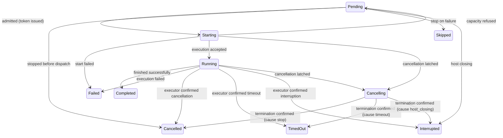
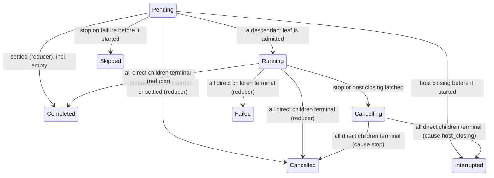
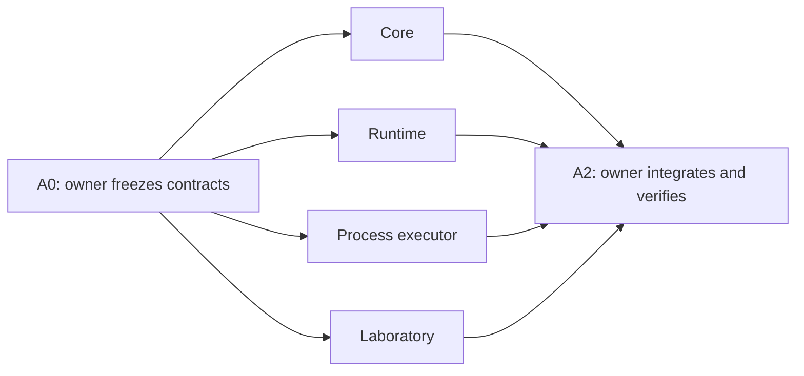

# Job batches — standalone engine and later Rush integration

Status: design only; this document does not authorize implementation or agent
launches. Revision 4 (2026-10-11) withdraws singleton root and legacy-contract
preservation (operator decisions 2026-10-11) and adds sole-child notice elision.
Revision 3 (2026-10-11) reconciles contract references, acceptance fences and the closure matrix in Appendix A.
Revision 2 (2026-10-08) addressed four independent reviews of revision 1
(`51599fa4`); Appendix A maps those findings and their round-two residuals:

- `docs/reviews/2026-10-08-job-batches-xxs-states.md` (S1-S5)
- `docs/reviews/2026-10-08-job-batches-xxs-api.md` (A1-A9)
- `docs/reviews/2026-10-08-job-batches-xxs-parallel-testing.md` (P1-P8)
- `docs/reviews/2026-10-08-job-batches-xxs-rush-integration.md` (I1-I7)

Round-two reports (historical verdicts, not current verification):

- `docs/reviews/2026-10-08-job-batches-xxs-states-round2.md`
- `docs/reviews/2026-10-08-job-batches-xxs-api-round2.md`
- `docs/reviews/2026-10-08-job-batches-xxs-parallel-testing-round2.md`
- `docs/reviews/2026-10-08-job-batches-xxs-rush-integration-round2.md`

The original integration investigation used HEAD `322705af`. File names below
are navigation aids, not frozen line-number contracts; re-read the current
implementation before changing it.

## 0. Scope and delivery boundary

The first deliverable is ordinary Go code in this repository:

```text
internal/jobbatch/                  Independent engine and runtime.
internal/jobbatch/testdata/         Deterministic core/runtime inputs.
internal/jobbatch/lab/              Scenario, controlled and process executors.
cmd/batchlab/                      Standalone development executable.
```

There is one module and one implementation. `batchlab` imports the package
that Rush will eventually use; it must not contain a second scheduler.
`internal/jobbatch/lab` is a consumer of the engine, not an engine dependency.
The engine/runtime depend only on the standard library. The process executor
may use `internal/platform` and `golang.org/x/sys`, but not Rush's app,
coordinator, session services, provider configuration, or MCP owner.

**Current scope ends at a working autonomous engine plus batchlab.** No Rush
tool registrations, DB migrations, changes to existing launch paths, new
model prompts, or project pre-refactoring are prerequisites for that delivery.
Section 9 records the later integration work; it is not part of the first
implementation wave.

Required behavior, retained from the operator's original request:

- A batch contains tasks and/or nested batches.
- Parallel batches start eligible work up to their limit and wait for every
  started task. Sequential batches process direct children in order, stopping
  on failure or continuing according to policy.
- Notifications are per-item or aggregate; several batches can coexist.
- Items can be appended to a nonterminal batch. Any item/subtree can be
  stopped. Task output can be inspected. Message-capable executors can receive
  input at any nesting depth.
- Success, failure, cancellation, timeout, interruption, and skipped work are
  distinct. An executor reports outcomes explicitly; the engine never
  interprets natural-language answers.
- Every invocation (built-in, MCP, CLI, or agent) enters as an ordinary
  batch; there is no standalone leaf or special singleton root. A one-task
  invocation uses the shared `OneItem` helper. An existing batch's leaf is
  not wrapped again. Rush wiring is later work, tested abstractly now.

Job batches are not the existing `fs_*` batching utilities. This component
owns group scheduling and policy, not filesystem-operation atomicity.

## 1. Architecture and ownership of truth

### 1.1 Pure engine

`Engine` owns a forest of batch trees and their shared scheduling budget.
Keeping shared admission here prevents each batch from independently
allocating the supposedly global limit. The tree is an internal representation,
not another public scheduler.

The engine has no goroutines, mutexes, clock reads, filesystem/network I/O,
process launching, or Rush imports. It accepts events and produces an ordered
transition containing changed views, execution commands, and notices.
The same ordered input events produce the same commands, notices and terminal
states. Time-dependent behavior enters as explicit events, not `time.Now()`
in core.

### 1.2 Runtime

One `Runner` owns one engine, potentially serving many root batches. It
serializes public requests and executor reports through one event loop.
Snapshots are requested through that loop while it is live, not by reading
the engine from another goroutine. At Closed the Runtime freezes the final
views and snapshots for read-only access without the exited loop: BatchView's
sequence is S_F, including roots settled earlier; released roots still return
`ErrReleased`. Events reads the frozen retained ring under its own lock
(section 4.1). Existing Batch.Done/Wait remain cached.

The loop applies events and schedules effects in transition order. Blocking
executor work happens outside it. Merely unlocking a mutex before calling an
executor is insufficient: separately dispatched transitions must not reorder
Start and Stop effects or issue duplicate executions.

Host cancellation starts closing; it does not stop the loop. The loop keeps
accepting executor reports until every accepted execution has confirmed
termination (section 3.4).

### 1.3 Executors and observers

The executor owns the actual execution and its output. The engine sees task
identity, admission group, cancellation intent, control results, and explicit
completion. CLI, MCP, and agent are adapter kind names, not branches of the
pure engine. Unknown executor kinds fail validation in the consumer before
launch.

Accepted work becomes terminal only when its executor confirms that the
execution has stopped. No executor error, panic, timeout, or Close deadline is
a substitute for that confirmation (sections 3.1.1 and 3.4).

The public record feed is not durable storage and is not a promise of
exactly-once delivery across crashes. It must not block executor cancellation
or the state loop. The final snapshot/Wait result remains authoritative even
if an observer falls behind.

## 2. Contract to freeze before parallel implementation

The integration owner implements the shared declarations in phase A0 before
spawning implementers. All slices use those declarations. The following names
and semantics are the shared contract, not competing design suggestions.

**What A0 writes in Go, and what it does not (P1).** Go has no forward
declarations: a function declared without a body is an external (assembly)
implementation, and a second declaration of the same name is a
redeclaration. A0 therefore writes only data declarations — types, interface
types, enum constants, error sentinels — plus small pure methods on those
types that every slice must answer identically (for example
`State.Terminal`). The function and method signatures listed in this section
and in section 5.3 are frozen by this document; each is declared exactly
once, with its real body, by its owning slice (section 7.2). The exported
pure helper `OneItem` belongs to the Runtime slice; A0 freezes its signature
here but writes no helper implementation. No placeholder
bodies, function variables or empty concrete structs exist to make early
compilation possible.

```go
type ID string
type Mode string   // "parallel", "sequential".
type OnFail string // "stop", "continue".
type Notify string // "each", "all".
type State string  // Section 3.1.
type Cause string  // "stop", "timeout", "host_closing", "stop_on_fail".

type TaskSpec struct {
    Kind    string
    Group   string          // Empty: the default group ""; capped by ByGroup[""] if set, else globally only.
    Payload json.RawMessage // Opaque to the engine; read-only once accepted.
    Timeout time.Duration   // Zero means no item timeout.
}
type BatchSpec struct {
    Mode        Mode
    OnFail      OnFail
    Notify      Notify
    MaxParallel int // 0: no cap of its own (section 3.2).
    Items       []Spec
}
type Spec struct {
    Task  *TaskSpec
    Batch *BatchSpec // Exactly one of Task/Batch is set.
}
type Limits struct {
    MaxConcurrent int
    ByGroup       map[string]int
    MaxDepth      int
    MaxNodes      int // Per root, including its nested batches.
}
type Result struct {
    State   State           // Completed, Failed, Cancelled, TimedOut, Interrupted.
    Code    string          // Short machine code; safe to journal.
    Summary string          // For explicit inspection only; never journaled.
    Details json.RawMessage // Opaque; never logged automatically.
}
type Launch struct {
    ID    ID
    Token uint64 // Admission-attempt identity, unique within one Runner.
    Task  TaskSpec
}

type Executor interface {
    Start(ctx context.Context, l Launch, report func(Result)) (Execution, error)
}
type Execution interface {
    Stop(ctx context.Context) error
}
// Optional capabilities, discovered on the Execution by type assertion.
type OutputReader interface {
    ReadOutput(ctx context.Context, cursor uint64) (OutputChunk, error)
}
type Messenger interface {
    Inject(ctx context.Context, msg json.RawMessage) error
}
type Disposer interface {
    Dispose(ctx context.Context) error
}

type RunnerConfig struct {
    Limits          Limits
    Executor        Executor
    ControlTimeout  time.Duration // Per physical Stop/Dispose call, from dispatch; positive.
    RecordRetention int           // Records kept for Events; positive.
}
type SubmitRequest struct {
    Root ID
    Spec Spec   // A batch (section 2.1).
    Ref  string // Optional caller reference; journaled, never payload.
}
type AddRequest struct {
    Parent ID
    Items  []Spec
    Ref    string
}
```

Enum strings: State is `pending`, `starting`, `running`, `cancelling`,
`completed`, `failed`, `cancelled`, `timed_out`, `interrupted`, `skipped`;
StartRejected reasons are `capacity`, `failure`, `cancelled`. JSON tags are
the snake_case of field names. `Ref` is optional and holds at most 128 bytes
of `[A-Za-z0-9._:-]`. Ordinary Runner refs need not be unique.

**Machine codes.** Every code in an Event, NodeView, record, footer or
`ErrDispose` is empty or 1-64 bytes of `[a-z0-9_.-]`. The closed set of
reserved runtime codes is `start_failed`, `start_nil_execution`, `start_panic`,
`executor_invalid_state`, `invalid_code`, `stop_failed`, `stop_panic`,
`stop_timeout`, `dispose_failed`, `dispose_panic`, `dispose_timeout`, and
`dispose_pending`.

Before `Apply`, the Runtime uses `norm(raw, fallback)`: empty raw becomes the
fallback; a grammar-valid, nonreserved raw code is retained; invalid,
overlong or reserved raw becomes `invalid_code`. Rejected raw values are
discarded, never logged or truncated. Code extraction and normalization run
under recover; a panic while obtaining `Code()` becomes `invalid_code`.
The only raw sources are `Result.Code` and `Code() string` from the first
error matched by `errors.As` to an interface providing that method. Never
read `Error()`, format an error with `%v`, or inspect panic values, Summary,
Details, payload or argv to derive a code.

Sources and event-specific allowed sets:

- Report: `norm(Result.Code, "")`; an invalid reported state uses the fixed
  runtime code `executor_invalid_state` (section 3.1). Settled permits empty,
  valid nonreserved codes, `invalid_code`, or `executor_invalid_state`.
- Start failure or cancelled rejection: `norm(Code(), "start_failed")`, using
  empty raw if no matching error provides Code. A nil execution with nil
  error uses fixed `start_nil_execution`; a Start panic uses fixed
  `start_panic`, without inspecting the panic value. StartRejected failure
  or cancelled requires a nonempty valid nonreserved code or one of
  `start_failed`, `start_nil_execution`, `start_panic`, `invalid_code`.
  A start failure's NodeView outcome is `{state: failed, code}`.
- Capacity refusal: StartRejected code is empty; do not read `Code()`.
- ControlReported permits only empty (Stop acknowledgement), `stop_failed`,
  `stop_panic`, or `stop_timeout`. Never inspect a Stop error for a code or
  text; a non-nil Stop error maps to fixed `stop_failed`.
- Disposal keeps its existing fixed set: `dispose_failed`, `dispose_panic`,
  `dispose_timeout`, `dispose_pending`; success has no error code.

Engine does not normalize codes. It rejects invalid grammar or codes outside
an event's allowed set through the invalid-event path, including nonempty
capacity codes and empty failure/cancelled rejection codes: no mutation,
sequence increment, commands or records.

Public core API:

```go
func NewEngine(Limits) (*Engine, error)
func (e *Engine) Apply(Event) (Transition, error)
func (e *Engine) View(ID) (NodeView, bool)
func (e *Engine) Snapshot(ID) (BatchView, bool)
```

Public runtime API:

```go
func OneItem(TaskSpec) Spec
func NewRunner(context.Context, RunnerConfig) (*Runner, error)
func (r *Runner) Submit(context.Context, SubmitRequest) (*Batch, error)
func (r *Runner) Add(context.Context, AddRequest) ([]ID, error)
func (r *Runner) Stop(context.Context, ID) error
func (r *Runner) CapacityAvailable(context.Context, string) error
func (r *Runner) View(context.Context, ID) (NodeView, error)
func (r *Runner) Snapshot(context.Context, ID) (BatchView, error)
func (r *Runner) Events(context.Context, uint64) (EventPage, error)
func (r *Runner) Output(context.Context, ID, uint64) (OutputChunk, error)
func (r *Runner) Inject(context.Context, ID, json.RawMessage) error
func (r *Runner) Release(context.Context, ID) error
func (r *Runner) Close(context.Context) error
func (b *Batch) ID() ID
func (b *Batch) Done() <-chan struct{}
func (b *Batch) Wait(context.Context) (Summary, error)
```

There is one exported pure ingress helper in `internal/jobbatch`:
`OneItem(TaskSpec) Spec` returns
`Batch{Mode: parallel, OnFail: "", Notify: all, MaxParallel: 0, Items: [task]}`.
Its implementation belongs to Runtime, not A0 or lab. Lab run and replay,
and the later Rush adapter, call this helper; Rush never imports lab.

Supporting types, also frozen in A0:

- `Event`: Submit{root, spec, ref}, Add{parent, items, ref},
  StopRequested{node}, Started{node, token}, StartRejected{node, token,
  reason, code}, Settled{node, token, result}, ControlReported{node, token,
  op, code}, CapacityAvailable{group}, DeadlineExpired{node, token},
  HostClosing, Release{root}. Invalid, stale or out-of-order events produce
  an error, no mutation, no sequence increment and no commands.
  `ControlReported{op: stop}` answers exactly one pending StopLeaf command
  for that leaf/token (section 3.1.2); it is not an unsolicited status update.
- `Command`: StartLeaf carries the full immutable `Launch` (identity, token,
  kind, group, timeout, payload), so the Runtime needs no lookup to start a
  leaf. StopLeaf carries node, token and cause.
- `Transition`: monotonic sequence of accepted events, the accepted event,
  changed node views, commands, selected notices, newly settled roots, and
  `Final bool`. Final is true exactly once: HostClosing has been applied and
  all roots are terminal after this transition. HostClosing itself is Final
  iff no nonterminal roots remain after it: this includes already-terminal
  or no roots and pending-only roots/subtrees interrupted and settled in that
  same transition. Otherwise Final is the later last-root drain `settled` or
  `start_rejected` under latched `host_closing`. Newly settled roots includes
  roots settled by HostClosing. The supplied design's enumeration wording is
  also corrected here.
  After Final, Engine.Apply rejects every event with `ErrClosed`, without
  mutation, sequence increment, commands, notices or records.
- `Notice`: root, node, node kind (task, batch, root), state, cause, leaf
  counts. Metadata only.
- `NodeView`: id, root, parent, ordinal, kind; batch policy fields for
  batches and group for tasks; state, latched cause, current token, attempt
  count, reported outcome (state, code, summary — never details), control
  error code and `control_pending` (true exactly while a StopLeaf command
  awaits its logical answer). Batch nodes have no control state. Payload is
  never a view field. Summary is for explicit
  inspection; it never enters records.
- `Counts`: leaf counts by pending, active (starting, running, cancelling),
  completed, failed, cancelled, timed_out, interrupted, skipped. A nested
  batch is never counted, only its leaves.
- `BatchView`: transition sequence, the batch's own view, its counts, and
  every descendant view in pre-order (section 4.2). `Summary`: root, state,
  counts, sequence — the small immutable aggregate returned by Wait.
- `OutputChunk`: data (a caller-owned copy), next cursor, oldest retained
  cursor, EOF, truncated (section 4.3).
- `Record`: cursor, transition sequence and type with the metadata of
  section 4.1; `closed` is the one last in-band record, with sequence S_F.
  `EventPage{Records, Next, Oldest, Head, Final}`: cursors start at 1;
  Head is inclusive newest (0 when empty), Oldest is oldest retained
  (Head+1 when empty), Next is last returned+1. Final is 0 until Closed,
  then F=Head forever; Closed iff Final != 0. Gap and EOF pages have the
  explicit Next values of section 4.1. S_F is the final transition sequence;
  records of sequences <= S_F have exactly cursors 1..F. Each root's
  `settled_sequence` s_r <= S_F, with equality only for roots settled in
  Final. An accepted stateless tail `capacity_available`, `release` or
  HostClosing after the last settlement gives max(s_r) < S_F. Footer
  `final_cursor=F` and `final_sequence=S_F` are producer boundaries;
  `last_cursor` is writer progress only.
- Errors: `ErrInvalidSpec`, `ErrDuplicateRoot`, `ErrUnknownNode`,
  `ErrTerminal`, `ErrNotTerminal`, `ErrNotStarted`, `ErrUnsupported`,
  `ErrReleased`, `ErrClosing`, `ErrClosed`, `ErrCloseTimeout`, `ErrGap`,
  `ErrExecutorPanic`, `ErrExecutionDone`, `ErrDispose`, and `ErrCapacity`, which an
  executor wraps in its Start error to signal a typed capacity refusal.
  `ErrDispose` names each affected node/token and its safe disposal code:
  `dispose_pending`, `dispose_failed`, `dispose_panic` or `dispose_timeout`.
  It describes handle cleanup, never a task outcome (sections 3.1.2, 3.4 and 4.5).

Do not add a mandatory Store interface or DB-style transaction to this scope.

### 2.1 IDs, ownership, and validation

Callers supply a unique nonempty root ID; the contract reserves `.` as the
item-path separator. Descendant IDs are deterministic append-only ordinal
paths, such as `root.1.2`. Parent and ordinal are explicit view fields;
consumers must not parse IDs for ownership. Duplicate root submission fails
without executing anything. Rerunning work requires a new root ID.

Root specs must be batches; both Engine and `Runner.Submit` reject task
roots with `ErrInvalidSpec`. Consumer ingress examines only the root: a raw
Task becomes an ordinary batch through `jobbatch.OneItem`. Nested leaves
and Add items are never wrapped.
The result is an ordinary batch; Add, Stop(root) and NotifyEach apply.
It has no special singleton policy or reducer.
Callers wanting another policy submit an explicit batch. Notify is an
explicit launch policy whose absent value defaults to `all`, unchanged.

Validate a complete Submit/Add subtree before accepting any of it: exactly
one node shape, known mode/policy, nonnegative timeout, valid limits, IDs and
reference, depth/node bounds (Add counts toward the root's `MaxNodes`), and no
irrelevant task/batch-only fields. Add is atomic as a request, not as
execution across tasks. Add returns the new direct children of `Parent` in
input order.

Require positive global, depth, and node limits. Group limits, when supplied,
must be positive; a group without a limit is bounded only globally.
The key `""` caps the default group.
`MaxParallel` is validated as written and never normalized into a number:
0 adds no cap of its own, a positive value caps every active leaf beneath the
batch (section 3.2). Sequential accepts only 0 or 1. Numeric
machine-specific defaults belong to batchlab/Rush, not hardcoded
command/agent categories in core.

Mode is explicit; absent Notify normalizes to `all`. A Sequential batch with
absent OnFail uses `stop`; Parallel requires OnFail to be empty. Root depth
is one and ordinals start at one. These defaults are resolved once, before
subtree validation.

### 2.2 Ownership of mutable values (A7)

| Value | Crosses | Rule |
|---|---|---|
| `Limits`, incl. `ByGroup` | caller → `NewEngine` | Copied once by `NewEngine`; later caller edits have no effect. `NewRunner` passes its Limits to `NewEngine` without making its own copy. |
| Submit/Add specs and payloads | caller → Runner | Deep-copied before the request is queued. |
| `Launch`, incl. `Task.Payload` | Runner → executor | Read-only shared data; the executor must not mutate it and need not copy it. |
| `Result` | executor → Runner | Copied once by the report callback. |
| Inject message | caller → executor | Copied by `Runner.Inject`; owned by the executor once `Messenger.Inject` returns nil. |
| `OutputChunk.Data` | executor → caller | A detached copy owned by the caller; the Runner does not copy again. |
| Views, snapshots, summaries, records | Runner → caller | Values that alias no internal state. |

Direct Engine consumers are the Runtime, replay (a fresh Engine), Core tests
and fuzz tests. Production consumers use Runner only. Direct Engine callers
transfer ownership of their events to `Apply`. Do not clone the entire forest
on every transition; report changed nodes only.

### 2.3 Requests: acceptance and replies (A5)

- Each public request is queued with a reply slot and an atomic state that
  moves from queued to either accepted (by the loop) or abandoned (by its
  caller). Exactly one of the two wins.
- The loop skips abandoned requests. For an accepted transition, it applies
  the event and appends all transition records before writing the reply or
  closing any Done channel; the reply is written without blocking. Rejected
  and abandoned requests produce no records.
- If the caller's context ends and abandonment wins, the request had no
  effect and the caller gets the context error. If acceptance already won,
  the caller waits for the reply — written promptly, because the loop never
  waits for executors — and gets the committed result. There is no
  "maybe accepted" outcome; an accepted Add always reaches its caller with
  its IDs.
- `Stop` returns nil once the stop intent is accepted. Every accepted
  nonterminal call, including a repeated no-op, records one `stop_requested`;
  a terminal node returns nil without acceptance or a record. After F it
  returns `ErrClosed`, including for terminal nodes. It never waits for
  `Execution.Stop` or termination; the control protocol is section 3.1.2.
  Termination is awaited with `Batch.Wait` or the node's `Events` records.
- `Release(root)` of a terminal root in an open or draining Runner is accepted
  and returns immediately, without waiting for pins or Dispose. It gives up
  retained handles and records Release. A repeat returns `ErrReleased`
  without a record; after F it returns `ErrClosed`. Nonterminal roots return
  `ErrNotTerminal` (sections 3.1.2 and 4.5).
- `Batch.Wait` returns the root `Summary` with a nil error for every
  terminal outcome, Failed and Cancelled included; its error describes only
  the wait itself. Cancelling Wait never stops work.
- `CapacityAvailable` returns after acceptance.

## 3. State, scheduling, and races

### 3.1 Lifecycle

Leaf states:



A report's `Result.State` must be Completed, Failed, Cancelled, TimedOut or
Interrupted. Any other value still means the execution ended: the leaf
settles Failed with code `executor_invalid_state`. When a cause was latched
first, the leaf settles with that cause and keeps the reported result as its
outcome (section 3.3).

Natural completion may arrive before Start returns. Runner buffers that
report and publishes Started before Settled for an accepted start. A failed
Start is authoritative: it must return no accepted execution. Start must
honor cancellation and finish its setup in bounded time. If cancellation was
already latched, a rejected start confirms that no execution exists and
settles with the latched cause, not a fresh Failed/Pending state.

Starting/Cancelling still hold their reserved slots until rejection or
confirmed execution termination. A successful Start means accepted work,
not completed work. At most one accepted execution per leaf. Rejected
admission attempts have distinct tokens and may retry without side effects.

Stop/timeout records intent and requests executor cancellation. It does not
pretend a process, MCP call, or agent has already stopped. Executor Stop
returning nil only acknowledges the request; completion confirms termination.

Batch states:



A nonterminal batch (Pending, Running or Cancelling) settles in the transition in which its last nonterminal direct child becomes terminal — by any path (Settled, a rejected start under a latched cause, Stop of a Pending leaf or batch, a skip, a nested batch settling) and whether or not any leaf was ever admitted. A batch created with no nonterminal direct child (empty, or holding only empty batches) settles in its creating transition. Outcome: its own latched cause wins (stop ⇒ Cancelled, host_closing ⇒ Interrupted, stop_on_fail ⇒ Skipped); otherwise the unchanged leaf-count reducer with an empty cause (zero leaves ⇒ Completed). A never-admitted batch can only reduce to Completed or Cancelled. Within one transition: latch the event's causes top-down (Stop: the addressed node and its nonterminal descendants; HostClosing: every nonterminal node), change leaf states, settle bottom-up to a fixpoint (a child that ends Failed under stop-on-fail skips its successors in the same pass), then admit (§3.2). Notices follow settlement order: descendants before ancestors, siblings by ordinal, after section 4.1 sole-child elision. Invariant after every transition: every nonterminal batch has a nonterminal direct child, and no terminal batch has a nonterminal descendant.

The unchanged leaf-count reducer is: any Failed/TimedOut/Interrupted ⇒ Failed;
otherwise any Cancelled ⇒ Cancelled; otherwise Completed, including zero leaves.
Without the batch's own latch, its aggregate cause is empty; child causes do not
climb to ancestors. Descendant outcomes stay visible in the counts. Using direct
children rather than leaves avoids settling a parent atop a stuck nested batch
and preserves the Sequential gate and Release requirements.

A Pending successor
that stop-on-fail never started becomes Skipped, and so do its Pending
descendants; an already-terminal successor batch also keeps its state (an
all-stopped successor remains Cancelled after a later predecessor failure,
not Skipped). Descendants that are already terminal keep their state, so an
empty batch that completed earlier is never renamed (S3). Skipped is produced
only by stop-on-fail and never conceals a start error.

Empty batches, including batches holding only empty nested batches, complete
in their creating transition, have zero task counts, and then reject Add.
An item asking for input is not terminal and does not free capacity;
waiting/interaction details belong to its executor.

#### 3.1.1 Errors by phase (S2, A2)

1. **Start rejected.** A non-nil error from `Start` is authoritative: no
   execution exists. `errors.Is(err, ErrCapacity)` is a capacity refusal
   (section 3.2), with empty code and without reading `Code()`. Other errors
   use the Machine codes contract in section 2: failure/cancelled rejection
   gets `norm(Code(), "start_failed")`; nil execution with nil error uses
   `start_nil_execution`; a recovered Start panic uses `start_panic` without
   inspecting its value. A start failure records NodeView outcome
   `{state: failed, code}`. When cancellation was latched before rejection,
   the leaf settles with the latched cause instead. No raw error text or
   unnormalized code enters Apply, views or records.
   The executor, not the Runner, guarantees that a rejected or panicking
   Start leaves no running process, call or agent behind (executor-owned
   setup cleanup). The Runner cannot verify that and does not claim to. A
   report made by a rejected attempt is ignored as an
   `executor_contract` violation, not journaled: there is no accepted event
   or diagnostic record for it. After F, callbacks cannot journal anything.
2. **Accepted execution.** Only the attempt's report settles it, and a
   report means the execution has stopped. Stop error, panic, timeout and
   acknowledgement follow the serialized command/result protocol in section
   3.1.2; none settles work or releases its reservation. Executor concurrency:
   Stop may overlap ReadOutput, Inject and the report callback, but never
   another Stop on the same Execution. Stop may repeat after the earlier
   physical Stop returned, including after the executor reported termination
   but before the loop accepted that report. Dispose runs once only after
   the report is accepted, retained ownership is given up, and all calls have
   actually returned. It overlaps no call; nothing may be called after Dispose.
3. **Inspection and input.** Errors from `ReadOutput`/`Inject` return to
   their callers, a panic as `ErrExecutorPanic`; neither changes state.
4. **Executor goroutines.** A panic inside a goroutine the executor owns is
   the executor's to contain; its protocol must still either report
   termination or keep the execution alive. The Runner cannot catch it.
5. **No synthetic termination.** No rule in this document turns an error, a
   panic, a timeout, or a Close deadline into Settled. Work an executor never
   confirms stays visible and nonterminal.

#### 3.1.2 Stop and disposal protocol (R2-API-02/03/04/05)

Engine control state is per leaf/current token: `none`, `pending`, `acked`
or `failed(code)`. Emitting StopLeaf sets `pending`; `control_pending` exposes
that gate. Commands and logical results alternate per token, without a public
invocation ID. Runtime alone calls `Execution.Stop`; Engine never calls it.

| Operation / condition | Engine acceptance and effects | Runtime / lifetime rule |
|---|---|---|
| Stop leaf: Pending | Latch first cause `stop`; settle Cancelled; no StopLeaf. | No execution or physical Stop. |
| Stop leaf: Starting | Latch first cause and emit StopLeaf, setting pending. | Cancel Start context; physically Stop only if Start returns an accepted Execution. A rejected Start settles by the existing cause and drops the command without ControlReported. |
| Stop leaf: Running | Latch first cause, enter Cancelling, emit StopLeaf and set pending. | Dispatch physical Stop, or queue at most one command behind an existing physical Stop. |
| Stop leaf: Cancelling | Reissue StopLeaf only when control is failed and nothing is pending; keep the original cause. Otherwise accepted recorded no-op. | A retry can queue behind a timed-out but still physically running Stop; never overlap physical Stops. |
| Stop leaf: Terminal / after F | Terminal returns nil without a record; after F return ErrClosed. | No command or call. |
| Stop batch/root: never admitted | Preserve section 3.1's S-R2-1 top-down causes, leaf changes and bottom-up settlement fixpoint; settle existing Pending descendants, no physical Stop. | No batch control state. |
| Stop batch/root: Running or Cancelling | One pre-order subtree traversal: latch only nodes without a cause, stop Starting/Running leaves, settle Pending leaves, and retry exactly Cancelling leaves with failed control and nothing pending, keeping their causes. Terminal descendants stay unchanged. | Commands are in pre-order; no batch control state or aggregate retry gate. |
| Every accepted nonterminal Stop call | Exactly one `stop_requested` record, including no-op calls; no extra request record per descendant. | Return at intent acceptance, not at dispatch, acknowledgement or termination. |
| DeadlineExpired / first HostClosing | Latch only where no cause exists; issue initial cancellation controls as appropriate. Never retry a failed control or replace a cause. | Cancel Starting context; no automatic retry, including on host cancellation. |
| ControlReported, current pending StopLeaf | Only `op: stop` answers pending: empty code acknowledges nil, sets acked and clears control error; failure sets failed(code) and control error (`stop_failed`, `stop_panic`, `stop_timeout`). Neither changes state, reservation or generation. | At most one logical result per command: first physical return, panic or timeout wins a one-shot latch. |
| ControlReported without pending / stale token / terminal / after F | Error, no mutation, sequence increment or record (ErrClosed after F). | Never publish an unsolicited or late result. |
| Physical Stop dispatch and return | Logical pending is independent of the physical-call slot. | Per-handle lock stores all active-call pins, one physical Stop slot and at most one queued StopLeaf. Acquire the Stop pin in the loop at physical dispatch; start ControlTimeout then, not while queued. Release pin and slot ONLY at actual return, never at timeout, Settled or F. Dispatch queued work only if the leaf is still nonterminal. |
| Timeout / late Stop return / leaf settlement | Timeout may answer the pending command once; settlement retires its control gate and drops any queued command. | Once the result latch fired or the leaf is terminal (even before F), late return is pin-only. No ControlReported if the leaf settles first, the queued command is dropped, or F has occurred. No automatic retry. |
| Release(root), terminal and open/draining | Accepted, record Release, return immediately; repeat ErrReleased without record; after F ErrClosed. | Give up retained handles without waiting for pins or Dispose; reject new handle accesses (section 4.5). |
| Dispose | Not an Engine event or task settlement; no feed/event. | Runner-only, once after accepted termination report, give-up by Release or F, pins=0, and optional Disposer present. Use detached context; ControlTimeout starts at physical dispatch. First nil / `dispose_failed` / `dispose_panic` / `dispose_timeout` latches cleanup result; no retry, late actual return ignored. No capability means no disposal call is required (sections 3.4 and 4.5). |
| Close(ctx), including host cancellation | First HostClosing only, never retries controls; drain to authoritative Final/F unchanged. | Lifetime wait is bounded by ctx and includes disposal results after F: on ctx expiry before F return ErrCloseTimeout; after F return ErrDispose naming failed cleanup, or pending cleanup if ctx expires before results complete; nil only when all required disposals succeeded. F gives up unreleased handles; disposal waits for pins outside the loop. Repeated Close results are stable once cleanup results complete (sections 3.4 and 4.5). |

ReadOutput and Inject also pin their physical calls. Pins and disposal neither
free admission slots nor bump availability generations. Accepted execution
termination and Start rejection handle reservations by sections 3.1/3.2;
in particular capacity-refused attempts release their reservations without
pretending to be accepted-execution settlements. Disposal results do not
change Final, F, frozen task state, cached Wait or retained feed boundaries.
The Release/Close/Dispose rows forward-reference the lifetime details in
sections 3.4 and 4.5; feed drain never waits for cleanup or observers.

### 3.2 Admission and fairness

A Pending leaf L without a latched cause is **eligible** when all of these
hold (active means Starting, Running or Cancelling; batch nodes consume no
slot):

1. **Sequential gate:** for every Sequential ancestor, L lies inside that
   ancestor's current direct child — the lowest-ordinal direct child that is
   not terminal. A nested batch settles before the next direct sibling
   starts.
2. **Global:** active leaves in the Runner < `MaxConcurrent`.
3. **Group:** if `ByGroup[g]` is set for L's group g, active leaves of g <
   `ByGroup[g]`.
4. **Subtree caps:** for every ancestor with `MaxParallel > 0`, active
   leaves beneath it < `MaxParallel`. `MaxParallel = 0` adds no cap and never
   inherits a number from the global or a group budget.
5. **Capacity block:** L's group is not capacity-blocked (below).
6. **Root:** the root is neither closing nor released.

Consequences (S4): `Sequential(0)` runs its current child under the child's
own rules, so a nested Parallel child may overlap its leaves;
`Sequential(1)` additionally limits its whole subtree to one active leaf. A
batch mixing groups `g:1` and `h:2` with `MaxParallel = 0` gets no common
cap of 1 from `g`.

**Selection.** After each accepted event the engine admits eligible leaves
until none is left. It walks roots round-robin from a cursor that persists
across transitions and, within a root, picks the eligible leaf with the
lowest pre-order position. A leaf blocked by its group is skipped, not
waited behind; this avoids head-of-line selection blocking, not a global
capacity shortage.
Under an open profile, units stuck in one group can still block clause 2
for all groups.
Releasing a slot reconsiders waiting work across the forest, including
a root that has never started a leaf.

**Capacity refusal without lost wake-ups (S1).** Each group g has an
availability generation `gen[g]`, incremented by every accepted
`CapacityAvailable(g)` and by every settlement of an accepted execution in g.
A StartLeaf records `gen[g]` at authorization. A capacity `StartRejected`
returns the leaf to Pending and releases its reservation. If `gen[g]` has
advanced since that attempt was authorized, the group stays eligible: the
signal arrived while the attempt was in flight and allows one retry.
Otherwise the group is blocked at the current generation and becomes
eligible again only when `gen[g]` advances. A late refusal therefore cannot
erase a signal accepted after its attempt began, a stale refusal cannot
re-block the group after a newer wake-up, and refusals without new signals
never spin. Do not busy-loop or wait only for the same tree to settle.

Operational start failure is Failed, not a capacity refusal. Automatic
retries of failed tasks are out of scope.

**Waiting executions and budgets (I1, S-R2-2).** Accounting here is Engine
state only. An admission unit is one leaf in Starting, Running or Cancelling:
`active[g]` equals that leaf count
for group g across the forest, and global active is `sum_g active[g]`.
StartLeaf alone acquires a unit. An accepted StartRejected or Settled with
the current token releases that attempt's unit exactly once. StopRequested,
DeadlineExpired, ControlReported (any code, including `stop_timeout`),
HostClosing, Release, pins, Dispose, Close deadlines and Final/F neither
acquire nor release units nor advance `gen[g]` by themselves. A transition's
emitted StartLeaf commands and accepted rejection/settlement effects are
accounted separately; a terminal Pending leaf never releases a unit.
The only generation advances are the CapacityAvailable and
accepted-execution settlement events defined above;
a Settled that releases a unit also advances its group's generation.
Pending leaves (including capacity-refused attempts), terminal leaves and
batch nodes hold no unit. Capacity-blocked is generation state, not a unit.
Failed or hung Stop holds the execution's unit until its termination report
is accepted (section 3.1.2). Capacity outside Runner is visible only through
`ErrCapacity`, not counted as Runner units.

A **closed profile** requires every accepted leaf's group to have a ByGroup
entry, including `""` if default work is accepted, and `MaxConcurrent >=
sum_g ByGroup[g]` over **all** entries, not just waiting groups. If clause 3
holds for h, `sum_{g != h} active[g] + active[h] < sum_g ByGroup[g] <=
MaxConcurrent`; hence clause 2 never fails alone. A level's budget is the
sum of its group caps, not a separate limit.

Execution X **depends on** Y if X's termination waits for Y's admission,
result or a message Y sends, including input/Inject waits. The consumer
assigns one rank per group: dependencies may target strictly lower ranks
only, never the execution's own group. Waiter and dependency use separate
roots, sharing no Sequential gate or ancestor with `MaxParallel > 0`.

The progress guarantee requires an open Runner, a closed profile, ranked
separate-root dependencies, finitely many Submit/Add requests, and these
executor/consumer premises: **(a)** once its dependencies settle, an execution
eventually reports; **(b)** a stopped execution reports without waiting for
dependency admission; **(c)** after `ErrCapacity` in g, the consumer later
sends `CapacityAvailable(g)` unless an accepted execution in g is active
(and its eventual settlement supplies the generation advance); **(d)** capacity
refusal cannot repeat forever for a leaf: on retries the consumer eventually
accepts its start or answers StartRejected with a terminal reason (failure or
cancelled). Under premises (a)-(d), every Pending leaf that stays uncaused is
eventually admitted, otherwise it settles; roots eventually settle. Engine
detects neither waits, profiles nor ranks; a consumer promising this guarantee
validates them before Submit (section 9.2), including work later accepted by
Add. An **open profile** remains legal, but promises only the admission
predicate, not this liveness guarantee. No lending is added in this scope;
future lending would be an additive field on `SubmitRequest`.

**I1 explanatory example.** With
`{max_concurrent:2,by_group:{agents:1,commands:1}}`, A.1 in agents and C.1
in the default group are accepted. C waits for Inject from A, which A sends
only after B's commands result. B is a separate root; commands has 0/1
active units, but global active is 2, so B remains Pending: deadlock.
A consumer promising progress rejects this unclosed default-group mapping.
Adding `"":1` and setting MaxConcurrent to 3 fixes the accounting shortage
(W-a); C(default) → A(agents) → B(commands) can then have strictly descending
ranks. Moving C to commands instead closes accounting, but C → A → B
requires commands > agents > commands, impossible ranks, so that dependency
profile is still rejected. The alternative of capping only waiting ranks,
using global > their sum and leaving rank 0 uncapped is rejected: k hung
default leaves can consume every spare slot (section 3.1.2), whereas the
closed sum contains that loss within the affected group's cap.

**Liveness argument and failure boundary:**
1. Closed accounting removes independent clause-2 competition; free group
   capacity is not stolen by other groups.
2. Rank 0 has no dependencies, so accepted executions report by (a);
   settlements free their own units and rerun persistent round-robin, which
   reaches a root with eligible group work within a rotation; (c) supplies
   capacity-refusal wake-ups and (d) ensures retries eventually accept a start
   or settle through a terminal StartRejected reason.
3. Inductively, rank r's dependencies in lower groups are not held by
   rank >= r's units; (c)/(d) give retry progress there, they settle, then (a)
   makes the rank-r execution report.
4. Queued stopped dependencies settle in the same transition without units
   (section 3.1, S-R2-1); Done/Wait/notice wake the waiter, and a stopped waiter
   reports by (b).
5. A never-reporting execution after failed/hung Stop loses a unit to its
   group and dependent ranks may hang, visibly Cancelling with control error
   and pre-F `ErrCloseTimeout`; other groups' capacity remains safe. This
   violates (b), not a synthetic-settlement exception.
6. HostClosing promises no admission progress: Pending leaves become
   Interrupted and wake dependencies. Final needs (b) for stopped accepted
   work; reports, not HostClosing, free its units.

### 3.3 Linearization rules

The event-loop acceptance order, not wall-clock callback order, decides:

1. **Add vs last direct child becoming terminal:** Add accepted first extends
   the batch; the event that makes its last nonterminal direct child terminal
   accepted first settles it, and subsequent Add returns `ErrTerminal`.
   This includes Stop of a Pending leaf, not just an execution completion.
2. **Stop vs dispatch:** stop cancels undispatched tasks. An already
   authorized Start may be in flight; its context is cancelled and the
   returned execution is stopped before waiting for its final report.
   A Start entered with an already-cancelled context must do no side effects.
3. **Stop vs natural completion:** Settled accepted first keeps its natural
   terminal state. Stop accepted first latches cancellation as terminal cause;
   retain the executor's reported outcome as details, not as a second notice.
4. **Repeated/late reports:** reports for terminal nodes or stale launch
   tokens cannot release capacity twice, restart work, or change the winner.
   Each StopLeaf command has at most one logical ControlReported (possibly
   none if settlement, queue drop or F wins). Late physical Stop returns are
   pin-only, including before F once terminal; they cannot clear or replace
   a newer control error (section 3.1.2).
5. **Timeout vs Stop:** the first accepted cancellation cause is retained.
   A later timer cannot relabel an operator stop or a completed task.
6. **Timers are attempt-scoped:** the Runner arms an item's timeout when it
   dispatches StartLeaf (authorization, not queueing) and retires it when
   that attempt is rejected or settles. `DeadlineExpired` carries the token;
   a stale token or a terminal node is rejected, so an old attempt's timer
   cancels neither a Pending leaf nor a newer attempt.
7. **Inject vs settlement:** Inject is accepted only for a leaf whose
   accepted execution is neither terminal nor cancelling at acceptance. The
   executor call runs after acceptance; if the execution ends meanwhile, the
   executor answers `ErrExecutionDone`. A message is never applied to work
   that was already terminal when Inject was accepted.

Report callbacks must return without waiting for the event loop, including
callbacks invoked synchronously by Start. Use a per-attempt completion latch,
not a blocking callback channel that deadlocks Start. Executor errors and
panics follow section 3.1.1; rejected work must not leak a reservation.

Public operation contexts bound request submission/waiting, not task lifetime
(section 2.3). Cancellation of Batch.Wait alone does not stop work. Runner's
host context or explicit Stop controls work lifetime. Rush's eventual
synchronous adapter will explicitly connect caller cancellation to Stop.

### 3.4 Host shutdown, Close and draining (S5)

Host shutdown is distinct from user Stop.

- **Closing** starts at host-context cancellation or the first `Close` call.
  Together they accept exactly one `HostClosing` event over the Runner's
  lifetime; later calls/cancellation never reissue it or retry failed controls.
  New Submit, Add and Inject fail with `ErrClosing`. Pending leaves become
  Interrupted. Starting and Running leaves without a latched cause latch
  `host_closing` and receive initial StopLeaf controls, preserving existing
  causes (section 3.1.2).
- **Draining.** The loop keeps accepting Start results, reports and control
  results, and serves View, Snapshot, Events, Output, Stop and Release.
  Physical Stop and Dispose use detached contexts bounded by `ControlTimeout`,
  starting at dispatch, not queueing; cancelled host/request contexts do not
  pre-cancel cleanup.
- **Close(ctx)** waits for F and then the logical disposal result of EVERY
  execution handle given up during the Runner's lifetime, including handles
  given up by Release before F. Expiry before F returns an error wrapping
  `ErrCloseTimeout` naming unfinished nodes. Nothing settles synthetically;
  reservations stay held. Once closed, failed disposal results, or pending
  results when ctx expires, return `ErrDispose` naming each affected node,
  launch token and code (`dispose_failed`, `dispose_panic`, `dispose_timeout`
  or `dispose_pending`). Nil requires all required disposal results to be nil;
  no required disposals is vacuous success. Close can be called again: pending
  cleanup can complete, but once all logical results are in, repeated calls
  return the same success or failure, without retrying disposal.
- **Closed** means closing AND every root terminal, witnessed by
  Transition.Final. Terminal roots alone do not close an open Runner. The
  exact publication order is: append Final's event, commands and selected
  notices in order; append ONE last `closed` record with sequence S_F and
  cursor F; set EventPage.Final=F and wake readers; close Done for roots newly
  settled in that transition; enter Closed and exit the loop; THEN give up
  unreleased handles, start eligible Dispose calls when pins=0, and resume
  Close waiters into the cleanup wait. Handles already given up by Release
  are never given up or disposed again at F. All transition records precede
  their roots' Done publication. Closed is a feed/state boundary, not a
  promise that pending or later Close calls return nil: Close has the separate
  disposal barrier above and never waits for reader/observer acknowledgement.
  Events reads retained records through F; View/Snapshot read frozen final
  state (sections 1.2 and 4.1), or `ErrReleased` for released roots. Existing
  Batch handles answer Done/Wait from cached Summary. Wait, Done, Events and
  final View/Snapshot are independent of disposal. Output, Inject, Stop,
  Submit, Add, Release and CapacityAvailable return `ErrClosed`. Late callbacks
  append nothing and cannot change Head, Final or frozen state.
- An executor that never confirms termination keeps the Runner draining,
  visible through Snapshot and pre-F Close errors, never hidden.

**Stop pins and the disposal barrier (R2-API-05, R2-API-02/03).** Each
StopLeaf command has at most one logical ControlReported, possibly none if
settlement, queue drop or F wins. After its timeout/result latch or terminal
settlement, late physical Stop return is pin-only, before as well as after F;
it cannot publish another result or replace a newer control error. Per-handle
locks and pins survive loop exit. A Stop still physically executing after
settlement allows Release to return nil immediately but prevents Dispose
until actual return releases its pin. If it never returns, bounded Close
returns `ErrDispose` with `dispose_pending` after F, even though the feed and
cached task results are already final. Dispose's own `dispose_timeout` is a
logical cleanup result, not confirmation of physical resource cleanup: Close
must not wait forever for that timed-out physical Dispose to return (section
4.5). Neither late Stop nor disposal creates feed records or Engine events.

**Accounting dependency.** See section 3.2, Waiting executions and budgets
(S-R2-2). Failed or hung Stop on a still-Cancelling execution keeps its
admission slot indefinitely until accepted execution termination; pins and
disposal do not free slots or advance availability generations. An independent
capacity tail accepted before F is covered by the final boundary; after Closed
CapacityAvailable returns `ErrClosed` without a generation change.
Premise (c) of section 3.2 requires the consumer, after `ErrCapacity` in g,
to later send `CapacityAvailable(g)` unless an accepted execution in g is
active and its eventual settlement supplies the generation advance.

**Integration dependencies (sections 9.1/9.2/9.4).** Rush wiring must cover
kill timeout as `stop_timeout`, shell and delegation Disposer implementations,
and `ErrDispose` logging/routing. These are forward dependencies, not changes
to those sections.

With section 9.2's Rush-only commit hook, a failed commit faults the Runner and
it leaves this lifecycle at once: no HostClosing, F or Closed follows (section
9.2). Without a hook nothing here changes.

## 4. Notifications, output, and injection

Separate three concepts:

- Diagnostic records describe every accepted transition.
- Selected notices implement NotifyEach/NotifyAll.
- Batch.Wait returns one root result; it is not an extra user notification.

### 4.1 Records, notices and the public feed (A1, A3)

`Runner.Events` is the only public stream: a cursor feed of records. Every
record has a gapless producer cursor, the sequence of the transition it came
from, and a type:

- one record per accepted event (`submit`, `add`, `stop_requested`,
  `started`, `start_rejected`, `settled`, `control`, `capacity_available`,
  `deadline_expired`, `host_closing`, `release`), carrying every
  scheduling-relevant field: root, node, token, state, cause, reason, safe
  code, group, `ref`, and for Submit/Add the IDs created;
- one `command` record per engine command, in transition order: start or
  stop, node, token, cause — never the payload;
- one `notice` record per selected notice; one transition may select
  several;
- exactly one last `closed` record, after all event/command/notice records
  of Transition.Final, with sequence S_F and cursor F. No record follows it.

Records never contain payloads, `Result.Summary`/`Details`, injected
messages, output, arguments, or error text. EventPage has `Records`, `Next`, `Oldest`,
`Head`, `Final` with the inclusive boundaries of section 2. Retention keeps
only the last `RecordRetention` records; `RecordRetention >= 1` ensures the
newest `closed` record is always retained. Older notices are lost, announced
by `ErrGap`; consumers must not reconstruct them by reapplying Notify.

`Events(ctx, c)` has these ordered read rules:

- If c < Oldest, return an empty EventPage with Next=Oldest and current
  Oldest, Head, Final, and an error wrapping `ErrGap`; never silently skip.
- If Oldest <= c <= Head, immediately return a bounded page of retained
  records starting at c, Next=last returned+1, and current boundaries, even
  with an already-cancelled ctx. Check context only before waiting.
- If c=Head+1 while not Closed, wait for append or context cancellation.
  Closing always appends `closed`, so the final append wakes waiters.
- If Closed and c>F, return an immediate empty page with Next=F+1,
  Head=Final=F, frozen Oldest, and `ErrClosed` as EOF, even if c>F+1.

After Closed the retention window [Oldest_F,F] is immutable and served under
its own ring lock, not through the exited loop. Reads are nonconsuming, have
no ack, and concurrent identical reads return identical pages. Close never
waits for readers. Post-Closed Events(1) returns the full feed if Oldest=1,
otherwise ErrGap; restarting at Oldest reaches `closed`. Snapshot/Wait may
inspect final state, but never repair a lost journal or recover lost notices.
Slow consumers never block the loop, cancellation or admission.

**Notice selection.** Root completion produces exactly one selected root notice.
For descendant completion, NotifyEach applies to direct children; an ancestor
NotifyAll suppresses ordinary notices inside its subtree. A nested aggregate,
a Skipped batch included, may be announced by its NotifyEach parent without
repeating descendant output. A settlement cascade selects notices in settlement
order: descendants before ancestors, siblings by ordinal. Reducer notices have
an empty cause absent the batch's own latch, even when its leaf counts include
Cancelled; Notice/NodeView cause is separate from Summary, which has no cause
field. For B{B.1}, NotifyAll and NotifyEach both select only B, once (sole-child elision).
Question/input requests are not engine events (section 4.4) and are never
suppressed by completion-notification policy.

**Sole-child elision (Engine Core, `notice.go`).** If B settles with exactly
one direct child C, C is not selected; selected B covers C. Children are
append-only, and Add to a terminal batch returns `ErrTerminal`, so one child
at settlement means B has only ever had one child. C settles in the same
transition as B. B has the same no-NotifyAll-ancestor eligibility as ordinary
notice selection; the root notice is always preserved. B keeps its own state
and cause, never mirrors C: Stop(root) keeps the root Cancelled with cause
`stop` even over a Completed child.

Apply elision per level: a one-child chain collapses to its outermost selected
batch. `R(Each){R.1(Each){a,b}}` selects `a,b,R`. For `R(Each){R.1}` with
R.1 a task, if Add appends R.2 before R.1 settles, selection is `R.1,R.2,R`.
For the nested tree, if Add appends task R.2 to R before either a or b settles
and completion order is a,b,R.2, both batches have two children and selection is
`a,b,R.1,R.2,R`. Batches with at least two direct
children retain the last child's notice and the parent's notice as separate
events, with descendants before ancestors and siblings by ordinal.

Invariants: each node is selected at most once, only in its settlement
transition; each root is selected exactly once; no transition selects both
a batch and its sole child.

### 4.2 Discovery (A8)

`Snapshot` accepts any batch node and returns a consistent view at one
transition: the batch, its leaf counts, and every descendant NodeView in
pre-order (parent before children, siblings by ordinal). Consumers address
deep nodes from snapshots and views, never by parsing IDs.

### 4.3 Output (A9)

Each execution exposes at most one byte stream with absolute cursors starting
at 0; the process executor merges stdout and stderr in arrival order.
`ReadOutput(ctx, cursor)`:

- returns retained bytes from `max(cursor, Oldest)`; `Truncated` is set when
  the cursor is older than `Oldest` (retention dropped those bytes), and
  `Next` is the cursor after the returned bytes;
- on a live stream with nothing new, waits until data, EOF or the end of ctx
  (a context error) — no busy polling and no false EOF;
- sets `EOF` only after the execution has terminated and every retained byte
  has been returned.

Typed errors: `ErrNotStarted` (no accepted execution yet), `ErrUnsupported`
(a batch node or an execution without OutputReader), `ErrReleased`,
`ErrUnknownNode`. Output storage and retention belong to the executor.

### 4.4 Injection

Inject resolves node ownership explicitly and is callable at any depth. A
batch node or an execution without Messenger returns `ErrUnsupported`;
Pending/Starting returns `ErrNotStarted`; a terminal or cancelling node
returns `ErrTerminal`; a closing Runner returns `ErrClosing`. No silent no-op
injection. An execution's input callback must not call back synchronously
into a blocking Runner operation.

Question/input transport remains an executor/host concern. A paused lab
execution advertises that state through inspected output and accepts Inject;
the core needs no agent-specific question event to schedule it, and an item
waiting for input stays nonterminal and keeps its slot.

### 4.5 Retention and Release (A6)

After settlement the Runner is the only owner of an execution handle. An
executor must not keep its own registry of finished executions; the
Execution value holds its retained output. Output, Inject and physical Stop
acquire active-call pins through the loop under a per-handle lock, then run
outside it. The lock and pin bookkeeping survive loop exit. Pins are released
ONLY when the physical call actually returns, including after timeout,
settlement or F; a logical result never releases a pin. Physical Stop's slot
and queued-command rules are in section 3.1.2. Pins and disposal have no
admission-slot or availability-generation effect (section 3.2, Waiting
executions and budgets, S-R2-2); failed/hung Stop keeps a still-Cancelling
execution's reservation until accepted termination.

`Release(root)` is refused with `ErrNotTerminal` while any node of the root
is nonterminal, and only roots can be released. Before F, accepted Release
records exactly one `release`, gives up retained handles and returns
immediately, without waiting for pins or Dispose. Repeated Release returns
`ErrReleased` without a record. New Output, Inject, View and Snapshot calls
on that root return `ErrReleased`; already pinned calls finish safely. Dispose
becomes eligible at give-up if pins=0, otherwise at the last pin's actual
return, once accepted execution termination has been reported. At F, after
Closed and loop exit, the Runner implicitly gives up every unreleased handle
without a release record; handles already released are not given up again.
Release after F returns `ErrClosed`.

**Disposal protocol.** Runner alone calls the optional execution `Disposer`,
exactly once per eligible handle, outside the loop with a detached context.
`ControlTimeout` starts at physical dispatch. A one-shot latch records the
first nil return, failure (`dispose_failed`), panic (`dispose_panic`) or
timeout (`dispose_timeout`) as its logical result. No retry is permitted;
a physical return after timeout is ignored. A disposal result need not await
physical return: specifically, timeout is a logical result, NOT confirmation
that physical resource cleanup completed. Close waits for that result, not
forever for a timed-out Dispose call. A pin blocking dispatch instead leaves
`dispose_pending` until the pin returns; it is not a dispatched Dispose
timeout. Disposal never emits a feed record or Engine event, settles a task,
or alters F, frozen state or cached Wait.

No Dispose call is required for a stopped Pending leaf, Skipped leaf,
Interrupted Pending leaf, capacity-refused or otherwise Start-rejected
attempt, or accepted execution without Disposer: these have zero required
disposals. Close owns the logical cleanup results of ALL handles given up
before or after F, including earlier Release, and retains those results even
when public handle access is gone. Its disposal barrier, bounded pending
errors and stable completed results are specified in section 3.4.

`Batch.Wait` keeps returning the cached Summary and Done remains usable.
A small root-ID tombstone is kept for the Runner lifetime so an old ID cannot
launch new work; Runner memory therefore grows with submitted roots — a
documented limit, not a reason to add an eviction policy. See sections
9.1/9.2/9.4 for the integration dependencies noted in section 3.4; this
protocol does not change those headings or decide cross-process routing.

## 5. Batchlab: separate runnable verification

### 5.1 Commands and exit status

```bash
go run ./cmd/batchlab run scenario.json
go run ./cmd/batchlab run scenario.json --events events.jsonl
go run ./cmd/batchlab replay scenario.json events.jsonl
go test ./internal/jobbatch/...
go test -race ./internal/jobbatch/...
```

In this repository test and build commands run through the heavy-command
wrapper with `capm 2g` and `-p 1`, never bare.

`run` uses the real Runner — one Runner for the whole scenario, so roots
share budgets. `replay` never constructs an executor. Exit status is fixed,
and tests check the exact code; the first matching row wins:

| Code | Meaning |
|---|---|
| 2 | usage error, unreadable or invalid scenario/journal |
| 3 | unfinished or cleanup unconfirmed/failed: invocation cancelled, wait bound expired, `ErrCloseTimeout`, or `ErrDispose` |
| 5 | `--events` journal incomplete (gap or write error) |
| 4 | the scenario's `expect` block or declared action expectation did not match, or an action returned an undeclared error |
| 1 | finished, expectations (if any) matched, some root not Completed |
| 0 | finished, expectations (if any) matched, every root Completed |

L1's expected failed aggregate therefore exits 1 with matched expectations;
a malformed scenario or a missing helper program cannot pass for it (2, or 4
when the leaf codes differ).

### 5.2 Scenario format (P2, P5)

A0 freezes the scenario schema in `internal/jobbatch/lab/schema.go`; decoding
rejects unknown fields. The vocabulary below, including gate results and oracle
additions, is part of that same pre-fan-out schema freeze (section 7.1), not a
post-implementation schema deferral.

Every submit/add has a mandatory nonempty Ref matching section 2's grammar,
unique among all submit/add actions in the scenario FILE. After decoding,
the loader validates this and requires the script to end with a nonasync
close or a join of an async close. Violations exit 2 before opening
`--events`, writing its header, constructing factories or Runner, or launching
anything. Stop, inject, capacity_available, release and close have no ref.
Inject has no record; the others describe themselves in their records and
need no scenario lookup during replay.

Ref flows only through SubmitRequest/AddRequest → Submit/Add Event.ref →
submit/add record. It never enters Spec, TaskSpec, Launch, Result, leaf
records, views, a leaf or an executor. Ordinary hosts retain optional,
nonunique Runner refs; their
journals are not lab-replayable. Rejected/abandoned requests have no records,
but their actually-run actions appear in the diagnostic footer inputs (§5.5).

- `version`; `limits`; `runner` (`control_timeout_ms`, `record_retention`);
  `wait_bound_ms` — a mandatory overall bound.
- `payloads`: named payloads, each `{"kind": "process", ...}` (section 5.4)
  or `{"kind": "controlled"}`; task specs reference them by `payload_ref`.
  `messages`: named inject messages.
- `script`: ordered actions. Every await takes `timeout_ms` (default: the
  remaining wait bound); an undeclared await expiry exits 3.
  - `submit` {ref, root, spec}; `add` {ref, parent, items}; `stop` {node};
    `inject` {node, message_ref}; `capacity_available` {group};
    `release` {root}; `close` {timeout_ms, expect: ok | timeout | dispose}.
    Close expectations match nil, `ErrCloseTimeout`, or `ErrDispose`
    respectively; matching timeout/dispose still exits 3 under section 5.1.
  - `await_start` {node, bind}: waits for the next not-yet-awaited registered
    start attempt of a controlled node and binds its token to a name, once.
  - `release_start` {attempt, decision: accept | accept_complete |
    refuse_capacity | fail, state, code}: registered only, one decision;
    returns AFTER physical Start returns. `accept_complete` reports completion
    inside Start and leaves the fixture attempt in reported phase. It still
    counts as an accepted Execution, not an accepted-phase fixture.
    `release_start.code` and `complete.code` are RAW: the loader does not
    validate them; Runtime applies section 2's Machine codes contract.
    A controlled fail error's Error text contains literal
    `batchlab-error-sentinel`, never a journal code.
  - `complete` {attempt, state, code}; `emit` {attempt, text};
    `await_inject` {attempt, message_ref}: accepted only.
  - `hold_stop` {attempt}; `fail_stop` {attempt, code}: registered through
    reported, arm the NEXT physical Stop, never an already-entered call.
    `await_stop` {attempt, call:k} observes physical entry of indexed call k;
    `return_stop` {attempt, call:k, result: ok | error:<code> | panic}
    releases only that held call. Indexes start at 1 and increment at physical
    entry, not at a Stop command, logical timeout or queued request.
  - `hold_dispose` {attempt}; `await_dispose` {attempt};
    `return_dispose` {attempt, result: ok | error:<code> | panic}: disposal
    gates, with phase rules in section 5.3. Await observes physical entry.
  - `hold_read` {attempt}; `return_read` {attempt}: output pin gates; hold
    arms the next physical ReadOutput, return releases only the held read.
  - `await_state` {node, state | "terminal"}; `expect_output` {node,
    contains | eof}.
  - Optional `async:<name>` on `close` or `expect_output` launches that action
    without blocking the script; names are unique. `join` {name} waits for
    it and checks its returned errors and declared expectations. Every async
    action must be joined within the overall bound; no silent error loss.
  - `await_record` {type, node?, code?}: observes the public Events feed,
    nonconsumingly. Match all supplied fields against retained history in
    cursor order (earliest match), starting at cursor 1 for each action, or
    await a future match; repeat observers
    may see the same record. No observer consumes another's match. An ErrGap
    is an error, never reconstructed history; frozen reads follow section 4.1.
    Low-retention scenarios cannot use `await_record` for fences once earlier
    records have been trimmed; use retention-independent state/fixture/lab gates.
  - Optional `expect_error:<code>` on any action declares its expected typed
    error (including an await error). An undeclared action error exits 4,
    except the unfinished/cleanup conditions with section 5.1 precedence;
    absent or wrong expected error is a mismatch, exit 4. A matched expected
    error never queues a deferred side effect. For async actions this check
    occurs at join. Do not combine conflicting Close/error expectations.
- `expect` — the independent oracle, optional in general and required for
  named smoke scenarios: `roots` [{id, state, counts}], `nodes` [{id,
  parent, state, cause, outcome: {state, code}, control, control_pending,
  attempts, starts, accepted, stops, disposes}], `notices` (ordered per root),
  `max_active` (maximum overlap of accepted attempts' Start-entry-to-report
  intervals), `before` (partial order pairs such as
  `["A.1:settled", "B.1:started"]`), and `exit_code`. Absent oracle fields
  are unchecked; present fields match exactly, including zero and empty.
  `cause` is empty for no cause; outcome state is empty for no outcome.
  `attempts` counts issued tokens. `control` mirrors the current leaf/token
  gate exactly: `none`, `pending`, `acked`, or `failed(code)`;
  `control_pending` is the NodeView gate (no batch roll-up).
  A lab-owned delegating wrapper around controlled/process executors makes
  no scheduling decisions: it measures `starts` (physical Start entries),
  `accepted` (Start returned an accepted Execution, including accept_complete),
  and `max_active` over [Start entry, report] across accepted attempts,
  retaining observations until acceptance is known even for an inside-Start
  report. These are not Engine/Runner counters. Fixture reported phase does
  not erase acceptance. `stops`/`disposes` count physical control entries,
  not logical commands or results. Additional labels are
  `<attempt>:stop_entered#k`, `<attempt>:stop_returned#k`,
  `<attempt>:dispose_entered`, and `closed` (producer Final publication).
  Fixture labels are observations, not synthetic feed records. For real
  processes the oracle checks invariants, never an OS completion order.

Run and replay ingress both call `jobbatch.OneItem` for a raw-root Task
(section 2.1, E1); nested/Add items are never wrapped. Policy fields are
unknown and rejected, not additional scenario knobs. Explicit BatchSpec
policy fields, including Notify with default `all`, remain unchanged.
Named smoke scenarios with their acceptance IDs live in
`internal/jobbatch/lab/testdata/scenarios/`.

### 5.3 Controlled executor (P2)

A development/test fixture, not a production MCP/agent fallback. Frozen API;
the bodies belong to the Laboratory slice:

```go
// Data contract only: GateResult is "ok", "error:<code>", or "panic".
// StartDecision uses decision/state/code as listed in section 5.2.
type GateResult string

func NewControlledExecutor() *ControlledExecutor
func (c *ControlledExecutor) AwaitStart(ctx context.Context, id jobbatch.ID) (jobbatch.Launch, error)
func (c *ControlledExecutor) ReleaseStart(ctx context.Context, token uint64, d StartDecision) error
func (c *ControlledExecutor) Complete(ctx context.Context, token uint64, r jobbatch.Result) error
func (c *ControlledExecutor) HoldStop(token uint64) error
func (c *ControlledExecutor) FailNextStop(token uint64, code string) error
func (c *ControlledExecutor) AwaitStop(ctx context.Context, token uint64, call uint64) error
func (c *ControlledExecutor) ReturnStop(token uint64, call uint64, result GateResult) error
func (c *ControlledExecutor) HoldDispose(token uint64) error
func (c *ControlledExecutor) AwaitDispose(ctx context.Context, token uint64) error
func (c *ControlledExecutor) ReturnDispose(token uint64, result GateResult) error
func (c *ControlledExecutor) HoldRead(token uint64) error
func (c *ControlledExecutor) ReturnRead(token uint64) error
func (c *ControlledExecutor) AwaitInject(ctx context.Context, token uint64) (json.RawMessage, error)
func (c *ControlledExecutor) Emit(token uint64, data []byte) error
```

**Attempt phases and decisions.** Start registers its token and blocks until
ReleaseStart supplies the first decision or its context is cancelled. The
observable progression is `registered -> release_start (once) -> accepted
or retired`; accepted execution termination moves to `reported`, and physical
Dispose return moves to `disposed`. There is no hidden `decided` phase.
Refusal, start failure or cancellation without acceptance retires the attempt;
cancellation returns a context error with no execution side effects.
ReleaseStart acknowledges only after Start has returned; accept_complete
reports inside Start and is already reported at that acknowledgement. A
cancelled wait for acknowledgement never replaces the first decision.
AwaitStart waits for registration, returning each node's attempts in start
order exactly once; script binding names that token, not a future execution.

**Phase errors.** ReleaseStart is registered only; Complete, Emit and
AwaitInject are accepted only. Too-early operations and repeats return
`ErrAttemptPhase` immediately. Retired, disposed or unregistered tokens return
`ErrUnknownAttempt`; Complete after reported also returns `ErrUnknownAttempt`
(preserving F-b). Errors never queue work, change the first decision or affect
a newer attempt. An await validates phase first, then may wait only for its
specified observation; it never queues a mutation for a future phase.

**Physical gates.** HoldStop and FailNextStop may arm the next physical Stop
from registered through reported. A duplicate arm of the same kind is a phase
error. Ungated Stop returns nil or the armed error; if both gates are armed,
entry consumes both arms and ReturnStop's explicit result chooses the held
call's physical result. AwaitStop
observes entry of call k, including historical entries, in those phases.
ReturnStop targets only an entered, still-held call k; too early or repeated
returns are phase errors. Stop entry increments the index and fixture counter;
physical return publishes stop_returned#k and releases its pin even when a
logical timeout already won. Stop never completes an execution: only its
single accepted termination report does. In particular, a held Stop may be
returned AFTER reported until disposal, so C-a can release its outstanding pin.

HoldDispose is accepted/reported only and arms the one physical Dispose before
entry; a duplicate or post-entry arm is a phase error. AwaitDispose is valid in
accepted/reported and ALSO after physical disposal has entered or finished
(including disposed), returning the retained entry observation. This is the
explicit exception to the disposed-token error rule. ReturnDispose releases
only the entered held call, in reported, with the declared result. A logical
Dispose timeout does not end that physical hold; its later return may mark
disposed but cannot change the Runner's latched result. Ungated Dispose returns
nil; controlled accepted executions implement Disposer. Retired attempts have
zero disposals.

HoldRead is accepted only, arming the next physical output read; duplicate arms
are phase errors. ReturnRead releases only an entered held read, in accepted or
reported, until disposal; too early/repeated returns are phase errors. It then
uses normal output bytes/EOF semantics, not an invented result. An entered read
keeps its physical pin through settlement/Release/Closed until ReturnRead.
Controlled executions implement OutputReader (fed by Emit) and Messenger
(observed by AwaitInject). These gates hold physical calls independently of
context/logical timeout and never release pins on a logical result.

### 5.4 Process executor (P7)

```go
// In package lab.
func NewProcessExecutor(ProcessOptions) (jobbatch.Executor, error)
```

Payload: `program`, `args`, optional `cwd`, optional `max_output_bytes`. Never
shell text; the program runs directly. `ProcessOptions.MaxRetainedBytes`
(positive) is the ceiling; a payload may lower it, never raise it. Retention
keeps the most recent bytes of the merged stream (section 4.3).

Platform strategy — an A0 decision, not left to the slice:

- **Spawn** through `platform.Command`; the repository's spawn guard rejects
  direct `exec.Command` under `internal/`. Add flags to the hardened
  `SysProcAttr`; never replace it.
- **Unix:** start the child as a process-group leader (`Setpgid`). Stop
  sends SIGTERM to the group, then SIGKILL after a grace period bounded by
  the Stop context. Termination is confirmed when the leader has been reaped
  and the group no longer exists.
- **Windows:** create the child suspended, assign it to its own Job Object
  with `JOB_OBJECT_LIMIT_KILL_ON_JOB_CLOSE`, then resume it, so no descendant
  can start outside the job; the slice owns the resume mechanism. Stop
  terminates that job. Termination is confirmed when the leader has been
  waited for and the job reports no active processes.
- Existing helpers are references only: `platform.AssignToNewJobObject`
  puts the host itself in a job, and `session.TrackProcessTree` attaches
  after start. The `session` package must not be imported (it pulls in the
  database). Platform-specific code lives in `lab/process_*.go`; changing
  shared helpers or the spawn guard needs an owner decision.
- Codes: a missing program is a start failure `missing_program`; a nonzero
  exit settles Failed with `exit_<n>`; a stopped process settles with its
  latched cause.
- The portable helper `lab/testdata/process/helper` imports only the standard
  library and `internal/platform` (on Windows, `golang.org/x/sys`), never
  agent, session, app or DB packages. Modes: print, exit with code n, hold,
  and spawn. Hold writes `ready <pid>` and blocks until killed; it never reads
  stdin. The process executor leaves Stdin nil (the null device).
- Spawn starts exactly one `os.Executable()` hold descendant through
  `platform.Command`, reads that child's `ready <pid>` from its stdout pipe,
  prints `descendant-ready <pid>`, then holds. This is the L2/L5 rendezvous,
  without sleeps. The helper never modifies returned SysProcAttr: no Setpgid,
  Setsid, breakaway or extra creation flags; the descendant inherits the
  executor's isolation. Direct `exec.Command`, `exec.CommandContext`,
  `exec.Cmd` literals, `os.StartProcess`, `syscall.StartProcess` and
  `syscall.ForkExec` are forbidden. The last two bypass the selector AST
  check at spawn_guard_test.go: TestNoUnhardenedProcessSpawns but are contractually prohibited.
- Build the helper once per test run into a temporary directory outside the
  repo, invoking `go build` through `platform.Command` under the heavy-command
  wrapper. Populate L1/L2/L5 scenarios with the absolute helper path before
  run; there is no variable expansion. Unrelated sentinels are started through
  `platform.Command` and cleaned up by their own PID, never a broad tree kill.
- No spawn exemptions or shared platform edits are authorized. The relevant
  guard is `TestNoUnhardenedProcessSpawns` plus this section's owner-decision
  boundary, not agentguard; agentguard belongs to later Rush wiring (§9.1).

### 5.5 Journal and replay (A3, P3)

`--events` writes JSONL:

- **Header:** format name, `version: 1`, `scenario_sha256` (SHA-256 of the
  scenario decoded into the schema types and re-encoded by `encoding/json`:
  fixed field order, sorted map keys), limits and runner settings.
- **Records:** the public feed of section 4.1 with cursors contiguous from 1.
  The `ref` of submit/add records binds them to the UNIQUE scenario action
  of the same action type and root/parent. Run and replay ingress both call
  `jobbatch.OneItem` for raw-root Tasks; nested/Add items are never wrapped.
  Other record types need no scenario lookup.
- **Footer:** `final_cursor` (absent if never Closed), `final_sequence`,
  `last_cursor`; `capture: complete | gap{first_missing,resumed_at} |
  write_error`; `outcome: closed | unfinished{IDs}`; each root's state,
  counts and `settled_sequence` s_r (absent for an unsettled root).
  `final_cursor=F`, `final_sequence=S_F` for closed outcome, not writer
  guesses or max(s_r). `last_cursor` is the last successfully written cursor.
  Capture is complete iff every record 1..last_cursor was written and, for
  outcome closed, the last record is `closed` and last_cursor=final_cursor.
  An intact unfinished prefix can have capture complete; it is not a closed
  or full-run replay.
- **Diagnostic footer inputs:** after the F/cut drain, run writes
  `inputs: [{ref, action, result: accepted | rejected | abandoned, ids?, error?}]`,
  one entry per actually-run submit/add in script order, including requests
  with no records. IDs are actual replies: [root] for Submit, direct added
  children for Add. Error is the typed expect_error name (for example
  `terminal`), never error text. `request_counts: {capacity_available, release}`
  counts those actions returning nil. Replay checks these diagnostics; they
  do not change capture, outcome, final_cursor or final_sequence. Stop is
  intentionally uncounted: terminal Stop can return nil without a record.

When the authoritative public EventPage boundary has `Final != 0`, regardless
of whether bounded Close returned nil or `ErrDispose`, invocation cancellation,
wait-bound expiry or normal completion, `run` drains Events through F before
writing a closed footer: final_cursor=F, final_sequence=S_F, outcome=closed,
with capture determined by the records actually written. The drain uses a
context independent of the invocation and a bounded cleanup budget. Process
exit status follows section 5.1 independently: cancellation/wait-bound expiry
still exits 3 even when Close returns nil; `ErrDispose` also exits 3 while
outcome remains closed. Disposal failure/unconfirmed cleanup is not an
unfinished Engine. On ErrGap,
record `gap{first_missing,resumed_at}`, resume at the returned Oldest and
capture through F; retain capture gap even after reading `closed`. A write
failure gives capture write_error. Neither blocks cancellation/Close, and
Snapshot cannot rebuild missing records. If the writer cannot drain within
its cleanup budget, it cannot claim capture complete.

Only for `ErrCloseTimeout` while the authoritative `Final == 0`, drain
nonblocking through the current Head cut, not through a future F, and exit 3.
If Final is already nonzero, use the closed branch instead. Footer outcome is unfinished
with the IDs and root state derived exclusively from records <= cut, never from a later
Snapshot. Its final_sequence is the last accepted transition at the cut;
final_cursor is absent because the producer was not Closed at that cut.
A later public completion/second Close may produce F>cut without altering
this journal.

Before rebuilding, replay checks diagnostic inputs and present records:

- **I1:** inputs are a prefix of the scenario's submit/add actions, with the
  same refs, action types and order (including rejected/abandoned actions).
- **I2:** cursor-ordered submit/add records are bijective with accepted inputs
  by ref/type/root-parent. After these structural preliminaries, during fresh
  Engine rebuild compare input IDs to reproduced replies ([root] or direct
  Add children) and record-created IDs to the reproduced transition.
- **I3:** no empty, unknown or repeated record refs, and no records for rejected
  or abandoned inputs. Present submit/add records preserve scenario order.
- **I4:** capacity_available/release record counts equal request_counts.

For intact closed or unfinished-prefix captures I1-I4 apply to records through
F or the cut, respectively: records precede replies (§2.3), so completed
accepted inputs are covered at the cut. Transition sequence checks catch an
applied event whose record was dropped; I2/I4 catch a nil reply that was never
applied. For gap/write_error captures perform only I1/I3 and order checks on
present records; never fill missing history or enforce a missing bijection.
Structural invalidity exits 2 before incomplete-capture exit 5; F-c's valid
gap behavior is unchanged.

`replay` validates header version/digest, cursor continuity and footer. It
rebuilds accepted events in order — specs from the unique scenario action
with that ref, same action type and root/parent, normalized at replay ingress
by calling `jobbatch.OneItem` for a raw-root Task, just as run does; nested/Add
items are never wrapped; executor
results from journal — in a fresh Engine, reproducing event, command, notice
and `closed` records with the same cursors and sequences. Replay uses
Transition.Final to reproduce `closed` at the same boundary; no records may
follow it. Compare root states,
counts and s_r, including equality to S_F only for roots settled in Final.
A prefix before `closed` leaves Engine non-Final: missing tail is detected,
even if all roots were already terminal before a stateless tail.
Replay also compares reconstructed outcomes, root states/counts, notices and
closed/Final facts against the scenario's optional `expect` block wherever
expressible by section 5.2's metadata fields. Disposal results are deliberately
outside the feed: replay cannot recover physical fixture Stop/Dispose counters,
held-call return labels, disposal results or output expectations. Compare only
expressible feed metadata; never invent events to satisfy fixture assertions.
Closed/Final boundary facts remain covered by the journal checks above. This
limitation does not add journal schema fields or widen the schema task.

Reject structural mismatches with exit 2: missing footer, unknown version,
changed scenario digest, unannounced cursor holes, capture=complete with closed outcome but without
`closed`, `closed` not last, wrong final_cursor, or removed HostClosing and
`closed` with authoritative footer retained. Announced gaps/write errors
are incomplete captures, not valid full replays: validate their structure
but never fill missing history or invent Engine events. An incomplete capture
may lack `closed` and have last_cursor<final_cursor (a write_error on the last
record); a present `closed` must still be last and agree with final_cursor. A closed intact
journal from a process that exited 3 validates and replays
normally; that process status does not make its closed outcome unfinished.
An intact unfinished
journal replays its prefix and exits 3; capture != complete exits 5 unless
unfinished exit 3 takes precedence. A structurally invalid journal exits 2.
Section 5.1's first-matching-row precedence is unchanged: structural invalidity
exits 2; unfinished/cancellation/cleanup failure exits 3 before capture-loss
exit 5; then oracle mismatch 4, failed aggregate 1, success 0. A closed gap
with successful cleanup alone exits 5 (F-c); F-e/F-f, C-d cleanup failure and
W-c ii retain exit 3 even if capture is also incomplete. Replay never
constructs an executor or reruns processes; a scenario whose process would
write a file leaves that file absent.

### 5.6 Timeouts and cleanup (P6)

The Runner implements execution timeouts outside the core with standard
timers (section 3.3, rule 6); unit tests use synctest or barriers, never
real-time sleeps. A timeout requests termination and settles TimedOut only
after confirmation.

Invocation cancellation (Ctrl-C) and the scenario wait bound both end in
`Runner.Close` with a fresh cleanup context bounded independently of the
cancelled invocation context — never the cancelled context itself. Both
exit 3. A controlled execution that withholds its confirmation past that
bound makes Close time out, keeps its admission held, and still exits 3,
never success.

The journal records sequence, input reference, node/launch identity,
transition reason and outcome state. Do not print task payloads, injected
messages, raw details, command arguments, or agent prompts. Task output is
available through explicit inspection, not copied into completion logs.

Do not build a daemon, RPC transport, or second Rush CLI inside batchlab.
All help and examples must describe real supported behavior.

## 6. Autonomous acceptance matrix

These are behavioral tests, not tests of source text, import lists, function
counts, forwarding, or copied constants. Agent reports are not verification.
Section 7.2 fixes which slice owns each ID.

**Dependent-action fences (all section 6 rows and variants).** Explicit script
steps and prose abbreviations obey the same rule: after release_start accept,
await_state of that leaf Running (or a public Started-record fence) precedes
Complete, capability calls and dependent controls. After Complete or
accept_complete, await_state of the expected terminal leaf/root or await_record
of its Settled precedes dependent inspection, a repeated fixture mutation, or
Close. Physical Start return/report callback return alone is not loop acceptance.
For shorthand, integration reports, and held physical returns, the harness
observes the corresponding public accepted record/state before the next dependent
action; no new script/schema field is added. Intentional early/repeated actions
with expect_error, and deliberately held reports, retain their
specified negative/ordering fences rather than acquiring a contradictory wait.
Every live run ends in nonasync Close or an async Close joined within its bound,
then the F/cut journal drain of §5.5. F-b/V-d are post-Closed reads/corruptions,
V-a and other invalid-loader inputs reject before constructing a Runner;
replay-only inputs launch no work. Pure-event generators, including R-e/W-e,
finish by HostClosing and valid current-token rejection/termination drain
through Final, checking invariants on the drain;
this is core-event cleanup, not synthetic execution termination.

### 6.1 Engine and admission

- **E1:** a raw-root task through real lab ingress calling `jobbatch.OneItem`
  and an explicit one-item batch produce the same ordinary tree, one launch,
  one result and the same notices. Nested leaves are not wrapped twice.
  Engine and Runner.Submit both reject a task root. Add to the helper-created
  root succeeds while nonterminal, with the same behavior as an explicit batch
  (R3-add supplies the deterministic Add fence; V-b covers Add/replay).
- **E2:** sequential and nested sequential ordering; parallel overlap and
  ancestor caps; `Sequential(0)` overlaps inside a nested Parallel child
  while `Sequential(1)` serializes it, and in both the next direct sibling
  waits for the nested batch; a mixed-group batch (`g:1`, `h:2`,
  MaxParallel 0) gets no common cap of 1; Starting and Cancelling keep
  counting; counts include each leaf once.
- **E3:** StopOnFail skips only pending successors after Failed/TimedOut/
  Interrupted; ContinueOnFail executes successors; Cancelled alone does not
  trigger StopOnFail; a skipped nested batch is Skipped (not Completed), its
  pending leaves never start, one Skipped notice is selected under an
  eligible NotifyEach parent after section 4.1 sole-child elision, and
  already-terminal descendants keep their state.
  An already-Cancelled successor batch keeps Cancelled when its predecessor
  later fails; it is not renamed Skipped.
- **E4:** several roots/groups share budgets. With `MaxConcurrent = 1`, root
  B's never-started leaf starts when root A's leaf settles, without Add or
  CapacityAvailable for B, and at most one execution is ever accepted at
  once. No eligible group starves behind a blocked one. A leaf gated on work
  of another group makes progress under the closed profile, ranked
  separate-root dependencies and premises (a)-(d) of section 3.2; section
  6.6 W-a..W-e defines the accounting and failure-boundary scenarios.
- **E5:** capacity refusal performs no execution and queues without
  spinning; a CapacityAvailable or relevant settlement accepted before a late
  refusal still yields exactly one retry with a new token; the reverse order
  needs the next signal; a stale refusal does not re-block after a newer
  wake-up; the item ultimately runs once.
- **E6:** stop leaf/subtree/root; sibling isolation; no false terminal state
  before execution termination; a Stop error or panic keeps the leaf
  Cancelling with a visible control error and its slot held, and only the
  single confirmed report frees the slot; repeated Stop is safe and
  re-issues only failed-descendant controls on repeated leaf/subtree/root Stop,
  excluding pending, acknowledged and terminal leaves. Pending retries are
  recorded no-ops; each command has at most one logical result, timeout wins
  once and late physical returns are pin-only. Physical Stops serialize, with
  at most one queued retry and ControlTimeout starting at dispatch, not queueing
  (3.1.2; C-b/C-c). Stop of a never-admitted leaf or subtree produces
  no execution command; stopping only a subset leaves its ancestor Pending
  until the last nonterminal direct child settles, then ready ancestors settle
  bottom-up in that same transition.
- **E7:** Add ordering and returned IDs, atomic rejection of invalid
  subtrees, the Add/last-settle race in both orders, empty batch, duplicate
  root ID, depth/node-limit boundaries. Zero-leaf nesting (batches holding
  only empty batches) completes bottom-up on Submit/Add with zero counts,
  no StartLeaf and no Pending descendant under a terminal ancestor.
- **E8:** terminal result/notice emitted once; stale tokens, stale deadlines,
  and duplicate or late reports cannot change the winner or release a slot
  twice; late control reports do not revive a terminal leaf. After every
  transition, each nonterminal batch has a nonterminal direct child and no
  terminal batch has a nonterminal descendant. Also after every transition,
  `active[g]` equals the number of Starting/Running/Cancelling leaves in g
  across the forest; for every set ByGroup entry, `active[g] <= ByGroup[g]`,
  and `sum_g active[g] <= MaxConcurrent`. Each node is selected at most once,
  only in its settlement transition; each root is selected exactly once;
  no transition selects both a batch and its sole direct child.
- **E9:** ownership: mutating each caller-owned value of section 2.2 after
  its hand-off point changes nothing accepted; mutate ByGroup after either
  NewEngine or NewRunner returns and verify budgets are unchanged. Snapshots
  cannot mutate state; diagnostics and journals contain none of the sentinel strings
  planted in argv, payloads, injected messages, summaries, and details.

### 6.2 Runtime and laboratory

- **R1:** immediate completion inside Start, start error, nil execution,
  Start panic before any side effect and after creating a resource the
  executor cleans up itself, Stop before Start returns, and concurrent
  Add/Stop/Settled; no deadlock or leaked slot; a report from a rejected
  attempt is ignored.
- **R2:** timeout vs natural completion/operator stop under virtual time;
  attempt-scoped timers; Wait cancellation does not stop work; HostClosing
  is distinct; after a Close deadline the loop keeps draining — the late
  confirmation settles Interrupted once, Done closes, and a second bounded
  Close succeeds; a Start that returns after the first Close deadline is
  handled the same way. Close success precedes resumed reader drain, not
  the reverse; records precede Done. F-a/F-b in section 6.4 check this boundary.
- **R3:** notices through the public feed: a NotifyEach root with a
  NotifyAll child, and a NotifyAll root, expose exactly the selected notices
  of section 4.1 with no consumer-side policy; blocked or failed observers
  do not freeze scheduling or cancellation; gaps are explicit and frozen
  final snapshots remain correct. F-a/F-b in section 6.4 read selected
  notices through F after Close and check concurrent nonconsuming readers.
  Three independent named cases use controlled payloads, unique refs,
  `wait_bound_ms:10000`, bounded awaits, and nonasync `close {expect:ok}`:
  - **R3-one:** submit `Parallel/NotifyEach{R.1}` with ref r3-one-R;
    await_start/bind r1, release_start accept, await R.1 Running, complete r1
    Completed, then await R Completed before Close. Notices are only R once.
  - **R3-chain:** submit `R=Parallel/NotifyEach{R.1=Parallel/NotifyEach{R.1.1}}`
    with ref r3-chain-R; await_start/bind r11, release_start accept, await
    R.1.1 Running, complete r11 Completed, then await R Completed before
    Close. Only outermost selected R appears, not R.1 or R.1.1.
  - **R3-add:** `max_concurrent:1`; submit `Parallel/NotifyEach{R.1}` with ref r3-add-R;
    await_start/bind r1, release_start accept, await R.1 Running; Add a
    controlled task to R with ref r3-add-second and observe reply [R.2]
    before completing r1. Complete r1 Completed, await R.1 Completed;
    await_start/bind r2, release_start accept, await R.2 Running, complete
    r2 Completed, await R Completed, then Close. Notices are R.1,R.2,R
    in that order: last child and parent remain separate events. Repeat with
    fresh refs r3-add-helper-R/r3-add-helper-second and raw-root Task ingress
    through OneItem, which yields Notify all: retain all fences, but the
    notice oracle is [R] only, since NotifyAll suppresses R.1 and R.2. The
    NotifyEach variant of a helper-created batch is a Runtime-API test
    (Runner.Submit with OneItem's result changed to Notify each before
    Submit), not a scenario script: scenario JSON has no policy knob (5.2).
- **R4:** output A → pause → B → completion read by cursor without false EOF
  or busy polling; small retention truncates the beginning with an explicit
  gap and recovery point, then the rest and a real EOF; not-started,
  unsupported and released are distinct errors; a paused message-capable
  fixture resumed by Inject at nested depth; Inject vs settlement and
  terminal injection refusal; Release with a read in flight is safe and
  Dispose runs once after the last active-call pin, including physical Stop
  even after logical timeout. Release and Close/F both give up retained
  ownership without disposing across a held call; Runtime owns the protocol,
  Laboratory the controlled scenarios C-a..C-d (6.5), integration owner their
  cross-slice proof.
- **R5:** request semantics with barriers between enqueue, acceptance and
  reply: cancellation before acceptance leaves no trace, cancellation after
  acceptance still returns the committed Submit/Add result; Stop returns at
  intent acceptance and capacity stays held until the report; Wait of a
  Failed root returns its Summary with a nil error; a Snapshot from only the
  root ID discovers every node after several nested Adds; a leaf added at
  depth greater than one receives exactly its own kind, group, timeout and
  payload in Launch. For a settled never-admitted root, Done closes and Wait
  returns its Summary with nil error; Add returns `ErrTerminal`; terminal
  Stop adds no records and does not change Head. Before Release, Output of
  its never-started leaf returns `ErrNotStarted` and Inject returns
  `ErrTerminal`. Release returns nil with one release record and zero Dispose
  calls (no execution handle); Wait remains cached afterwards. Apply section
  4.5 without changing the Stop/Dispose invocation protocol.
- **L1:** three real command items through the CLI, one exiting 7 with oracle
  outcome `{state:failed,code:exit_7}`, plus a missing-program variant with
  outcome `{state:failed,code:missing_program}` and accepted=0 for that leaf.
  Failed aggregate, exit 1 with matched expectations; a wrong code exits 4.
  No model/API needed.
- **L2:** real command cancellation with partial-output inspection: a child,
  its descendant, and an unrelated sentinel, all ready by pipe handshake.
  Stop terminates only the child's tree, confirmed by termination rather
  than by a nil Stop; the sentinel and a sibling process keep running and
  keep their output.
- **L3:** a controlled multi-root scenario exercises Add, capacity release,
  failure policy, nested stop, and both notification modes against its
  `expect` oracle, including a stopped never-admitted root settling before
  the unrelated held execution releases its slot.
- **L4:** replay preserves structural final state, root settled_sequence,
  commands, notices and the last `closed` record at identical cursors and
  sequences, with no records afterwards; it performs no side effects even if
  a scenario includes a process that would write a file. Failed/cancelled
  closed runs replay to the same outcome, distinct from unfinished prefixes.
- **L5:** invocation cancellation and wait-bound expiry each run Close with a
  fresh bounded cleanup context, exit 3, terminate the run's own process
  trees, and leave an unrelated process alive; a controlled execution that
  withholds confirmation past the bound yields a Close timeout, held
  admission and exit 3.
- **L6:** journal integrity: a removed footer or last record, an unannounced
  internal gap, unknown version or changed scenario content under the same
  refs is rejected with exit 2. F-c/F-d in section 6.4 cover frozen retention
  overflow (capture gap, closed outcome, exit 5), dropped `closed`, dropped
  HostClosing+closed with footer retained, wrong final_cursor, and closed
  outcome without `closed`. Never replay such captures as complete.

Use channels/barriers or synctest for timing-sensitive unit tests. Property/
fuzz tests use seeded Submit/Add/Stop/StartRejected/Settled/HostClosing sequences,
check both section 3.1 invariants after every transition, and publish failing
sequences. No StartLeaf may appear under a terminal batch; stopping the last
Pending leaf settles a never-admitted root in the same transition. Do not
manufacture CPU/memory load to test limits; controlled held tasks demonstrate
admission limits.

### 6.3 S-R2-1 concrete scenarios

The rows use only section 5.2's updated, A0-frozen script actions and oracle
vocabulary; they add no schema fields beyond those frozen additions.
Braces/name assignments below abbreviate Spec trees; each task
uses a named controlled `payload_ref`, each submit/add has a distinct `ref`,
and each run has a bounded wait. Cause, outcome and attempts are expressible
in section 5.2's oracle. Other API facts — transition contents, Done/Wait,
Head, disposal and replay boundaries — remain prose/public-API assertions
where not expressible. These rows neither extend that schema nor change
integration ingress.

| ID | Controlled script / public-API actions | Acceptance |
|---|---|---|
| **R-a** | `max_concurrent:1`; `submit {ref:ra-A,root:A,spec:Parallel/NotifyAll{A.1}}`; `await_start {node:A.1,bind:a1}`; `release_start {attempt:a1,decision:accept}`; `await_state {node:A.1,state:running}`; `submit {ref:ra-B,root:B,spec:raw task}` normalized at lab ingress to `B{B.1}` with NotifyAll (2.1/5.2); `stop {node:B.1}`; `await_state {node:B,state:cancelled}`; `add {ref:ra-add-B,parent:B,items:[controlled task],expect_error:terminal}`; `stop {node:B}`; `stop {node:B.1}`; perform the pre-Release public checks below; `release {root:B}`; `complete {attempt:a1,state:completed}`; `await_record {type:settled,node:A.1}`; `await_state {node:A,state:completed}`; `close {expect:ok}`. | `roots` A completed, B cancelled; B counts cancelled=1, all other counts=0; A completed=1, all others=0. `nodes` B.1 starts=0, A.1 starts=1. `notices` B=[B cancelled]; `before:[["B:notice","A.1:settled"]]`; `max_active:1`; `exit_code:1`. |
| **R-b** | `max_concurrent:2`; `submit {ref:rb-R,root:R,spec:Sequential/stop/NotifyEach{R.1,R.2=Parallel/NotifyAll{R.2.1,R.2.2},R.3}}`; `await_start {node:R.1,bind:r1}`; `release_start {attempt:r1,decision:accept}`; `await_state {node:R.1,state:running}`; `stop {node:R.2.1}`; `stop {node:R.2.2}`; `await_state {node:R.2,state:cancelled}`; `complete {attempt:r1,state:completed}`; `await_record {type:settled,node:R.1}`; `await_start {node:R.3,bind:r3}`; `release_start {attempt:r3,decision:accept}`; `await_state {node:R.3,state:running}`; `complete {attempt:r3,state:completed}`; `await_record {type:settled,node:R.3}`; `await_state {node:R,state:cancelled}`; `close {expect:ok}`. | R cancelled, completed=2, cancelled=2, all other counts=0; R.2 leaves starts=0. `notices` R=[R.2 cancelled,R.1 completed,R.3 completed,R cancelled]; `before:[["R.2.2:stop_requested","R.2:notice"],["R.2:notice","R.3:started"]]`. |
| **R-c** | `submit {ref:rc-Z,root:Z,spec:Parallel/NotifyAll{Z.1=Sequential[],Z.2=Parallel{Z.2.1=Parallel[]}}}`; `add {ref:rc-add-Z2,parent:Z.2,items:[controlled task],expect_error:terminal}`; `close {expect:ok}`. Independent second part: `max_concurrent:1`; `submit {ref:rc-P,root:P,spec:Parallel/NotifyAll{P.1,P.2=Parallel{P.2.1}}}`; `await_start {node:P.1,bind:p1}`; `release_start {attempt:p1,decision:accept}`; `await_state {node:P.1,state:running}`; `stop {node:P.2.1}`; `await_state {node:P.2,state:cancelled}`; `complete {attempt:p1,state:completed}`; `await_record {type:settled,node:P.1}`; `await_state {node:P,state:cancelled}`; `release {root:P}`; `close {expect:ok}`. | Z and every nested batch complete entirely in Submit, zero leaf counts and no commands; default `notices` Z=[Z completed]. P.2 cancelled before P settles; P counts completed=1, cancelled=1, all others=0. Public Release(P) succeeds. |
| **R-d** | Independent runs, `max_concurrent:1`: `submit {ref:rd-A,root:A,spec:Parallel/NotifyAll{A.1}}`; `await_start {node:A.1,bind:a1}`; `release_start {attempt:a1,decision:accept}`; `await_state {node:A.1,state:running}`; `submit {ref:rd-B,root:B,spec:Parallel/NotifyAll{B.1=Parallel{B.1.1},B.2}}`; `stop {node:B.1}`; `await_state {node:B.1,state:cancelled}`. Variant i: `stop {node:B.2}`; `await_state {node:B,state:cancelled}`; `complete {attempt:a1,state:completed}`; `await_record {type:settled,node:A.1}`; `await_state {node:A,state:completed}`; `close {expect:ok}`. Variant ii: `close {async:c,expect:ok}`; `await_record {type:host_closing}`; `await_record {type:notice,node:B}` while A.1 is held; `await_stop {attempt:a1,call:1}`; `complete {attempt:a1,state:interrupted}`; `await_record {type:settled,node:A.1}`; `join {name:c}`. | After Stop(B.1), B.1 cancelled with own cause stop, B still Pending. Variant i: B cancelled with empty cause (child cause does not climb), cancelled=2, all other counts=0. Variant ii: B.2 interrupted and B interrupted with own cause host_closing, not Failed; B cancelled=1, interrupted=1, all other counts=0; B notice before A.1:settled. |
| **R-e** | Seeded valid Submit/Add/Stop/StartRejected/Settled/HostClosing sequences; controlled attempt tokens and acceptance barriers, with reproducible seed and failing sequence retained; finish with HostClosing and valid current-token drain through Final. | After every transition, every nonterminal batch has a nonterminal direct child and no terminal batch has a nonterminal descendant; `active[g]` equals the forest's Starting/Running/Cancelling leaf count in g, `active[g] <= ByGroup[g]` for every set entry, and `sum_g active[g] <= MaxConcurrent`. No StartLeaf under a terminal batch; stopping the last Pending leaf settles a never-admitted root in that transition, without fake Start/Running or slot use. |

**R-a transition and runtime assertions.** StopRequested(B.1) changes the leaf
to Cancelled with cause stop, no token and attempts=0, with no StopLeaf or
command record. The reducer settles B with empty cause, newly settled roots
[B], and sequence s: Done closes and Wait returns `Summary{B,cancelled,counts,s}`
with nil error. The `stop_requested` B.1 record precedes selected notices:
only B under NotifyAll and also only B in the NotifyEach variant, by
sole-child elision. The later
terminal Stops return nil without records or Head change. A.1 receives no Stop.
Before Release, Output(B.1) returns `ErrNotStarted`, Inject(B.1) returns
`ErrTerminal`, and Add(B, nonempty items) returns `ErrTerminal`. Release(B)
returns nil, creates one release record and causes zero Dispose calls; Wait
still returns its cached Summary afterwards (4.5, no invocation-protocol change).
Final roots include B cancelled and its counts, B is not unfinished, and B's
notice cursor is <= F=`final_cursor` after Close and writer drain. Replay
rebuilds B settlement from StopRequested with its settled_sequence, without
a synthetic Settled or new event.

R-a variants replace the main script with these full deltas, retaining all
other actions and closing only after the added cleanup:

- **h-held:** limits `{max_concurrent:3,by_group:{h:1}}`; before A's Submit,
  insert `submit {ref:ra-G,root:G,spec:Parallel/NotifyAll{G.1@h}}`,
  `await_start {node:G.1,bind:g1}`, `release_start {attempt:g1,decision:accept}`;
  `await_state {node:G.1,state:running}`. Set B.1's Group to h. Before Close,
  insert `complete {attempt:g1,state:completed}` and
  `await_state {node:G,state:completed}`. B.1 attempts=0/starts=0; G Completed;
  max_active=2, exit 1.
- **h-blocked:** max_concurrent=2; before A's Submit insert
  `submit {ref:ra-H,root:H,spec:Parallel/NotifyAll{H.1@h}}`,
  `await_start {node:H.1,bind:hprobe}`,
  `release_start {attempt:hprobe,decision:refuse_capacity}`,
  `await_record {type:start_rejected,node:H.1}`. Set B.1's Group to h. Before
  Close insert `stop {node:H}`, `await_state {node:H,state:cancelled}`,
  `release_start {attempt:hprobe,decision:accept,expect_error:unknown_attempt}`.
  B.1 attempts=0/starts=0; H.1 attempts=1/starts=1/accepted=0/cause=stop;
  no capacity_available; max_active=1, exit 1.

The same never-admitted settlement occurs without a wake-up. Rush one-item
roots and waiting levels depend on this lifecycle rule (9.2); integration
accounting is unchanged.

**R-d Close ordering.** A literal sequential `close {expect:ok}` followed by
`await_stop`/`complete` would deadlock: Close waits for the held A.1 report.
Instead, `close {async:c,expect:ok}` launches Close, and
`await_record {type:host_closing}` observes public acceptance;
`await_record {type:notice,node:B}` observes B's Interrupted notice while
A.1 is still held, then
`await_stop {attempt:a1,call:1}`, complete a1 Interrupted, and `join {name:c}`.
Close returns nil. The pure Engine equivalent applies HostClosing and then
controlled drain events. These are the already updated section 5.2 actions,
not another schema extension. The retained final feed is read after Close
as in section 6.4.

### 6.4 Final boundary and frozen-feed scenarios

These rows use the section 6.3 tree abbreviations, section 5.2 actions and
oracle vocabulary, including only the updated additions frozen in 5.2.
Reader/writer holds and cursor/footer/replay assertions remain lab
barriers/public-API checks, not further script fields; concurrent Close may
use the existing async/await_record/join actions.
Every await and cleanup is bounded; no sleeps, second scheduler, Snapshot
history reconstruction or consumer-side Notify selection is allowed.

| ID | Controlled script / public-API actions | Acceptance |
|---|---|---|
| **F-a** | `record_retention:64`; `max_concurrent:2`; `submit {ref:fa-R,root:R,spec:Parallel/NotifyEach{R.1,R.2=Parallel/NotifyAll{R.2.1}}}`; `await_start {node:R.1,bind:r1}`; `await_start {node:R.2.1,bind:r21}`; `release_start {attempt:r1,decision:accept}`; `await_state {node:R.1,state:running}`; `release_start {attempt:r21,decision:accept}`; `await_state {node:R.2.1,state:running}`. Reader consumes through Head=k, then is held. Concurrent public Close observes HostClosing acceptance through the R-d barrier; `await_stop {attempt:r1,call:1}`; `await_stop {attempt:r21,call:1}`; `complete {attempt:r1,state:interrupted}`; `await_record {type:settled,node:R.1}`; `complete {attempt:r21,state:interrupted}`; `await_record {type:settled,node:R.2.1}`; join Close with nil THEN resume reader at k+1. | Close precedes reader drain. Contiguous k+1..F contains `host_closing`, two stop command records, two `settled` records, notices R.1, R.2 (not R.2.1), R, then exactly one last `closed`. `notices` R=[R.1 interrupted,R.2 interrupted,R interrupted]; R interrupted=2, all other leaf counts=0. S_F=s_R; all transition records precede Done. Post-Closed pages Head=Final=F, no ErrGap; Events(F+1) immediately returns empty Next=F+1 with ErrClosed. |
| **F-b** | After F-a Close, two concurrent readers independently drain `Events(1)` through F, then ask F+1; a third asks F+3. `complete {attempt:r1,state:completed,expect_error:unknown_attempt}` is late; inspect Snapshot(R), Head/Final and public Output(R.1), plus all post-Closed mutations, each declaring `expect_error:closed`. | Identical nonconsuming feeds 1..F ending in `closed`, then ErrClosed; F+3 is immediate EOF with Next=F+1. Late controlled Complete returns `ErrUnknownAttempt`; late executor callbacks create no records. Head=Final=F forever, Snapshot(R).sequence=S_F; Output and Inject/Stop/Submit/Add/Release/CapacityAvailable return ErrClosed. |
| **F-c** | Separate run with `record_retention:4`, `max_concurrent:2`, `--events`; hold the public reader and journal writer before any feed read using lab gates. `submit {ref:fc-R,root:R,spec:Parallel/NotifyEach{R.1,R.2=Parallel/NotifyAll{R.2.1}}}`; `await_start {node:R.1,bind:r1}`; `await_start {node:R.2.1,bind:r21}`; `release_start {attempt:r1,decision:accept}`; `await_state {node:R.1,state:running}`; `release_start {attempt:r21,decision:accept}`; `await_state {node:R.2.1,state:running}`; `close {async:c,expect:ok}`; `await_stop {attempt:r1,call:1}`; `await_stop {attempt:r21,call:1}`; `complete {attempt:r1,state:interrupted}`; `await_state {node:R.1,state:terminal}`; `complete {attempt:r21,state:interrupted}`; `await_state {node:R.2.1,state:terminal}`; `await_state {node:R,state:terminal}`. Lab gates observe Final publication and hold Close's return boundary while reader/writer remain held. After Closed, release the public reader for one deliberate `Events(1)` probe with `expect_error:gap`; inspect `Events(Oldest)` through F and retain that window; release the Close-return gate and `join {name:c}`; repeat the retained-window checks after Close returns. Resume writer at the probe's gap-Oldest and drain through F (normal retained drain, not another gap probe). No feed-based action is used as a synchronization fence. | Events(1) gives ErrGap, empty page Next=Oldest=F-3, Head=Final=F. Events(F-3) returns the four frozen records ending in `closed`; window is unchanged before/after Close completion and repeat reads. Footer capture=gap{first_missing:1,resumed_at:F-3}, final_cursor=F, outcome=closed, exit 5 when cleanup succeeded and no exit-3 condition occurred. Replay is not complete; no rebuilding missing notices/history from Snapshot. |
| **F-d** | `submit {ref:fd-A,root:A,spec:Parallel/NotifyAll{A.1}}`; `await_start {node:A.1,bind:a1}`; `release_start {attempt:a1,decision:accept}`; `await_state {node:A.1,state:running}`; `complete {attempt:a1,state:completed}`; `await_record {type:settled,node:A.1}`; `await_state {node:A,state:completed}`; `capacity_available {group:g}`; `close {expect:ok}`; `--events` writer drains through F. L6 copies remove `closed`, remove HostClosing+closed with footer retained, change final_cursor to F-1, or declare outcome closed without `closed`. | HostClosing is Final; last records are `host_closing`, `closed`. Footer final_cursor=last_cursor=cursor(closed)=F, final_sequence=S_F=s_A+2, settled_sequence(A)=s_A<S_F; capture complete, outcome closed, exit 0. Footer inputs=[{ref:fd-A,action:submit,result:accepted,ids:[A]}], request_counts={capacity_available:1,release:0}. Replay reproduces stateless capacity/HostClosing tail and `closed`; every L6 corruption exits 2. Also check no-roots Close and all-roots-terminal Close are Final on HostClosing, and a release tail before Close has max(s_r)<S_F. |
| **F-e** | Separate F-d tree (`ref:fe-A`) with a1 accepted but held. Concurrent Close latches HostClosing; `await_stop {attempt:a1,call:1}`; Close times out. Writer nonblocking-drains to current Head=cut and writes the unfinished footer; replay it. Later public `complete {attempt:a1,state:interrupted}` and second bounded Close return nil. | Initial exit 3, no `closed`, final_cursor absent, outcome=unfinished{A.1,A}, capture complete for intact records 1..cut; root/leaf Cancelling state comes only from records <=cut. Replay keeps admission held/Cancelling and exits 3, never complete-run success. Later Closed has F>cut and cannot change the journal or its footer through Snapshot. |
| **F-f** | Separate F-d tree (`ref:ff-A`) with a1 accepted; invocation cancellation starts bounded Close. Observe HostClosing and `await_stop {attempt:a1,call:1}`; confirm `complete {attempt:a1,state:interrupted}` within the cleanup bound; Close returns nil and writer drains through F. | Capture complete, outcome=closed, final_cursor=last_cursor=F, final_sequence=S_F; process exits 3 for invocation cancellation. The intact closed journal validates/replays normally, not as an unfinished cut. |

### 6.5 Control, physical pins and disposal scenarios

These rows use only the A0-frozen additions in 5.2 and the tree abbreviations
of 6.3. Each run has a sufficient overall bound, retained public feed and
named controlled payloads. Runtime owns public lifetime/control assertions;
Laboratory owns scripts/fixture counters; the integration owner owns their
cross-slice acceptance. Variant replacements below specify complete changes
to the main script, not extra schema or implicit scheduler actions.

| ID | Controlled script / public-API actions | Acceptance |
|---|---|---|
| **C-a** | `control_timeout_ms:60000`; `submit {ref:ca-A,root:A,spec:Parallel/NotifyAll{A.1}}`; `await_start {node:A.1,bind:a1}`; `release_start {attempt:a1,decision:accept}`; `await_state {node:A.1,state:running}`; `hold_stop {attempt:a1}`; `stop {node:A.1}`; `await_stop {attempt:a1,call:1}`; `complete {attempt:a1,state:cancelled}`; `await_record {type:settled,node:A.1}`; `await_state {node:A,state:cancelled}`; public Snapshot(A)/Wait checks while Stop is held; `release {root:A}`; `return_stop {attempt:a1,call:1,result:ok}`; `await_dispose {attempt:a1}`; `close {expect:ok}`. Variant ii: timeout 50; insert `await_record {type:control,node:A.1,code:stop_timeout}` before complete. Variant iii: replace hold_stop/stop/await_stop with `hold_read {attempt:a1}`; `expect_output {node:A.1,eof:true,async:o}`; public read-entry barrier described below; keep complete cancelled independently of Stop, await_state/checks/release; replace return_stop with `return_read {attempt:a1}`; `join {name:o}`; then await_dispose/close. | Release returns nil with exactly one release record while the call is held; no disposal entry before actual return. `before:[["a1:stop_returned#1","a1:dispose_entered"]]` (read variant: observed read return before disposal). starts=1, stops=1, disposes=1; read variant stops=0. Main has zero control records because settlement wins; ii exactly one timeout, late nil creates none. Snapshot and cached Wait are served during the hold before Release; afterwards Snapshot returns ErrReleased, Wait remains cached. A cancelled=1, other counts=0; exit 1. |
| **C-b** | `max_concurrent:1`; `control_timeout_ms:50`; `submit {ref:cb-A,root:A,spec:Parallel/NotifyAll{A.1}}`; `await_start {node:A.1,bind:a1}`; `release_start {attempt:a1,decision:accept}`; `await_state {node:A.1,state:running}`; `submit {ref:cb-B,root:B,spec:Parallel/NotifyAll{B.1}}`; `hold_stop {attempt:a1}`; `stop {node:A.1}`; `await_stop {attempt:a1,call:1}`; `await_record {type:control,node:A.1,code:stop_timeout}`; `stop {node:A.1}`; public queued-gate checks; `stop {node:A.1}`; `fail_stop {attempt:a1,code:busy}`; `return_stop {attempt:a1,call:1,result:ok}`; `await_stop {attempt:a1,call:2}`; `await_record {type:control,node:A.1,code:stop_failed}`; `complete {attempt:a1,state:cancelled}`; `await_record {type:settled,node:A.1}`; `await_start {node:B.1,bind:b1}`; `release_start {attempt:b1,decision:accept_complete,state:completed}`; `await_state {node:B,state:completed}`; `close {expect:ok}`. Mirror: omit fail_stop; return call 1 `error:x`; await call 2's control with empty code (nil acknowledgement), then same completions/Close. | A.1 filtered record order: stop_requested, command, control(stop_timeout), stop_requested, command, stop_requested, control(stop_failed), settled. Exactly two physical Stops; `before:[["a1:stop_returned#1","a1:stop_entered#2"],["A.1:settled","B.1:started"]]`; max_active=1; exit 1. After timeout control=failed(stop_timeout), control_pending=false; queued retry sets control=pending/control_pending=true while control error still stop_timeout. Third Stop is one request record, zero commands. ControlTimeout starts at dispatch, not queueing: hold call 1 across more than 50 virtual ms with no second timeout. Late nil does not clear timeout; mirror late error does not overwrite the latest cleared error after call 2 ack. |
| **C-c** | `max_concurrent:3`; `control_timeout_ms:60000`; `submit {ref:cc-R,root:R,spec:Parallel/NotifyAll{R.1,R.2=Parallel{R.2.1},R.3}}`; `await_start {node:R.1,bind:r1}`; `await_start {node:R.2.1,bind:r21}`; `await_start {node:R.3,bind:r3}`; `release_start {attempt:r1,decision:accept}`; `await_state {node:R.1,state:running}`; `release_start {attempt:r21,decision:accept}`; `await_state {node:R.2.1,state:running}`; `release_start {attempt:r3,decision:accept}`; `await_state {node:R.3,state:running}`; `complete {attempt:r3,state:completed}`; `await_record {type:settled,node:R.3}`; `await_state {node:R.3,state:completed}`; `fail_stop {attempt:r1,code:boom}`; `stop {node:R}`; `await_record {type:control,node:R.1,code:stop_failed}`; `await_record {type:control,node:R.2.1,code:""}`; `stop {node:R}`; `stop {node:R.2}`; `await_stop {attempt:r1,call:2}`; `await_record {type:control,node:R.1,code:""}`; `complete {attempt:r1,state:cancelled}`; `await_record {type:settled,node:R.1}`; `complete {attempt:r21,state:cancelled}`; `await_record {type:settled,node:R.2.1}`; `await_state {node:R,state:cancelled}`; `close {expect:ok}`. | Second Stop(R): exactly one stop_requested and one command, only R.1, cause stop; Stop(R.2): one request, zero commands (acked descendant). stops R.1=2, R.2.1=1, R.3=0. R has own cause stop and counts completed=1/cancelled=2, others=0; notices R=[R cancelled] only after both confirmations; exit 1. Public barrier checks pending/no-op retries before acknowledgements, and selective failed-descendant retry without batch control roll-up. |
| **C-d** | `max_concurrent:1`; `control_timeout_ms:60000`; `submit {ref:cd-A,root:A,spec:Parallel/NotifyAll{A.1}}`; `await_start {node:A.1,bind:a1}`; `release_start {attempt:a1,decision:accept}`; `await_state {node:A.1,state:running}`; `submit {ref:cd-N,root:N,spec:Parallel/NotifyAll{N.1}}`; `stop {node:N.1}`; `await_state {node:N,state:cancelled}`; `complete {attempt:a1,state:completed}`; `await_record {type:settled,node:A.1}`; `await_state {node:A,state:completed}`; `hold_dispose {attempt:a1}`; `close {async:c,expect:dispose}`; `await_record {type:closed}`; `await_dispose {attempt:a1}`; `return_dispose {attempt:a1,result:error:leak}`; `join {name:c}`; `close {expect:dispose}`. Variant i: return_dispose ok and both Close expectations ok. Variant ii: replace first Close with `close {async:c,timeout_ms:50,expect:dispose}`; join before return_dispose, verify dispose_pending, return_dispose ok, then second Close expect ok. Variant iii: before complete, hold_stop/stop A.1/await_stop call:1; replace complete/await with `complete {attempt:a1,state:cancelled}`; `await_record {type:settled,node:A.1}`; `await_state {node:A,state:cancelled}`; launch Close as above, observe closed with Stop pin still held and zero disposal entries; return_stop call:1 ok, then await_dispose/return_dispose/join/repeat Close. | No Release needed: `before:[["closed","a1:dispose_entered"]]`; Stop-pin variant also stop_returned#1 before dispose_entered. Main Close after return reports ErrDispose identifying A.1, token a1 and dispose_failed; repeat same completed result. Main A completed=1 unchanged, Wait cached; disposes A.1=1/N.1=0. Closed footer has final_cursor=F despite cleanup error, exit 3; ok variant exit 1 since N cancelled. Caller-bound variant reports pending, then nil after successful result, not permanent pending failure. Stop-pin variant A cancelled=1, unchanged by cleanup. Main timeout is long enough not to accidentally latch dispose_timeout. |
| **C-e** | `submit {ref:ce-A,root:A,spec:Parallel/NotifyAll{A.1}}`; `await_start {node:A.1,bind:a1}`; `complete {attempt:a1,state:completed,expect_error:attempt_phase}`; `emit {attempt:a1,text:x,expect_error:attempt_phase}`; `release_start {attempt:a1,decision:accept}`; `await_state {node:A.1,state:running}`; `release_start {attempt:a1,decision:fail,expect_error:attempt_phase}`; `complete {attempt:a1,state:completed}`; `await_record {type:settled,node:A.1}`; `complete {attempt:a1,state:failed,expect_error:unknown_attempt}`; `close {expect:ok}`. Variant: remove only the first expect_error; record the mismatch, then orderly public cleanup releases the still-registered Start with accept and completes it before Close, without a cancellation/await-bound expiry. | starts=1, exactly one started and one settled; no hidden early report, first Start decision stands, main exit 0. Variant exits 4 for the undeclared phase error once orderly cleanup succeeds; never let cancellation of a held registered attempt or a wait-bound expiry introduce exit-3 precedence and eclipse that mismatch. |

**Read-entry barrier (C-a iii).** Launching async output alone is not proof of
pin acquisition. Before complete/Release, the public-API fixture observes
that the actual ReadOutput invocation entered its held gate (the invocation
of the public Output action, not private Runner state). This is an explicit
lab/public-call barrier, not an `await_read` action or new schema field.
ReturnRead and join occur after Release and before await_dispose; no Stop is
issued and the independent accepted report supplies Cancelled.

**Static contract limits.** These scenarios are contract closure, not executed
verification. AwaitDispose's retained disposed-token observation is the
explicit 5.3 exception, not an unresolved phase contradiction. The supplied
DESIGN wording “Dispose result only after physical return” contradicts timeout;
4.5 already reconciles it: logical dispose_timeout is not proof of physical
cleanup. No new scope, schema beyond 5.2's frozen additions, or integration
work is introduced here.

### 6.6 Closed-profile accounting and ranked-wait scenarios (S-R2-2, I1-R2)

STATIC scenario contracts only, not executed results. Every run has
`wait_bound_ms:10000`, bounded awaits, unique Submit refs and explicit
Parallel/NotifyAll roots with MaxParallel=0. `X.1@g` names a controlled task
with Group g; it adds no schema or ID parsing. `go` is a declared message.
Every dependent action follows the shown await or public acceptance fence.
Snapshot assertions are Runtime public-API checks, not new script actions.

The W-c return-to-retry barrier observes the existing fixture label
`x1:stop_returned#1` (5.2) within the run bound, then public View(X.1)
confirms Cancelling/failed(stop_timeout)/control_pending=false before retry.
ReturnStop only releases the gate; public View alone cannot prove physical
return. Existing script actions cannot await a fixture return label, so this
is an explicit Runtime/Laboratory harness observation barrier, like C-a's
read-entry barrier, not a new action or schema field.

| ID | Explicit actions and acceptance fences | Independent expected oracle |
|---|---|---|
| **W-a** | Closed `{max_concurrent:3,by_group:{agents:1,commands:1,"":1}}`; `messages:{go}`; ranks default=2, agents=1, commands=0. `submit {ref:wa-A,root:A,spec:Parallel/NotifyAll{A.1@agents}}`; `await_start {node:A.1,bind:a1}`; `release_start {attempt:a1,decision:accept}`; `await_state {node:A.1,state:running}`; `submit {ref:wa-C,root:C,spec:Parallel/NotifyAll{C.1@""}}`; `await_start {node:C.1,bind:c1}`; `release_start {attempt:c1,decision:accept}`; `await_state {node:C.1,state:running}`; `submit {ref:wa-B,root:B,spec:Parallel/NotifyAll{B.1@commands}}`; `await_start {node:B.1,bind:b1}`; `release_start {attempt:b1,decision:accept}`; `await_state {node:B.1,state:running}`; `complete {attempt:b1,state:completed}`; `await_record {type:settled,node:B.1}`; `await_state {node:B,state:completed}`; `await_record {type:notice,node:B}`; `inject {node:C.1,message_ref:go}`; `await_inject {attempt:c1,message_ref:go}`; `complete {attempt:a1,state:completed}`; `await_record {type:settled,node:A.1}`; `await_state {node:A,state:completed}`; `complete {attempt:c1,state:completed}`; `await_record {type:settled,node:C.1}`; `await_state {node:C,state:completed}`; `close {expect:ok}`. | B.1:started before A.1:settled and C.1:settled; B:notice before A.1:settled. max_active=3; each leaf starts=1, stops=0; A/B/C Completed, one aggregate notice each; exit 0. |
| **W-b i** | Unsafe open `{max_concurrent:2,by_group:{agents:1,commands:1}}`. `submit {ref:wb-A,root:A,spec:Parallel/NotifyAll{A.1@agents}}`; `await_start {node:A.1,bind:a1}`; `release_start {attempt:a1,decision:accept}`; `await_state {node:A.1,state:running}`; `submit {ref:wb-C,root:C,spec:Parallel/NotifyAll{C.1@""}}`; `await_start {node:C.1,bind:c1}`; `release_start {attempt:c1,decision:accept}`; `await_state {node:C.1,state:running}`; `submit {ref:wb-B,root:B,spec:Parallel/NotifyAll{B.1@commands}}`; after accepted Submit reply, public Snapshot(B) shows B.1 Pending, attempts=0; forest public snapshots show commands active=0. `stop {node:C.1}`; `await_stop {attempt:c1,call:1}`; `await_record {type:control,node:C.1,code:""}` (nil ack); public Snapshot(B) still Pending; `complete {attempt:c1,state:cancelled}`; `await_record {type:settled,node:C.1}`; `await_state {node:C,state:cancelled}`; `await_start {node:B.1,bind:b1}`; `release_start {attempt:b1,decision:accept}`; `await_state {node:B.1,state:running}`; `complete {attempt:b1,state:completed}`; `await_record {type:settled,node:B.1}`; `await_state {node:B,state:completed}`; `complete {attempt:a1,state:completed}`; `await_record {type:settled,node:A.1}`; `await_state {node:A,state:completed}`; `close {expect:ok}`. | C.1:settled before B.1:started; max_active=2; A/B Completed, C Cancelled; C stops=1; exit 1. A promising consumer rejects the unclosed mapping; raw Runner legally demonstrates only its predicate. |
| **W-b ii** | Closed but unrankable `{max_concurrent:2,by_group:{agents:1,commands:1}}`: C(commands) → A(agents) → B(commands). `submit {ref:wb2-A,root:A,spec:Parallel/NotifyAll{A.1@agents}}`; `await_start {node:A.1,bind:a1}`; `release_start {attempt:a1,decision:accept}`; `await_state {node:A.1,state:running}`; `submit {ref:wb2-C,root:C,spec:Parallel/NotifyAll{C.1@commands}}`; `await_start {node:C.1,bind:c1}`; `release_start {attempt:c1,decision:accept}`; `await_state {node:C.1,state:running}`; `submit {ref:wb2-B,root:B,spec:Parallel/NotifyAll{B.1@commands}}`; after accepted Submit reply, public Snapshot(B) shows B.1 Pending, attempts=0; forest public snapshots show commands active=1/1, clause 3 blocked. `stop {node:C.1}`; `await_stop {attempt:c1,call:1}`; `await_record {type:control,node:C.1,code:""}`; public Snapshot(B) still Pending; `complete {attempt:c1,state:cancelled}`; `await_record {type:settled,node:C.1}`; `await_state {node:C,state:cancelled}`; `await_start {node:B.1,bind:b1}`; `release_start {attempt:b1,decision:accept}`; `await_state {node:B.1,state:running}`; `complete {attempt:b1,state:completed}`; `await_record {type:settled,node:B.1}`; `await_state {node:B,state:completed}`; `complete {attempt:a1,state:completed}`; `await_record {type:settled,node:A.1}`; `await_state {node:A,state:completed}`; `close {expect:ok}`. | C.1:settled before B.1:started; max_active=2; A/B Completed, C Cancelled; C stops=1; exit 1. A promising consumer rejects the impossible ranks; raw Runner permits this predicate demonstration. |
| **W-c i** | Closed `{max_concurrent:3,by_group:{agents:1,commands:1,tools:1}}`, `control_timeout_ms:50`. `submit {ref:wc-X,root:X,spec:Parallel/NotifyAll{X.1@commands}}`; `await_start {node:X.1,bind:x1}`; `release_start {attempt:x1,decision:accept}`; `await_state {node:X.1,state:running}`; `hold_stop {attempt:x1}`; `stop {node:X.1}`; `await_stop {attempt:x1,call:1}`; `await_record {type:control,node:X.1,code:stop_timeout}`; `submit {ref:wc-A,root:A,spec:Parallel/NotifyAll{A.1@agents}}`; `await_start {node:A.1,bind:a1}`; `release_start {attempt:a1,decision:accept}`; `await_state {node:A.1,state:running}`; `submit {ref:wc-B,root:B,spec:Parallel/NotifyAll{B.1@commands}}`; after Submit reply public Snapshot(B) shows Pending/attempts=0; `submit {ref:wc-T,root:T,spec:Parallel/NotifyAll{T.1@tools}}`; `await_start {node:T.1,bind:t1}`; `release_start {attempt:t1,decision:accept}`; `await_state {node:T.1,state:running}`; `complete {attempt:t1,state:completed}`; `await_record {type:settled,node:T.1}`; `await_state {node:T,state:completed}`; public Snapshot(B) still Pending; `return_stop {attempt:x1,call:1,result:ok}`; actual-return harness barrier and public failed-gate check described above; `fail_stop {attempt:x1,code:busy}`; `stop {node:X.1}`; `await_stop {attempt:x1,call:2}`; `await_record {type:control,node:X.1,code:stop_failed}`; public Snapshot(B) still Pending; `complete {attempt:x1,state:cancelled}`; `await_record {type:settled,node:X.1}`; `await_state {node:X,state:cancelled}`; `await_start {node:B.1,bind:b1}`; `release_start {attempt:b1,decision:accept}`; `await_state {node:B.1,state:running}`; `complete {attempt:b1,state:completed}`; `await_record {type:settled,node:B.1}`; `await_state {node:B,state:completed}`; `complete {attempt:a1,state:completed}`; `await_record {type:settled,node:A.1}`; `await_state {node:A,state:completed}`; `close {expect:ok}`. | T.1:started before X.1:settled; x1:stop_returned#1 before x1:stop_entered#2; X.1:settled before B.1:started. X Cancelled, stops=2, control=failed(stop_failed); A/B/T Completed; max_active=3; exit 1. Loss stays within commands until report. |
| **W-c ii** | Closed `{max_concurrent:3,by_group:{agents:1,commands:1,tools:1}}`, `control_timeout_ms:50`. `submit {ref:wc2-X,root:X,spec:Parallel/NotifyAll{X.1@commands}}`; `await_start {node:X.1,bind:x1}`; `release_start {attempt:x1,decision:accept}`; `await_state {node:X.1,state:running}`; `hold_stop {attempt:x1}`; `stop {node:X.1}`; `await_stop {attempt:x1,call:1}`; `await_record {type:control,node:X.1,code:stop_timeout}`; `submit {ref:wc2-A,root:A,spec:Parallel/NotifyAll{A.1@agents}}`; `await_start {node:A.1,bind:a1}`; `release_start {attempt:a1,decision:accept}`; `await_state {node:A.1,state:running}`; `submit {ref:wc2-B,root:B,spec:Parallel/NotifyAll{B.1@commands}}`; after Submit reply public Snapshot(B) shows Pending/attempts=0; `submit {ref:wc2-T,root:T,spec:Parallel/NotifyAll{T.1@tools}}`; `await_start {node:T.1,bind:t1}`; `release_start {attempt:t1,decision:accept}`; `await_state {node:T.1,state:running}`; `complete {attempt:t1,state:completed}`; `await_record {type:settled,node:T.1}`; `await_state {node:T,state:completed}`; public Snapshot(B) still Pending; `close {async:c,timeout_ms:500,expect:timeout}`; `await_record {type:host_closing}`; `await_state {node:B,state:interrupted}`; `await_stop {attempt:a1,call:1}`; `complete {attempt:a1,state:interrupted}`; `await_record {type:settled,node:A.1}`; `await_state {node:A,state:interrupted}`; `join {name:c}` asserts ErrCloseTimeout naming only X.1/X; `return_stop {attempt:x1,call:1,result:ok}`; bounded harness observes actual x1:stop_returned#1; `complete {attempt:x1,state:cancelled}`; `await_record {type:settled,node:X.1}`; `await_state {node:X,state:cancelled}`; `close {expect:ok}`. | T Completed, A/B Interrupted, X Cancelled with original stop cause. B starts=0; X stops=1; first Close unfinished only X.1/X, second Close nil; max_active=3; exit 3 despite later successful drain. |
| **W-d** | Closed `{max_concurrent:2,by_group:{agents:1,commands:1}}`. `submit {ref:wd-X,root:X,spec:Parallel/NotifyAll{X.1@commands}}`; `await_start {node:X.1,bind:x1}`; `release_start {attempt:x1,decision:accept}`; `await_state {node:X.1,state:running}`; `submit {ref:wd-A,root:A,spec:Parallel/NotifyAll{A.1@agents}}`; `await_start {node:A.1,bind:a1}`; `release_start {attempt:a1,decision:accept}`; `await_state {node:A.1,state:running}`; `submit {ref:wd-B,root:B,spec:Parallel/NotifyAll{B.1@commands,B.2@commands}}`; `submit {ref:wd-D,root:D,spec:Parallel/NotifyAll{D.1@agents}}`; after accepted Submit replies public Snapshots show all B/D leaves Pending, attempts=0; `hold_stop {attempt:a1}`; `stop {node:A.1}`; `await_stop {attempt:a1,call:1}`; public Snapshot(B) confirms Stop(A.1) alone left B's Pending leaves/empty causes unchanged before stopping B; `stop {node:B}`; `await_state {node:B,state:cancelled}`; `await_record {type:notice,node:B}`; public Snapshot(D) still Pending; `return_stop {attempt:a1,call:1,result:ok}`; `complete {attempt:a1,state:cancelled}`; `await_record {type:settled,node:A.1}`; `await_state {node:A,state:cancelled}`; `await_start {node:D.1,bind:d1}`; `release_start {attempt:d1,decision:accept}`; `await_state {node:D.1,state:running}`; `complete {attempt:d1,state:completed}`; `await_record {type:settled,node:D.1}`; `await_state {node:D,state:completed}`; `complete {attempt:x1,state:completed}`; `await_record {type:settled,node:X.1}`; `await_state {node:X,state:completed}`; public Snapshot(B) confirms Cancelled leaves/attempts=0 even after commands cap frees; `close {expect:ok}`. | B Cancelled, cancelled=2, own cause=stop; B leaves starts=0; A Cancelled, X/D Completed. B:notice before A.1:settled; A.1:settled before D.1:started; D.1:started before X.1:settled. A stops=1; no B physical Stops; max_active=2; exit 1. |
| **W-e** | Core seeded valid Submit/Add/Stop/StartRejected (ALL reasons: capacity, failure, cancelled)/Settled/ControlReported/DeadlineExpired/CapacityAvailable/HostClosing sequences, current tokens, appropriate causes/control gates, bounded event counts, retained failing seeds/sequences. Closed `{max_concurrent:3,by_group:{a:1,b:1,"":1}}` and open `{max_concurrent:2,by_group:{a:1,b:1,"":1}}`; mapped groups, explicit Parallel/NotifyAll roots; finish with HostClosing and valid current-token drain through Final. | EVERY transition: active[g] equals Starting/Running/Cancelling leaf count; each set cap bounds its group; global sum <= MaxConcurrent. Units acquired only by emitted StartLeaf, released only by accepted current-token StartRejected/Settled. gen[g] advances only on accepted-execution Settled in g or accepted CapacityAvailable(g); StartLeaf/StartRejected do not advance gen. Excluded events neither acquire nor release units nor advance gen; admission commands emitted by their transitions are accounted separately. In closed profile while Runner open, no uncaused Pending leaf passing clauses 1,3,4,5,6 remains after admission. Open generator must produce a leaf blocked solely by clause 2. Include E8/R-e invariants and bottom-up settlement. No execution result asserted before the required HostClosing/drain ending. |

### 6.7 Rush integration scenarios (I8)

STATIC integration-harness contracts, not executed lab scenarios. `rush:`
steps and `[fence]` observations are future integration/public-API seams,
NOT section 5.2 fields. Executor reports confirm termination; the host event
loop's first accepted event determines engine state. `spec:task` abbreviates
ordinary ingress calling `jobbatch.OneItem` to create a one-task root with
leaf R.1 (or the named root's .1); it is not a new root Spec type and does
not change Engine/Runner root-task rejection.
Every run uses bounded waits and joins (`wait_bound_ms:10000` as a harness
bound, not a selected Rush default), unique refs, and explicit acceptance
fences before dependent actions. Variants use distinct refs and fresh runs.
Node rows project accepted engine state; only selected node notices create
durable completion debt. An elected synchronous answer consumes root notice
delivery; a generic stop answer does not. A `complete` below confirms actual
exit; a held termination report leaves the root live until confirmation is
accepted. Every live scenario ends in nonasync Close or joined async Close.
R-a already covers stopping a never-admitted one-item root.

Worker waiters are harness-driven against a separately accounted rank-1
agent budget; command roots are rank-0 targets in separate roots. In AW-b,
`max_concurrent:1` denotes the tested command Runner's executable
slot, NOT a global budget of 1 shared with an admitted waiting agent.
A co-resident production Runner instead uses §3.2's closed profile with
global budget covering both finite group caps; these fixtures do not claim
that an unranked co-resident worker can progress at global=1.

| ID | Explicit actions and acceptance fences | Independent expected oracle |
|---|---|---|
| **AW-a** | `submit {ref:wa-R,root:R,spec:Parallel/NotifyAll{R.1,R.2}}`; `await_start {node:R.1,bind:r1}`; `release_start {attempt:r1,decision:accept}`; `await_state {node:R.1,state:running}`; `await_start {node:R.2,bind:r2}`; `release_start {attempt:r2,decision:accept}`; `await_state {node:R.2,state:running}`; rush: worker await_tasks any async:w, captured target set {R} [fence]; `complete {attempt:r1,state:completed}`; `await_record {type:settled,node:R.1}`; `await_state {node:R.1,state:completed}`; rush: R.1 node row Completed, w blocked, zero selected completion debt [fence]; rush: hold root delivery D [fence]; `complete {attempt:r2,state:completed}`; `await_record {type:settled,node:R.2}`; `await_state {node:R,state:completed}`; rush: R node row Completed and selected R notice debt committed, D still held [fence]; `join {name:w}`; rush: release D and observe one R delivery [fence]; `close {expect:ok}`. Top-level any variant repeats with fresh ref wa-top-R, replacing worker entry/join with StopTurn acceptance and arbiter fences: no launch after R.1, one eligible launch after root debt (delivery hold does not suppress durable debt). All/S variants are specified below. | Worker finished=1 BEFORE D; only R is counted, no leaf delivery or double count. Zero debt after R.1 is not zero debt after R settles: root debt exists while D is held. Top-level any has no leaf-triggered launch and one root-triggered launch, subject to other arbiter gates. All remains deferred with S live; child_question from S breaks sleep without completing S. |
| **AW-b** | Tested command `max_concurrent:1`, separate ranked waiter budget as above; `submit {ref:wb-D,root:D,spec:task}`; `await_start {node:D.1,bind:d1}`; `release_start {attempt:d1,decision:accept}`; `await_state {node:D.1,state:running}`; `complete {attempt:d1,state:completed}`; `await_record {type:settled,node:D.1}`; `await_state {node:D,state:completed}`; rush: D node row Completed and selected D notice debt committed, delivery held [fence]; `submit {ref:wb-R,root:R,spec:task}`; `await_start {node:R.1,bind:r1}`; `release_start {attempt:r1,decision:accept}`; `await_state {node:R.1,state:running}`; `hold_stop {attempt:r1}`; rush: worker await_tasks all async:w, captured targets {R} [fence]; rush: top-level all SleepAll armed for R [fence]; rush: batch_stop(R) accepted by host event loop, R node row Cancelling [fence]; `await_stop {attempt:r1,call:1}`; `submit {ref:wb-B,root:B,spec:task}`; public View(B.1) Pending [fence]; rush: with D’s debt pending, rule 4b defers on live R, no launch [fence]; rush: guard sees live R, worker all blocked, B Pending [fence]; `return_stop {attempt:r1,call:1,result:ok}`; rush: actual Stop return and R still live/B Pending [fence]; `complete {attempt:r1,state:cancelled}`; `await_record {type:settled,node:R.1}`; `await_state {node:R,state:cancelled}`; rush: R node row Cancelled, explicitly elect synchronous R result delivery once confirmed settlement is accepted; consume R root notice delivery exactly once, leaving zero pending R debt [fence]; `join {name:w}`; `await_start {node:B.1,bind:b1}`; `release_start {attempt:b1,decision:accept}`; `await_state {node:B.1,state:running}`; `complete {attempt:b1,state:completed}`; `await_record {type:settled,node:B.1}`; `await_state {node:B,state:completed}`; rush: R and B settled, D’s debt pending: 4b lifts, exactly one eligible launch; release D, one D delivery [fence]; `close {expect:ok}`. | R's slot frees only at confirmed complete, never stop intent or Stop return; B starts only after R settles. Worker returns once R Done closes (B was not in its entry set). Batch_stop's intent answer is not completion delivery; explicitly elected synchronous delivery consumes the selected R root notice only after settlement, leaving zero pending R debt. D's completion debt remains pending throughout live R and B. Top-level 4b continues deferring while later B is live and lifts only once R/B settle, permitting exactly one eligible launch before one D delivery; R exit alone cannot lift it if B is already live. Guard clears R only after real exit. |

**AW-b arbiter fence.** D supplies independent completion-class debt, held
pending throughout live R and B. With that debt, rule 4b defers until both
settle; then exactly one eligible launch and one D delivery are observed.
B, submitted after worker entry, is not captured by w but remains live work
for top-level 4b. Independent debt-free variant: remove the entire D fixture
and all D fences, use fresh refs wb-free-R/wb-free-B, and split the arbiter
fences/acceptance:

- **EARLY:** while R is live after batch_stop and before B completes, with no
  pending-inclusive completion debt, rule 1 gives no launch and no 4b verdict.
  Stop intent alone creates no completion debt and is never evidence of a
  4b decision; R's selected root delivery is consumed by the explicitly
  elected synchronous answer only after confirmed settlement.
- **FINAL:** B completes naturally and its root settlement commits durable
  completion debt (§9.2). With R/B settled, 4b no longer defers; one eligible
  launch follows, subject to the other arbiter gates. This final fence is not
  debt-free and cannot claim a rule-1 no-debt verdict.

**AW-a all/S fences.** In a fresh run, use refs wa-all-R and wa-all-S;
repeat AW-a's explicit R starts/binds/accepts/running awaits, then
`submit {ref:wa-all-S,root:S,spec:task}`;
`await_start {node:S.1,bind:s1}`;
`release_start {attempt:s1,decision:accept}`;
`await_state {node:S.1,state:running}`. The harness provisions three command
slots for this variant and the separate ranked waiter budget described above.
Rush: top-level await_tasks all StopTurn/SleepAll accepted, roots {R,S}
[fence]; complete r1/await R.1 Completed, then complete r2/await R Completed
as in AW-a; rush: durable R completion debt and S live, 4b deferred [fence].
Variant i: `complete {attempt:s1,state:completed}`;
`await_state {node:S,state:completed}`; rush: durable S completion debt and
4b eligible launch [fence]; `close {expect:ok}`.
Variant ii uses fresh refs wa-question-R/wa-question-S for the same full
setup; after the 4b-deferred fence, rush: S child_question debt committed
[fence], public arbiter evaluation breaks SleepAll while S remains live
[fence], answer/inject accepted [fence]; complete s1/await S Completed,
then close ok. Questions are non-completion wakes, not suppressed leaf
completion or evidence that the root ended.

### 6.8 Validation, correlation and privacy closure

STATIC contract closure, not executed verification. Valid runs use
`wait_bound_ms:10000`, sufficient record retention and named controlled
payloads (pa/pb where shown); run with `--events`, then replay intact journals.
Invalid-loader files have zero Start entries and no header, hence no replay.
Tree/task abbreviations follow 6.3; every await is bounded.

| ID | Controlled script / corruption | Acceptance |
|---|---|---|
| **V-a** | Separate files: two adds both ref va-x; submit and add sharing va-x; empty ref; missing ref; ref va/x. Each otherwise valid file ends `close {expect:ok}` to isolate ref validation. | Each exits 2 before factories/Runner/Start or events header; starts=0; no replay. |
| **V-b** | `max_concurrent:2`; `submit {ref:vb-R,root:R,spec:Parallel/NotifyAll{R.1}}`; `await_start {node:R.1,bind:r1}`; `release_start {attempt:r1,decision:accept}`; `await_state {node:R.1,state:running}`; `add {ref:vb-g,parent:R,items:[task@g payload_ref:pa]}`; `await_start {node:R.2,bind:r2}`; `release_start {attempt:r2,decision:accept}`; `await_state {node:R.2,state:running}`; `complete {attempt:r2,state:completed,code:ok_a}`; `await_record {type:settled,node:R.2}`; `await_state {node:R.2,state:completed}`; `add {ref:vb-h,parent:R,items:[task@h payload_ref:pb]}`; `complete {attempt:r1,state:completed}`; `await_record {type:settled,node:R.1}`; `await_start {node:R.3,bind:r3}`; `release_start {attempt:r3,decision:accept}`; `await_state {node:R.3,state:running}`; `complete {attempt:r3,state:failed,code:exit_7}`; `await_record {type:settled,node:R.3}`; `await_state {node:R,state:failed}`; `add {ref:vb-late,parent:R,items:[task],expect_error:terminal}`; `close {expect:ok}`. | R.2 outcome completed/ok_a, R.3 failed/exit_7; each attempts=starts=accepted=1. Inputs in order: vb-R accepted [R], vb-g accepted [R.2], vb-h accepted [R.3], vb-late rejected error terminal, no vb-late record. Replay retains groups g/h and those outcomes; run/replay exit 1. |
| **V-c** | `max_concurrent:4`; `submit {ref:vc-R,root:R,spec:Parallel/NotifyAll{R.1,R.2,R.3,R.4}}`; bind r1/r2/r3/r4 with await_start for the corresponding leaves; release_start each with decision fail and respective RAW codes `missing_program`, `aaaaaaaaaaaaaaaaaaaaaaaaaaaaaaaaaaaaaaaaaaaaaaaaaaaaaaaaaaaaaaaaa` (exactly 65 ASCII a bytes), `PRIVATE_SENTINEL/argv=x`, `stop_timeout`; `await_record {type:start_rejected,node:R.2,code:invalid_code}`; `await_state {node:R,state:failed}`; `close {expect:ok}`. | Outcomes failed/missing_program, then failed/invalid_code for three leaves; each starts=1, accepted=0. Run/replay exit 1. Empty-code variant replaces r1's fail code with empty: start_failed. Result-code variant replaces r1's fail release with accept, then `complete {attempt:r1,state:failed,code:PRIVATE_SENTINEL/argv=x}`: invalid_code, accepted=1. Kept-code variant makes that same accept/complete replacement with code exit_7: failed/exit_7, accepted=1. All variants use fresh refs; other leaves/actions unchanged. |
| **V-d** | Independently corrupt V-b/F-d journals: drop vb-h input; change vb-late result to accepted; swap vb-g/vb-h inputs; replace one submit/add record ref with vb-zz; set F-d request_counts.capacity_available to 2. | Each replay exits 2 via I1-I4; original V-b replays normally with exit 1, original F-d with exit 0. No synthetic missing events. |
| **V-e** | Independent E1 runs: `submit {ref:e1-T,root:T,spec:task}`, bind T.1 as t1, `release_start {attempt:t1,decision:accept_complete,state:completed}`, `await_state {node:T,state:completed}`, `close {expect:ok}`; versus `submit {ref:e1-E,root:E,spec:Parallel/NotifyAll{E.1}}`, bind E.1 as e1, accept_complete completed, await E completed, close ok. | Under identity relabeling, equal normalized trees/policy, one launch and starts=accepted=1 each; run/replay exit 0. Separate raw-task file with a policy field exits 2 before header/Start; policy is not a lab knob. |

V-c extends E9 privacy: neither `PRIVATE_SENTINEL` nor
`batchlab-error-sentinel` appears in feed, journal, views or Close errors.
Only normalized machine codes survive. Footer inputs are diagnostic checks,
not a durable input ledger or an exactly-once guarantee. Loader validation
never sanitizes RAW fixture codes, and ordinary Runner refs remain optional
and nonunique; stop/inject do not acquire refs. No variable expansion or lab
agentguard wiring is introduced; Rush policy remains in 9.1.

## 7. Parallel-agent execution plan

The orchestrator owns decomposition, contract approval, shared-file edits,
integration, and verification. Several agents implement independent slices;
they do not independently redesign the API. No agent is launched by updating
this document.

### 7.1 A0 — shared prerequisite, inline by integration owner

Before fan-out:

1. Write the data declarations of section 2 in `types.go`, `events.go`,
   `executor.go`, `runtime_types.go` and `errors.go`, with the small pure
   methods permitted there (P1). Freeze `OneItem(TaskSpec) Spec` in the
   contract; its implementation belongs only to Runtime, not A0.
2. Write the scenario, payload, `ProcessOptions`, `StartDecision`, and
   journal header/footer types in `internal/jobbatch/lab/schema.go`
   (sections 5.2-5.5). Factory and controlled-executor signatures stay in
   this document.
3. Record the named smoke scenarios with their `expect` blocks and
   acceptance IDs, and record the platform strategy of section 5.4 as the
   Process slice's input.
4. Publish the ownership manifest of section 7.2, including test-helper
   prefixes and fixture directories.
5. Set the target branch/worktree and allowed file ownership. No commits,
   pushes, Rush integration, library bumps, or nested agent launches by
   implementers.

**A0a as written (2026-10-11).** `internal/jobbatch/{types,events,executor,runtime_types,errors}.go`
hold the section 2 data declarations. Additions beyond the section 2 listing,
all owner decisions: the pure helpers `ValidCode`, `ReservedCode` and `ValidRef`
(Core validation and Runtime `norm` must answer identically); `ErrInvalidEvent`
for invalid, stale or out-of-order events; the typed carriers `DisposeError`
and `CloseTimeoutError` behind `ErrDispose` and `ErrCloseTimeout`;
`NodeView.Control` (none, pending, acked, failed) exposing the control gate the
`control` oracle mirrors, with `ControlError` its code and `ControlPending`
exactly `Control == pending`; `Transition.SettledRoots` carrying the `Summary`
each newly settled root's `Wait` returns; `Event` is one flat struct whose
`Type` selects the field set documented on it. `Engine`, `Runner` and `Batch`
are declared by their owning slices, not A0 (no empty placeholder structs).

Contract changes later belong only to the integration owner. An implementer
reports the missing field/method and its consumer-visible reason; the owner
updates the contract and informs all affected agents before they depend on it.
Do not ask sibling agents to edit the same shared declarations.

### 7.2 A1 — genuine parallel implementation wave



| Slice | Owned files | Acceptance it proves | Test helpers / fixtures |
|---|---|---|---|
| Core | `internal/jobbatch/engine.go`, `tree.go`, `tree_apply.go`, `admission.go`, `view.go`, `notice.go` and their tests | E2-E8 at the pure-event level, including sole-child elision in `notice.go`; R-e (6.3), W-e (6.6); the engine side of E1 (root task rejected) | `coreTest*`; `internal/jobbatch/testdata/core/` |
| Runtime | `internal/jobbatch/runner.go`, `runner_dispatch.go`, `runner_control.go`, `runner_observe.go`, `runner_requests.go` (including the exported pure `OneItem` helper) and their tests | R1-R5, including R3-one/R3-chain/R3-add; E1 Runner root-task rejection and helper-created root Add; the public-API parts of E8/E9; R-a..R-d/F-a..F-f/C-a..C-e public-API fences (6.3-6.5); W-a..W-d public acceptance/Snapshot checks and physical-return barriers (6.6); V-b/V-c public views (6.8) | `runtimeTest*`; `internal/jobbatch/testdata/runtime/` |
| Process executor | `internal/jobbatch/lab/process*.go`, the helper program and process tests | process-level L1/L2: codes, output cap, tree termination, sentinel isolation — not the CLI aggregate | `processTest*`; `internal/jobbatch/lab/testdata/process/` |
| Laboratory | `internal/jobbatch/lab/scenario.go`, `controlled.go`, `journal.go`, `replay.go`, `cmd/batchlab/*.go`, scenario testdata and tests | E1 through the real ingress; R3-one/R3-chain/R3-add scripts and notice oracles; L1-L6 through the CLI; R-a..R-d/F-a..F-f/C-a..C-e/W-a..W-d/V-a..V-e scripts and journal checks (6.3-6.8); the journal-privacy part of E9 | `labTest*`; `internal/jobbatch/lab/testdata/scenarios/` |

Runtime may write against the frozen Engine API while Core is unfinished;
Laboratory may do the same against Runner and the process factory. Shared
API bodies are never replaced with placeholders merely to compile early.
Actual compilation/execution is the joint gate, not a reason to serialize
independent writing work.

Package-level test helpers carry their slice's prefix, so two slices in one
package never declare the same name (P8). There is no shared mutable helper
file. README/changelog, contract files, the cross-slice acceptance file
(`internal/jobbatch/lab/acceptance_test.go`, written in A2), and cross-slice
reconciliation remain owned by the integration owner. AW-a/AW-b
belong to the later §9.2 execution-cutover / §9.4 integration-acceptance owner,
not an autonomous A1 slice. F/C/R/V public-API and Laboratory responsibilities
are joint proofs at §7.3, not duplicate scenario definitions.

A slice task supplied to an agent must include the complete scope, file
ownership, relevant acceptance IDs, fixed interfaces, exclusions, and handoff
requirements. Supply the plan/artifact path instead of an incomplete summary.

Each implementer skips build, lint, tests, and formatters during the shared
editing wave. It statically reviews its slice and hands off:

- exact touched files and implemented acceptance IDs;
- executor assumptions and any unresolved contract issues;
- tests written, commands needed, and specific unverified behavior;
- no claim of successful execution.

Agents do not touch each other's slices. The orchestrator keeps working
during fan-out and does not poll or launch duplicate agents for the same job.

### 7.3 A2 — integration and verification, one owner

After every A1 slice has handed off:

1. Reconcile contracts and remove dead/duplicate code; format changed Go files.
2. Compile the package and batchlab together. Run focused core/runtime/lab
   tests, then `-race` where the platform supports it; record any actual
   platform prerequisite instead of claiming an unexecuted race check.
3. Run L1-L6 through batchlab and inspect output, process termination, and
   replay. Tests alone do not prove the command executable works.
4. Write the cross-slice acceptance file and the final map "acceptance ID →
   test or scenario → observed boundary → expected and actual result",
   recording the command that produced each result and its limits.
5. Run repository-required checks once after integration. Do not run several
   memory-heavy suites concurrently. Fix failures in the same work cycle.
6. Update documentation with the actual commands, semantics, and verification
   limits. Remove temporary scripts/binaries; retain useful scenario fixtures.

If a real defect spans slices, the owner assigns disjoint corrective work or
fixes the shared boundary itself. Any changed slice is reverified with its
affected behavioral tests and smoke path. Do not widen the scope into Rush
integration to make the autonomous deliverable appear complete.

Autonomous completion means the real Engine, Runner, command executor, and
batchlab all work together, with the matrix satisfied. A compiling skeleton,
mock-only program, or pending integration gate is not completion.

## 8. Decisions fixed now and decisions deferred

Fixed for autonomous implementation:

- Lab Submit/Add refs are mandatory and file-unique, validated before header
  or launch; ordinary Runner refs remain optional/nonunique. Diagnostic footer
  inputs and capacity/release counts enforce replay I1-I4, not durable or
  exactly-once delivery (5.2/5.5; 6.8 V-a/V-b/V-d).
- Machine codes use section 2's private normalization and reserved runtime
  set; raw error text and rejected codes never reach records (V-c).
- NewEngine alone copies Limits/ByGroup; production uses Runner. Raw-root
  ingress calls the shared exported `jobbatch.OneItem` helper in run/replay
  and the later Rush adapter, producing an ordinary parallel/all/no-cap batch,
  with no nested/Add wrapping or scenario policy knob (2.1/2.2; E9/V-e).
- Helper spawns use platform.Command without isolation escape, no exemptions
  or shared platform edits; absolute fixture paths have no variable expansion
  (5.4). Agentguard is later Rush wiring, not the lab spawn guard.
- The lab-owned delegating oracle distinguishes tokens, physical starts and
  accepted executions, including accept_complete; barriers and independent
  pending debt make R/C/AW scenarios reproducible (5.2; 6.3/6.5/6.7/6.8).
  These are STATIC closures, not executed results.

- Notifications default to NotifyAll; callers may request NotifyEach.
  Core sole-child elision selects only the covering batch, collapsing a
  one-child chain per level; no transition selects parent and sole child.
  Selected notices are records in the public feed.
- Cancelled does not trigger StopOnFail; aggregate still exposes
  cancellation. A nonterminal Pending successor batch under stop-on-fail is
  Skipped; an already-terminal successor preserves its state.
- A batch settles when its last direct child is terminal, admitted or not;
  empty batches complete immediately; Add to terminal batches fails.
- No automatic task retries; typed pre-execution capacity refusal is
  different and cannot lose a wake-up (availability generation per group).
- `MaxParallel = 0` adds no cap; `Sequential(1)` caps its whole subtree.
- Accepted work is terminal only on executor-confirmed termination; control
  errors are view state, never settlements; Close never settles
  synthetically and the loop keeps draining after a Close deadline.
- Requests are either accepted with a committed reply or abandoned without
  effect; `Runner.Stop` returns at intent acceptance.
- One output stream per execution, absolute cursors, ring retention.
- The Runner is the only owner of settled execution handles; `Disposer` is
  optional.
- Process isolation per platform as in section 5.4.
- Waiting levels use distinct ranked groups under a closed profile (section
  3.2); no lending primitive in this scope.
- batchlab exit codes as in section 5.1.
- Exactly one Engine Transition.Final at closing plus all-terminal;
  event/command/notice records then one last in-band `closed` precede Done.
  Frozen F=Head and S_F bound producer history, retained Events and frozen
  View/Snapshot remain readable after Close without waiting for readers.
  Footer separates capture from outcome; writer drains through F, replay
  reproduces `closed` and detects removed stateless tails (2, 3.4, 4.1,
  5.5; R2/R3/L4/L6 and 6.4). Scenario schema ordering is a shared A0
  dependency (5.2/5.5), not a separate deferred Stop/Dispose follow-up.
- Leaf control gates and selective subtree retries are fixed by 3.1.2:
  pending retries are no-ops, physical Stops serialize, and one logical result
  wins per command; late return only releases its physical pin.
- Every physical capability/Stop call is pinned through actual return;
  Release or F gives up ownership and optional Dispose runs once after the
  last pin. Close owns cleanup results (`ErrDispose`), outside the feed and
  without changing Final/task outcomes (3.4/4.5; C-a..C-d).
- Controlled attempt phases, first Start decision, gate errors and the
  disposed AwaitDispose exception are frozen in 5.2/5.3 (C-e).
- No automatic execution resumption after host restart.
- Scheduling limits are caller supplied and shared across roots in one Runner.
- Opaque results and capability interfaces, not agent-text interpretation.

Deferred to Rush integration, without blocking autonomous development:

- Default numeric limits and the kind→group→rank mapping plus validator
  (§9.2 execution-cutover owner).
- Durable root/node representation, transactional delivery, recovery and
  the optional Rush-only Runner commit-hook contract (§9.2/9.3 owners).
- Implementation/acceptance of the contract-closed top-level/worker await
  mapping (I8; §9.2 execution-cutover owner).
- Cross-process transport (§9.4 control-routing owner); durable node/control
  projections are not the diagnostic lab footer (§9.3 persistence/recovery owner).
- Agentguard for future agent-bearing payloads belongs to §9.1 policy wiring,
  not autonomous lab payloads; no lab agentguard integration is authorized.
- Whether task_outcome is required for explicitly outcome-aware agent work
  remains undecided.
- Which operator/model controls expose additional batch items and nesting.

The old recommendations of 4 parallel tasks, 16 hard maximum, 2 commands,
4 agents, depth 3, and 100 nodes are integration proposals, not engine laws.
Do not run every heavy command at once merely because a batch is parallel.

## 9. Later Rush integration roadmap

This is a separate work package, started only after autonomous acceptance.
It must be planned against the then-current repository, not old file offsets.

### 9.1 Pre-refactoring still worth doing

- Confirm termination from the real completion source: background shell
  `Wait`/done, `cmd.Wait`, or release of the delegation scope. The execution
  handle retains that source until confirmation. A bounded kill timeout is a
  control error, not termination.
- One tool construction path retains hooks, permissions, restricted-run,
  folder scope, and agentguard. A leaf reuses policy-wrapped execution without
  recursively reapplying batch ingress; executors resolve their target from
  the pinned, policy-filtered tool set, never a raw factory fed by Payload.
- Exclude batch-managed work from the stall-detach wrapper on that same path,
  including dynamically named MCP tools, so one operation never becomes both
  a batch leaf and a `stall-*` job.

### 9.2 Execution cutover

Every built-in, CLI, MCP and agent invocation enters as an ordinary batch.
Direct-call ingress uses `jobbatch.OneItem`; explicit groups submit their
BatchSpec to the same scheduler. Nested tasks are not wrapped again. Rush
imports jobbatch, never lab; the core does not parse Rush tool input.

- Synchronous/SDK calls may wait, and inline-window delivery may be elected:
  an elected sync/inline answer consumes the root notice’s delivery. Caller
  cancellation requests Runner.Stop, rather than deciding a terminal outcome.
  A background escape retains the same execution, not a new batch.
- Asynchronous calls may return started, then deliver selected notices.
  Web Drain stays nonblocking; neither universal detachment nor universal
  synchronous waiting is required.
- Questions and descendant work keep an agent item live; a child model turn
  returning is not delegation termination. Input resumes the held execution.
- MCP leaves use `tools.Tool.Run` -> `Owner.RunTool(ctx, ...)`. Stop cancels
  that call's execution context, not the shared MCP server session. Two calls
  sharing an owner, with only one stopped, are an acceptance case.

**Durable model — design only.** The owning host event loop is the ONLY
terminal authority for live work. SQLite is a write-ahead projection of
accepted engine transitions, not a competing arbiter.

Checked-today historical facts, not constraints on the chosen model:
`async_jobs` has primary key (owner_session_id, tool_call_id), claim_id-scoped
terminal CAS, an announced gate, and delivery/wake/reacted outbox state
(`internal/db/migrations/20261005000001_bg_shell_jobs.sql`,
`internal/db/sql/async_jobs.sql`). `pullOneJobNotice` performs its delivery CAS
and history insert in one transaction (`internal/session/notice_pull.go`).
`RecoverDeadHost` uses an OS-lock probe: running announced rows become
Interrupted with wake=0, unannounced rows are deleted, and unknown host
status permits no recovery write (`internal/session/async_job_recovery.go`).
Those observations do not retain the old terminal authority or row shape.

Chosen representation, without SQL in this design:

- `batch_nodes` has one row per node. A fresh UUID `root_id` identifies each
  incarnation; node IDs derive from it. Rows carry owner, root_id, parent,
  ordinal, kind, host_id, batch policy or task fields, state, cause, outcome
  code/summary, response-envelope reference, and child_session_id. Root rows
  additionally carry tool_call_id, input_hash, and announced.
- Each node is selected for notice at most once (section 4.1), so its outbox
  columns live on that same row: selected notice metadata, delivery, wake,
  reacted, and delivery/history identity. Suppressed nodes have no notice debt;
  selected child notices do, after sole-child elision.
- `batch_control_requests` holds node-ID stop requests and the owning host's
  answers. It is not another execution or terminal authority.
- Keep `async_hosts`, host locks, and `session_notices`; drop `async_jobs`
  without migration or preservation of its rows. sqlc naming details and
  schema-change timestamps are implementation-time choices.

**Single writer and commit boundary.** An optional Runner commit hook is used
only by Rush. Autonomous Engine/Runner/lab do not need durable storage.
The hook contract must be frozen by the later Rush owner before that wiring,
not by autonomous A0; this document invents no signature.

The writer commits transitions in sequence order. Submit/Add reserve all
accepted node rows before dispatch; StopRequested projects the latched cause;
Settled projects state and reported outcome together with selected notices'
pending delivery and wake in ONE transaction.

Effects split in two. OUTWARD effects of transition s - StartLeaf dispatch and
its timer, request replies, feed records, Done closing and notice delivery -
occur only after commit s. CONTAINMENT effects - StopLeaf dispatch,
Start-context cancellation and Dispose - never wait for a commit: they only
reduce running work, latch no cause and accept no event. Section 3.3 rule 3 is
unaffected because the winner is the loop's acceptance order, not dispatch
order. Confirmed termination is unaffected because a Stop is not a termination
report.

A failed commit, or one with an unknown outcome, is fatal and never retried; the
Runner becomes faulted. It applies no further event, so no HostClosing, Final
or F follows. It publishes no outward effect of the failed transition or of any
later one. It contains running work: no undispatched StartLeaf runs; Start
contexts are cancelled; every accepted execution with no physical Stop
dispatched yet, including one returned by an in-flight Start, gets one under
section 3.1.2's slot rules, never retrying a failed control; Dispose follows
section 4.5. Every public call, Wait included, then returns an error wrapping
`ErrCommitFailed`. That sentinel belongs to the later hook contract, not A0's
list. Done stays open for roots whose settlement was not published, so readers
lag toward live (I8); Done channels already closed and cached Summaries stay
valid. Events serves retained records, then the error; Final stays 0. Close
waits, bounded by its ctx, for termination reports and disposal results of
contained executions, then returns an error wrapping `ErrCommitFailed`, never
nil or `ErrCloseTimeout`. A caller whose request was in the failed transition
gets that error instead of a committed reply (the exception to section 2.3).

Rush then exits the process. Exit releases the OS host lock and ends in-process
work, which is what makes section 9.3's dead-host sweep sound. Rush never
releases that lock, or opens another writer for the host, while the process
lives. Rows that were not committed terminal get the sweep's `host_lost`;
whichever rows of the failed commit actually landed are reconciled by the same
sweep. The live host never synthesizes a settlement, and no outward effect is
ever published for an uncommitted transition.

Stop follows Runner.Stop cause acceptance, then StopLeaf cancellation, then
confirmed report/Settled. Section 3.3 rule 3 applies: the first accepted event
wins, not a DB CAS or callback arrival. Stop(root) latches the root's own
cause; an ordinary one-item batch keeps its reducer and supports Add while
nonterminal. Accepted execution holds admission until termination is confirmed.
R-a covers never-admitted settlement without an execution report or unit.

**Reservation and ack are different gates (I7).** Submit/Add reserve ordinary
node rows; a started tool_result and the root's announced flag commit in ONE
transaction. That ack gates completion delivery, so completion never appears
before ack even when execution finishes first. The outer root ack covers its
internal nodes; they have no separate launch tool_result. Durable pull/history
and the elected inline-close transaction own delivery. An elected answer
consumes root delivery in its transaction and cannot produce a later duplicate;
a generic stop-intent answer is not completion delivery.

Acceptance uses ordinary node rows: delay root ack while two leaves finish,
then observe only selected notices after ack; elect an inline result for a
one-item root and observe no later completion turn; fail root ack while work
is running and retain a controllable reserved identity until cleanup/recovery,
without repeating side effects; fail a commit while a running leaf needs Stop:
bounded Close returns an error wrapping `ErrCommitFailed`, the process exits,
the sweep writes `host_lost`, and no Done or notice is published for the
uncommitted settlement.

**Results (I6).** `Result.Details` carries or references the full response
envelope, including text/media and metadata. Denial or failure never becomes
success; this is not a promise of identical direct-call formatting.

**Timeout intent.** `wake_only` does not terminate work and never maps to
DeadlineExpired. `terminate_and_wake` maps to the execution deadline. There
is one termination timer, not independent adapter and Runner timers.

**Waiting levels (I1).** A consumer promising admission progress uses section
3.2's closed profile covering every mapped group, ranked separate-root
dependencies and premises (a)-(d). Validate before Submit and for later Add.
Child launches are accounted by group, not structural agent ancestors; never
create a second executor for an existing leaf. Later Rush work owns numeric
caps, kind→group→rank mapping and its validator. A rank-1 worker waiting on
rank-0 separate-root work remains subject to these conditions.

**Await mapping (I8).** Capture EVERY nonterminal root in the session scope at
entry, once, with its Batch.Done channel. Live means its root row is
nonterminal, including Pending and stopped work awaiting confirmed termination.
Readers may lag toward live, never toward falsely finished. A held termination
report leaves the root live for await, scope, rule 4b and the guard.

Await units are derived from captured roots: root under NotifyAll, root plus
its direct children under NotifyEach. Events hints trigger Snapshot level
reads, including later Add children of captured roots; newly submitted roots
are not captured. ANY observes the first terminal await unit; ALL requires
every captured root Done, not merely a child settlement. Await-unit state does
not itself create durable debt: ONLY selected node notices after section 4.1
elision do. Top-level relaunch still requires durable facts and arbiter gates.

| Aspect | Top-level (ParentSessionID empty) | Worker (ParentSessionID set) |
|---|---|---|
| TODAY | Any returns StopTurn; rule 1 requires debt. All arms SleepAll and uses rule 4b. | Current worker captures (owner,tool_call_id) pairs at entry, not claim_id (9d390c38; `coordinator_await_tasks.go: awaitTasksWorker`). Any completes when one captured pair leaves a COMPLETE read; all when none remain. Incomplete reads remove nothing. No StopTurn or stall-detach. |
| WAITS ON | Durable selected-node notice debt, not callbacks or feed records; elected sync/inline root delivery consumes that notice's delivery, rather than creating duplicate debt. | Captured roots' Done plus level state, context and min(max_wait, cap), cap when omitted. |
| ANY | Durable selected notice for a terminal await unit, or non-completion child_question, timeout_wake_only or wake_fired, subject to arbiter gates. | First terminal await unit; Snapshot includes later Add children of captured NotifyEach roots. Delivery/reaction is not required. |
| ALL | All captured roots must settle; session live roots replace RunningOwnJobs/RunningDelegation for rule 4b. Selected child settlement alone cannot finish all; question, wake_only and max_wait can break sleep. | Every captured root Done closes; child settlement alone cannot finish all. |
| NO DUPLICATE / NO LOST WAKE | Transactional pull per selected node notice; debt is durable and re-evaluated on every hint. Suppressed nodes create no completion turn. | One return per call; level-triggered Done/state prevents lost signals. A later call captures only nonterminal roots. Timeout reports remaining work without stopping it. |
| ADMISSION | Await holds no execution admission unit. | Holds the agent's rank-1 unit, with rank-0 separate-root targets under section 3.2. |

CompletionOnly treats selected node notices of any node kind as
completion-class, including batches; child_question is not completion-class.
Pending-inclusive debt participates in rule 1/4b. Elected synchronous root
completion consumes delivery; stop intent alone is neither completion nor an
exception to selected-notice debt (AW-b).

Today's observed 40m worker cap, 1s polling and max_wait bounds 60–21600
(`coordinator_await_tasks.go`) are not defaults selected for batch integration.
These are static design contracts, not implementation or executed acceptance.

### 9.3 Outcomes, persistence, and recovery

`task_outcome(success|failure)` belongs to the agent adapter, not the engine.
Whether it is required remains undecided; undeclared outcome is Failed only
where that contract is explicitly selected. Declarations are scoped to the
incarnation/attempt and cannot overwrite an already terminal node.

**Identity per incarnation (I5).** `root_id` is a fresh UUID per execution
incarnation; node IDs derive from it, not tool_call_id alone. A retry with the
same (owner, tool_call_id, input_hash) attaches to the LIVE root before Submit;
a mismatched input is rejected. A new run gets a fresh incarnation. Stale
reports, acks and controls for an old root/node never reach a new incarnation.
Admission tokens still identify attempts within that incarnation.

**Held questions.** An answer goes through Inject/control to the existing
held execution at its nesting depth, not a new batch or incarnation.

**Shutdown vs user stop.** `context.Canceled` alone is not a cause. Closing
uses HostClosing and drains as in sections 3.4/4.5, committing confirmed
Interrupted results with wake=0 rather than manufacturing termination at a
deadline. Accepted Pending interruption still needs no executor report under
section 3.1. An admitted execution not confirmed by the Close deadline stays
nonterminal in DB; keep the projection available for the later drain, and
close DB only after Runner.Close's drain/cleanup mechanics permit it. A
bounded Close timeout does not discard the still-draining writer. Existing
latched causes and terminal outcomes remain unchanged.

**Crash recovery.** Only an OS-lock confirmed-dead verdict permits the
recovery sweep; unknown host status writes nothing. Sweep every nonterminal
node of the dead host, Pending included, to Interrupted with code `host_lost`,
without rerunning side effects. For an announced root, create one root notice,
not a notice cascade for recovered descendants; preserve existing
terminal state and already-selected delivery records. Delete unannounced
roots and their subtree rows. Recovery is the dead-host path, not a second
arbiter racing the owning event loop. A commit-faulted host (section 9.2) is
recovered here after its process exits. Diagnostic replay is not execution
recovery.

Durable pull/history and inline-close transactions own consumer delivery,
not the bounded Events feed. Selected child notices are durable on their
node rows; suppressed notices never create completion turns. A Runner
callback alone does not provide transactional delivery.

### 9.4 Model tools, operator CLI, and web

Model tools: batch_run, batch_add, batch_status, batch_output, batch_stop.
Commands: `rush batch run|show|add|stop`. Rush adds authenticated ownership
and cross-process control; web presents the same hierarchy and operations,
not another scheduler.

Notify is exposed ONLY on batch specs: batch_run and batch nodes supplied
in batch_run/batch_add items. Ordinary direct calls use NotifyAll through
OneItem. A model wanting per-item notification MUST use batch_run, which
supports one item as well as many; Notify remains an explicit launch choice.

Rejected alternatives:

- A reserved notify argument on every tool adds schema tokens every turn,
  causes prompt-cache churn and MCP-name collisions, and would need stripping
  before MCP, hooks, permissions, agentguard and input_hash calculation.
- An envelope around tool arguments breaks native and MCP input schemas.
- A session default adds hidden state and races instead of a launch-chosen
  policy.

Started and inline results carry opaque batch_id and item_id. batch_add takes
parent=batch_id while that batch is nonterminal, then returns ErrTerminal.
batch_stop addresses a node: root stop latches the root's cause; item stop
addresses only that item/subtree, not its siblings. batch_status/batch_output
accept item_id; await_tasks exposes batch IDs for its captured root set.
`job_kill`/`job_output` may be aliases resolving item IDs, or may be removed;
that is an implementation choice, not a separate control authority.

**Cross-process control.** Runner methods are process-local; constructing a
second Runner controls nothing on the owning host. A requester writes a
node stop request and awaits its ack in batch_control_requests. ONLY the
owning host accepts the intent through Runner and cancels the execution.
Reject stale node/root incarnations; unknown host status permits no outcome
write. A confirmed-dead host goes through section 9.3 recovery, not requester
cancellation. A session-wide cancellation request cannot substitute for a
nested leaf stop because it would stop siblings too.

Control and Inject resolve stable owner/node/execution identities without
bypassing hooks or permissions. A child must not await its own parent batch.
Generic task items must not recursively invoke scheduler/control tools;
explicit task kinds describe supported execution.

Integration acceptance includes AW-a/AW-b (6.7) and R-a (6.3), all static
harness contracts until actually verified, plus:

- Ordinary one-item CLI, MCP and agent launches, sync/inline or detached,
  each with one consumer completion; sync caller cancellation and held
  termination cannot release admission early.
- Parallel/sequential/nested groups, failure policy, Add, subtree Stop,
  ranked waiting levels and group-aware caps; a second process stops one
  nested leaf while siblings stay unchanged, and stale incarnation control
  never reaches a new run.
- Finish before delayed ack, elected inline-close, failed ack, matching live
  retries and input mismatch rejection; ordered commit before effects/reply/
  Done, commit failure, shutdown drain and dead-host recovery without rerun
  or duplicate notices.
- Held questions and Inject at nested depth, with descendants keeping the
  agent live and explicit failure remaining failure.
- Details envelopes carrying MCP text, image and audio; stopping one MCP
  call does not destroy the shared connection or another call.
- Actual WebUI hierarchy and controls verified in the browser; Web Drain
  remains nonblocking.

No integration phase is complete merely because batchlab passed. The later
Rush owner freezes the optional Runner commit-hook contract before wiring;
autonomous A0 adds no hook declaration or implementation requirement.

## Appendix A. Review findings and their resolution

This matrix covers all 43 unique finding IDs from the four first-round and
round-two reports listed in the introduction. Each ID remains separate;
overlap references do not merge findings. “Closed” means **closed in contract
text**, not implemented, tested or release-ready. All autonomous acceptance is
owned as in §7.2 and verified later by the §7.3 integration owner. “Deferred”
names the later §9 work-package owner, not a fabricated task number. I8 is
contract-closed; implementation and integration acceptance remain deferred.
The 43 rows comprise 37 closed contract rows (some with explicit integration
implementation deferrals), five deferred integration rows with selected contracts,
and one withdrawn row (I2). There are zero partial/unresolved rows.
Historical reports remain unchanged.

| Finding ID | Finding / residual | Normative section(s) | Scenario(s) / acceptance gate / overlap | Status and later owner |
|---|---|---|---|---|
| S1 | Late refusal loses wake-up | 3.2 Admission and fairness | E5 | Closed |
| S2 | Errors/panics versus termination | 3.1.1 Errors by phase; 3.1.2 Stop and disposal protocol | E6, R1, C-a/C-b | Closed |
| S3 | Skipped nested batch outcome | 3.1 Lifecycle; 4.1 Records, notices and the public feed | E3 | Closed |
| S4 | MaxParallel zero/one | 2.1 IDs, ownership, and validation; 3.2 Admission and fairness | E2 | Closed |
| S5 | Drain survives Close deadline | 1.2 Runtime; 3.4 Host shutdown, Close and draining | R2, F-e/F-f | Closed |
| S-R2-1 | Never-admitted batch settlement | 3.1 Lifecycle | E6-E8, R5, L3, R-a..R-e | Closed |
| S-R2-2 | Closed accounting and ranked waits | 3.2 Admission and fairness; 9.2 Waiting levels | E4, W-a..W-e; overlap I1 | Closed; Rush mapping/validator deferred to §9.2 execution-cutover owner |
| S-R2-3 | Retained final notices after Closed | 1.2 Runtime; 3.4 Host shutdown, Close and draining; 4.1 Records, notices and the public feed; 5.5 Journal and replay | R2/R3, L4/L6, F-a..F-f; overlap R2-API-06/P3 | Closed |
| A1 | Public selected-notice transport | 2 Contract; 4.1 Records, notices and the public feed | R3, F-a/F-b | Closed |
| A2 | ControlReported and no synthetic settlement | 2 Contract; 3.1.1 Errors by phase; 3.1.2 Stop and disposal protocol | E6, C-a..C-c | Closed |
| A3 | Journal producer and correlation | 2.3 Requests; 4.1 Records, notices and the public feed; 5.2 Scenario format; 5.5 Journal and replay | L4/L6, V-a/V-b/V-d; residual R2-API-01, API §4 P3 below | Closed |
| A4 | StartLeaf carries full Launch | 2 Contract; 2.2 Ownership of mutable values | R5 | Closed |
| A5 | Acceptance, replies and Wait outcome | 2.3 Requests: acceptance and replies; 3.3 Linearization rules | R5, R-a | Closed |
| A6 | Handle lifetime and Release | 3.1.2 Stop and disposal protocol; 4.5 Retention and Release | R4, C-a/C-d; residual R2-API-02 | Closed |
| A7 | Mutable boundary ownership | 2.2 Ownership of mutable values | E9 | Closed |
| A8 | Tree discovery and Add IDs | 2 Contract; 2.1 IDs, ownership, and validation; 4.2 Discovery | R5 | Closed |
| A9 | Output cursor, truncation and EOF | 4.3 Output; 5.4 Process executor | R4, L1/L2 | Closed |
| R2-API-01 | File-unique lab refs | 2 Contract; 5.2 Scenario format; 5.5 Journal and replay | V-a/V-b/V-d, L4/L6; overlap A3/P3-C | Closed |
| R2-API-02 | Physical Stop pins | 3.1.2 Stop and disposal protocol; 4.5 Retention and Release | R4, C-a/C-d; overlap A6 | Closed |
| R2-API-03 | Stop timeout/retry ordering | 3.1.2 Stop and disposal protocol; 3.3 Linearization rules | E6, C-b | Closed |
| R2-API-04 | Selective subtree Stop retry | 3.1.2 Stop and disposal protocol | E6, C-c | Closed |
| R2-API-05 | Closed cleanup ownership/results | 3.4 Host shutdown, Close and draining; 4.5 Retention and Release; 5.5 Journal and replay | R4, C-d | Closed |
| R2-API-06 | Producer-owned boundary/drain | 2 Contract; 3.4 Host shutdown, Close and draining; 4.1 Records, notices and the public feed; 5.5 Journal and replay | R2/R3, L4/L6, F-a..F-f; overlap S-R2-3/P3-A | Closed |
| R2-API-07 | Start/Result code privacy | 2 Machine codes; 3.1.1 Errors by phase; 4.1 Records, notices and the public feed | E9, V-c | Closed |
| R2-API-08 | Direct NewEngine ownership | 2.2 Ownership of mutable values | E9; one NewEngine copy, no double Runner copy | Closed |
| P1 | Data-only A0, no Go prototypes | 2 Contract to freeze before parallel implementation; 7.1 A0; 7.2 A1 | Structural declaration/ownership gate §7.3; scenario not applicable | Closed |
| P2 | Attempt gates, phases and duplicates | 5.2 Scenario format; 5.3 Controlled executor | E5, R1, C-e; §3.1 residual below | Closed |
| P3 | Journal completeness and binding | 2.3 Requests; 5.2 Scenario format; 5.5 Journal and replay | L4/L6, F-a..F-f, V-a/V-b/V-d; §3.2 A/B/C below | Closed |
| P4 | Consumer acceptance ownership | 7.2 A1; 7.3 A2 | §7.3 ownership/cross-slice gate; E1, R1-R5, L1-L6; structural gate, not a new scenario | Closed |
| P5 | Independent code/counter oracle | 5.1 Commands and exit status; 5.2 Scenario format | E4/E5, L1/L3, V-b/V-c/V-e; §3.3 residual below | Closed |
| P6 | CLI cancellation and bounded cleanup | 5.6 Timeouts and cleanup; 3.4 Host shutdown, Close and draining | L5, R2, F-e/F-f | Closed |
| P7 | Per-child process isolation | 5.4 Process executor | L2/L5, §7.3 platform gate | Closed |
| P8 | Package helper namespace ownership | 7.1 A0; 7.2 A1 | §7.3 ownership gate; scenario not applicable | Closed |
| N1 | Fixed raw-root constructor | 2 Contract; 2.1 IDs, ownership, and validation; 5.2 Scenario format; 7.2 A1 | E1, V-e, R3-add; OneItem creates an ordinary batch | Closed in contract text; Runtime owns OneItem implementation and the §7.3 integration owner owns verification. |
| N2 | Helper imports versus spawn guard | 5.4 Process executor | L1/L2/L5, §7.3 spawn/platform gate; helper may import platform, no exemption | Closed |
| I1 | Waiting-agent admission deadlock | 3.2 Admission and fairness; 9.2 Waiting levels | E4, W-a..W-e; I1-R2 is this residual, overlap S-R2-2 | Closed autonomous contract; mapping/caps/validator and integration acceptance are deferred to the §9.2 execution-cutover owner. |
| I2 | Historical singleton root / second terminal authority withdrawn | 9.2 Durable model; 3.3 Linearization rules | Ordinary-batch replacement: E1, R-a, AW-b | Withdrawn 2026-10-11, operator decision 1. |
| I3 | Real-source termination confirmation | 9.1 Pre-refactoring still worth doing; 9.2 Execution cutover | AW-b; §9.4 held-termination integration acceptance | Deferred to the §9.1 adapter-seam owner: real completion sources confirm termination without a second terminal authority. |
| I4 | Policy construction and stall exclusion | 9.1 Pre-refactoring still worth doing | §9.4 policy/MCP/sibling-call integration acceptance; autonomous scenario not applicable | Deferred to the §9.1 policy-wiring owner: ordinary batches use the pinned policy toolset and are excluded from stall-detach. |
| I5 | UUID root_id incarnation identity | 9.3 Identity per incarnation | §9.4 live retry/input mismatch/stale-incarnation/recovery acceptance | Deferred to the §9.3 persistence/recovery owner: fresh UUID roots and derived node IDs isolate new runs from stale controls and reports. |
| I6 | Details response envelope, failure is not success | 9.2 Results; 9.4 Model tools, operator CLI, and web | §9.4 text/image/audio acceptance; autonomous scenario not applicable | Deferred to the §9.2 result-adapter owner: Details carries the envelope and failure never becomes success, without a sameness guarantee. |
| I7 | Write-ahead reservation, ack and delivery | 9.2 Single writer and commit boundary; Reservation and ack are different gates; 9.3 Outcomes, persistence, and recovery | AW-a delivery hold; §9.2 delayed-ack/inline/failed-ack acceptance and §9.4 integration gate | Deferred to the §9.2 reservation/delivery owner: node-row projection commits before effects/reply/Done and transactional ack gates selected-notice delivery. |
| I8 | Captured roots and selected-notice debt | 9.2 Await mapping; 4.1 Records, notices and the public feed | AW-a/AW-b cover NotifyAll; R3-one/R3-chain/R3-add cover elision; §9.4 integration acceptance | Closed in contract text; the §9.2 execution-cutover owner implements entry-captured roots, later Add await units and selected debt after elision. |

### A.1 Separately tracked round-two residuals and implementation notes

These seven rows are subclaims/implementation notes, not seven extra unique finding IDs.
Report section numbers below refer to the named round-two report, not this plan.

| Report heading / residual | Plan section(s) | Scenario(s) / overlap | Status and owner |
|---|---|---|---|
| Parallel/testing §3.1 P2 residual — phases/duplicate actions | 5.2 Scenario format; 5.3 Controlled executor | C-e, E5, R1; parent P2 | Closed in contract text; §7.3 acceptance remains unexecuted. |
| Parallel/testing §3.2 P3 residual A — independent final boundary/drain | 2 Contract; 3.4 Host shutdown, Close and draining; 4.1 Records, notices and the public feed; 5.5 Journal and replay | F-a..F-f, L4/L6; R2-API-06, S-R2-3 | Closed in contract text; §7.3 acceptance remains unexecuted. |
| Parallel/testing §3.2 P3 residual B — capture integrity versus execution outcome | 5.1 Commands and exit status; 5.5 Journal and replay; 5.6 Timeouts and cleanup | F-c/F-e/F-f, C-d, W-c ii; parent P3 | Closed in contract text; exit 3 precedes 5, structural invalidity is 2; §7.3 acceptance unexecuted. |
| Parallel/testing §3.2 P3 residual C — unique ref lookup | 5.2 Scenario format; 5.5 Journal and replay | V-a/V-b/V-d; R2-API-01, A3 | Closed in contract text; ordinary Runner refs remain optional/nonunique; §7.3 acceptance unexecuted. |
| Parallel/testing §3.3 P5 residual — leaf codes and independent counters | 5.2 Scenario format; 5.4 Process executor | L1/L3, V-b/V-c/V-e, E4/E5; parent P5 | Closed in contract text; fixture starts/accepted/attempts are distinct; §7.3 acceptance unexecuted. |
| API §4 P3 residual — producer final boundary and refs (also R2-API-06 §3) | 4.1 Records, notices and the public feed; 5.2 Scenario format; 5.5 Journal and replay | F-a..F-f, V-a/V-b/V-d, L4/L6; P3-A/P3-C, R2-API-01/06 | Closed in contract text; neither public Events nor diagnostic footer is durable storage; §7.3 acceptance unexecuted. |
| Integration P3 worker captured-set repair (related report I8) | 9.2 Await mapping | Current entry keys (owner,tool_call_id), not claim_id; AW-a/AW-b cover the replacement root contracts | Closed by 9d390c38 (row-key set); superseded by Batch.Done; the §9.2 execution-cutover owner implements the batch await mapping. |

### Revision 4 changes

| Item | Sections | Scenarios touched |
|---|---|---|
| Sole-child notice elision, settlement ordering and selection invariants | 3.1, 4.1, 6.1-6.3, 7.2, 8 | E8, R3-one/R3-chain/R3-add, R-a; R-b retained |
| Withdraw special root/second authority and legacy-contract preservation | 0, 2.1, 6.7, 8, 9.2, Appendix A | E1, R-a, AW-a/AW-b; obsolete integration rows removed |
| OneItem exported pure constructor; Runtime owns body, A0 retains small pure methods | 2, 2.1, 5.2/5.5, 6.1/6.8, 7.1/7.2, 8, 9.2 | E1, R3-add, V-b/V-e |
| Host-loop authority, node/control rows, ordered write-ahead projection and Rush-only hook; stop cause before cancellation | 3.4, 6.7, 8, 9.2/9.4 | R-a, AW-a/AW-b; later commit-failure/control acceptance |
| Reservation/ack, elected root delivery and Details envelope without sameness guarantee | 6.7, 9.2/9.4, Appendix A | AW-a/AW-b; delayed/failed ack, inline and media acceptance |
| UUID root incarnation, live retry, held input, confirmed shutdown drain and dead-host sweep | 9.3/9.4, Appendix A | AW-b, R-a; later retry/recovery/nested-input acceptance |
| Batch-only Notify, opaque batch_id/item_id, node addressing, alias/removal choice and three rejected alternatives | 9.4 | R3-one/R3-add; later model/operator/browser acceptance |
| Captured roots, derived later Add await units, selected debt after elision and corrected current worker row-key note | 6.7, 8, 9.2, A.1/A.2 | AW-a/AW-b, R3-one/R3-chain/R3-add |
| Reduced pre-refactoring and deferred ownership; no caps/migration/count-bug backlog | 3.4, 7.2, 8, 9.1/9.2, Appendix A | AW-a/AW-b; policy/termination acceptance |
| Revision header, 43-ID matrix, 37 closed / 5 deferred / 1 withdrawn, whole-plan reference and cleanup sweep | Header, 2.1, 6, 8, Appendix A | Existing IDs retained; bounded Close/drain rules apply |
| Post-review P1 fixes: outward vs containment effects, fatal commit fault (`ErrCommitFailed`, no HostClosing/Final, process exit then dead-host sweep); nested Add example in sole-child elision; R3-add helper variant keeps NotifyAll and expects [R] | 3.4, 4.1, 6.2, 9.2/9.3 | R3-add, R3-chain; later commit-failure acceptance in 9.2 |

### A.2 Noticed coverage and deferred boundaries

- Premise (d) is selected in §3.2 and referenced by E4/§9.2. E5/W-e do not
  independently prove that repeated capacity refusals eventually end in acceptance
  or terminal rejection. Implementation acceptance is noticed/deferred to the
  §7.3 integration owner (and the §9.2 consumer validator owner for Rush), not a
  new scenario or an executed liveness result.
- I8's captured-set contract is closed in §9.2: roots and Batch.Done channels
  are captured at entry; await units derive from captured roots, including
  direct children later added under NotifyEach. ANY observes a terminal await
  unit; ALL requires every captured root Done closed. Implementation and
  integration acceptance remain deferred; AW-a/AW-b cover NotifyAll only.
- Selected notice state and durable delivery/wake debt commit in the SAME
  transition transaction (§9.2). An elected sync/inline answer consumes root
  delivery without duplication; a generic stop answer does not. AW-b consumes
  R's root delivery only after settlement; FINAL naturally completed B is not
  debt-free.
- kind→group→rank mappings/validators, numeric defaults, cross-process transport,
  durable node/control projections and transactional delivery, agentguard for
  future agent-bearing payloads, and the optional Runner commit-hook contract
  remain owned by the named §9 packages in §8. None is an autonomous lab
  prerequisite or a claim of implementation.
- Existing frozen API/schema snippets are design declarations/signatures, not
  new executable implementation. Structural process/ownership gates use §7.3;
  no scenario beyond the listed Revision 4 cases, schema field, executable,
  or new review cycle is introduced.
